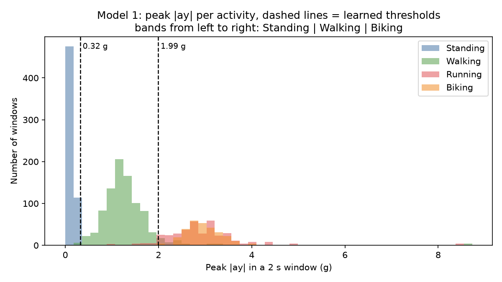
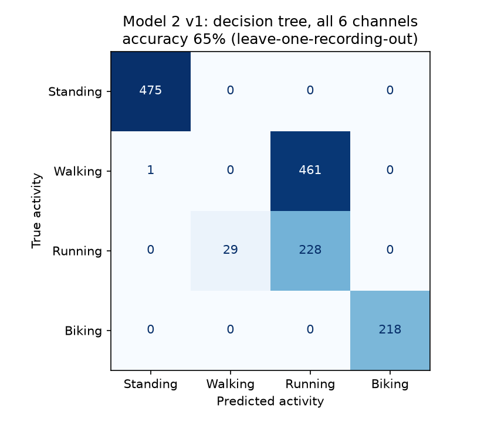
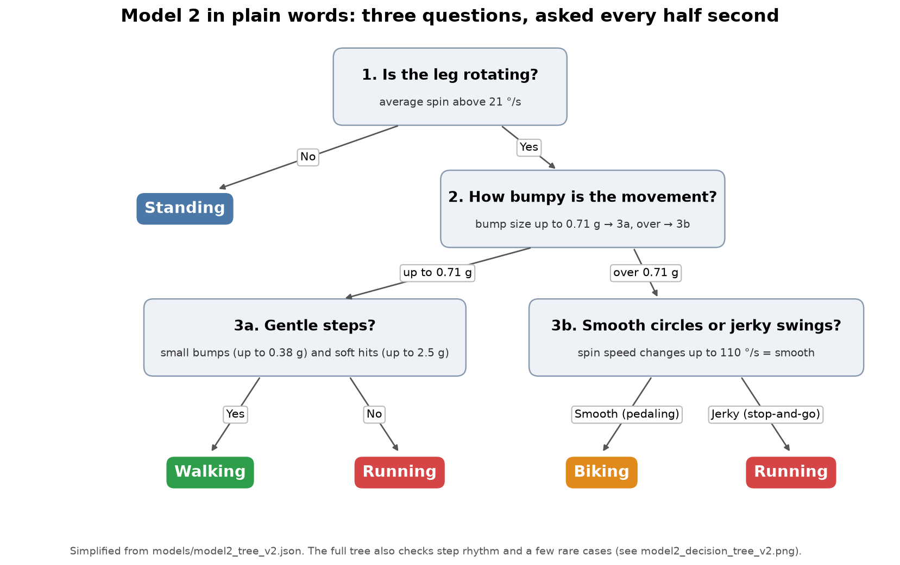
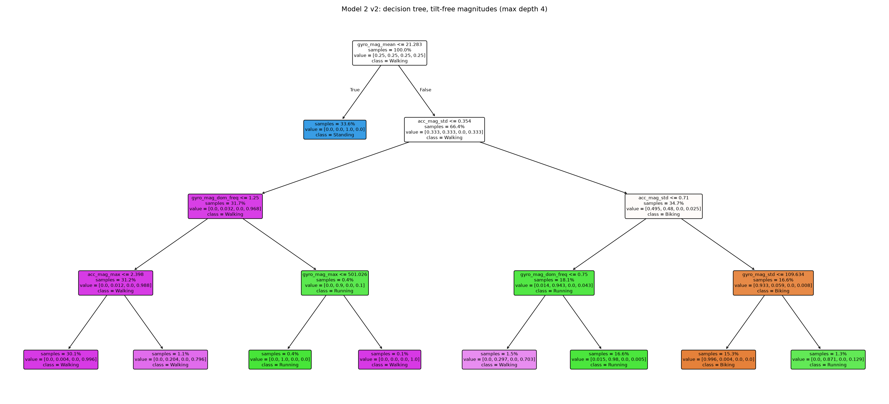
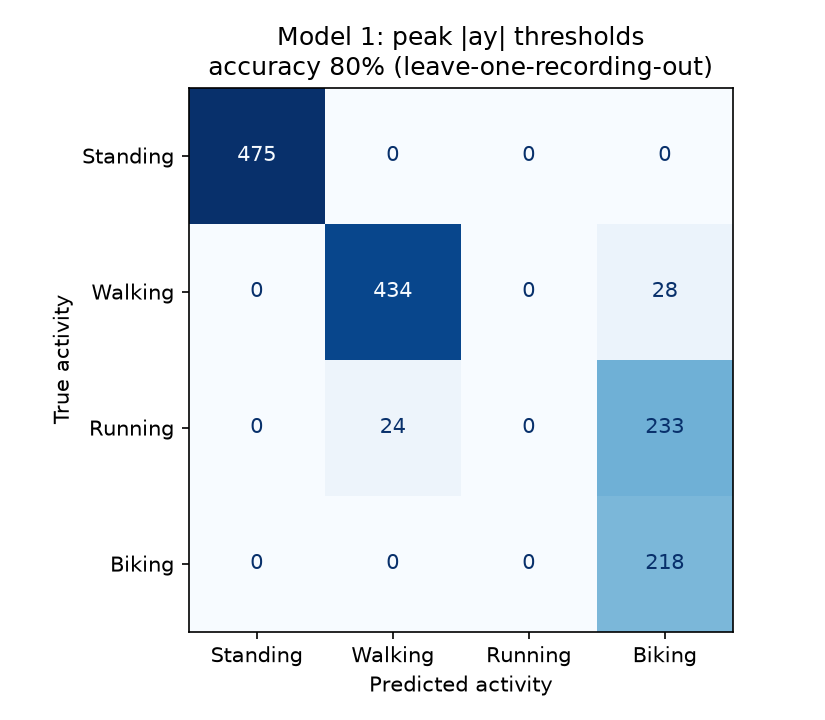
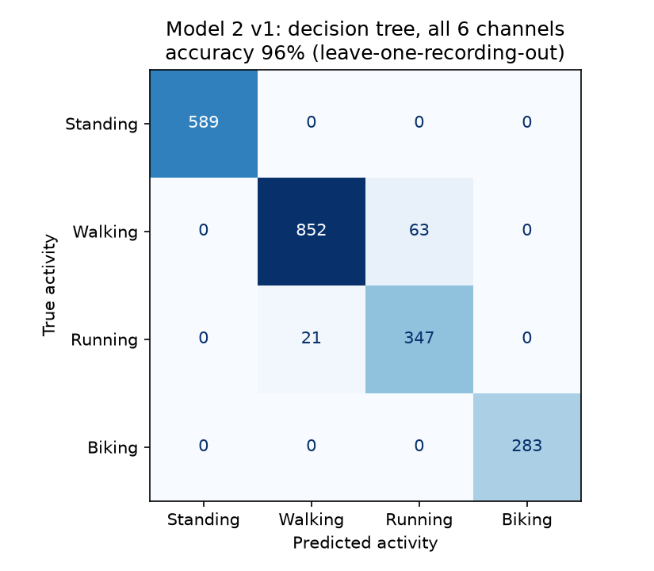
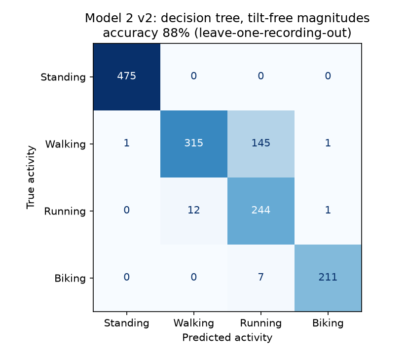

# Gait Identifier (HW6)

A wearable that tells whether you are standing, walking, running or biking. An MPU-6050
IMU (accelerometer + gyroscope) and an Arduino UNO Q are strapped to the right lower leg
with a power bank, so it works without a laptop. It records labelled motion data from a phone
page, and two machine-learning models trained on the laptop (scikit-learn) then run live
on the board. Every 0.5 s they guess the activity from the last 2 s of movement and show the
guess on the phone and on the board's LED matrix. The project compares a one-number threshold
model with a decision tree, and shows how a model can learn the wrong thing, in this case how
the board was strapped on rather than how you moved.

## How it works

```
 MPU-6050 ─I2C─► UNO Q sketch (100 Hz) ─Bridge─► UNO Q Python (main.py)
                                                  ├─ Record: labelled CSVs ──► laptop: training/train.py
                                                  │                              └─► models/*.json
                                                  └─ Live: last 2 s, every 0.5 s ◄── same gait_model.py + JSON
                                                       ├─► phone page (port 7000)
                                                       └─► LED matrix letter (S / W / R / B)
```

1. **Record.** On the phone page, pick an activity, press Start, do it for 30–120 s, press Stop.
   The board saves one CSV per recording: time, `ax ay az` (g), `gx gy gz` (°/s), activity, person.
2. **Train (laptop).** `training/train.py` trims 2 s from each end of every recording and cuts
   it into **2 s windows (200 samples) sliding by 0.5 s**. It then trains and tests the models
   and saves them as small JSON files.
3. **Live (board).** The board keeps the newest 2 s of samples and runs both models every
   0.5 s. It shows the most common of the last 3 guesses, so one odd window doesn't flicker
   the display.

Training and the board share one file, `training/gait_model.py` (windowing, features and
running a JSON model, numpy only), so features are computed the same way in both places.

### The two models

| | Model 1: one direction | Model 2: decision tree |
|---|---|---|
| Input | peak \|acceleration\| on one axis in the window | many features from all six IMU outputs |
| Model | up to 3 thresholds (a depth-2 tree on one number) | depth-4 tree, `class_weight="balanced"` |
| Best version | ay axis (ax and az were far worse) | v2: tilt-free features |
| Saved as | `models/model1_thresholds.json` | `models/model2_tree_v2.json` |

**Model 1** splits the peak |ay| into bands: ≤ 0.32 g Standing, 0.32–1.99 g Walking,
above 1.99 g Biking. Running and biking jolt equally hard, so their peaks overlap and **Running
never gets a band**.



### Why Model 2 v1 failed: it learned the strap angle

Model 2 v1 used mean, std, min, max and dominant frequency of each of the 6 channels (30
features). On the first 12 recordings it scored only **65%**, and it called **every** held-out
walking window Running.

The accelerometer measures gravity as well as motion, so its mean, min and max mostly say
**which way the board is tilted**, meaning how it was strapped on that day. The two walking
recordings had been made with the board at different angles (average ax of −0.81 g in one,
−0.05 g in the other). With one walk held out for testing, the tree learned "walking = the
other recording's angle", and a walk at a new angle looked like running:



The v1 tree from that run (`figures/first_12_recordings/model2_decision_tree.png`) splits on
`ay_mean` near the top, which is a tilt feature, not a movement feature.

### How v2 fixed it: tilt-free features

v2 uses only the **magnitude** of each sensor, the length of the (x, y, z) arrow,
√(x² + y² + z²). Turning the board changes how that arrow splits across x, y and z but not its
length. There are 9 features: mean, std, max and dominant frequency of the total acceleration
and of the total rotation, plus the dominant frequency of the gyro axis that swings most.
On the same 12 recordings, v2 scored **88%**.

The trained v2 tree mostly asks three questions:

1. **Is the leg rotating?** Average rotation ≤ 21 °/s → Standing.
2. **How much does the jolt vary?** (`acc_mag_std`) About 0.25 g walking, 0.5 g running,
   0.85 g biking.
3. **Smooth or jerky rotation?** (`gyro_mag_std`) This separates biking (a steady pedalling
   circle) from running (a stop-start swing).

This is a simplified view of the deployed v2 tree, with the full tree shown below it:





These are the "rotation", "bumpiness" and "smoothness" numbers shown in the phone's Live view.

### Results

All accuracies use **leave-one-recording-out** testing: train on every recording but one,
test on the one left out, and repeat for each. Windows from the same recording overlap and
look alike, so testing on random windows would overstate accuracy.

| Model | 12 recordings | 19 recordings (7 new, incl. a re-strap) |
|---|---|---|
| Model 1 (peak \|ay\|) | 79.8% | 74.6% |
| Model 2 v1 (30 per-axis features) | 65.2% | 96.1% |
| **Model 2 v2 (9 tilt-free, deployed)** | 88.2% | **95.5%** |

Adding slow, normal and fast walks and a re-strapped set helped both trees. v1 recovered
once the data covered several strap angles, but it still relies on angles it has seen,
while v2 ignores tilt altogether. Model 1 got worse: after re-strapping, gravity falls
partly on ay, so standing still already reads above its Standing limit. Trained on 15
recordings and tested on the 4 re-strapped ones, both trees scored 98.5% and Model 1 40.9%.

Full numbers, per-recording accuracy and confusion matrices:
[results_v1.md](training/results_v1.md) (first 12 recordings),
[results_v2.md](training/results_v2.md) (v2 added),
[results_v3.md](training/results_v3.md) (all 19 recordings).

Confusion matrices on all 19 recordings (rows = true activity, columns = predicted):

| Model 1 | Model 2 v1 | Model 2 v2 |
|---|---|---|
|  |  |  |

The figures from the first 12 recordings, including v1's failure above, are kept in
`figures/first_12_recordings/`.

### Phone page and LED matrix

- **Record** tab: name, activity, Start/Stop, live sample rate and dropped-sample warnings,
  and "Download all CSVs" (a zip).
- **Live** tab: Model 1 and Model 2 side by side. Each shows a large colored guess, the
  numbers the model uses, and its last 3 raw guesses.
- **LED matrix**: Model 2's guess as a letter (S, W, R, B), and three dots for the first 2 s.
  It works with no phone or Wi-Fi.

## Hardware

- Arduino UNO Q, set to start this app on power-up, so it only needs a power bank
- GY-521 MPU-6050 breakout with a right-angle header, on I2C (address 0x68), set to
  ±16 g and ±2000 °/s and read at 100 Hz
- 4 male-to-female jumper wires, a USB power bank and 3 velcro straps
- A phone on the same Wi-Fi as the board, for recording and the Live view

**Where it's worn** (outer side of the right leg):

| Part | Position |
|---|---|
| MPU-6050 | On the sock just above the outer ankle bone, header pins pointing up toward the knee |
| UNO Q | Mid-shin |
| Power bank | Upper calf |

All the training data was recorded in this position, so other positions are untested.

**MPU-6050 wiring:**

| GY-521 | UNO Q |
|---|---|
| VCC | 3.3V |
| GND | GND |
| SCL | SCL (header pin next to AREF) |
| SDA | SDA (header pin next to AREF) |

Those SCL/SDA pins are the `Wire` bus. The sketch checks `Wire` first and falls back to
`Wire1` if nothing answers there.

## Files

```
Gait Identifier/
├── unoq_app/              UNO Q app "Gait Recorder"
│   ├── sketch/sketch.ino    reads the MPU-6050 at 100 Hz, draws on the LED matrix
│   ├── python/main.py       phone page, recording, live predictions
│   ├── python/gait_model.py, model1_thresholds.json, model2_tree_v2.json
│   │                        symlinks to training/ and models/ (deploy copies the real files)
│   └── assets/              phone page (HTML, JS, CSS)
├── training/
│   ├── train.py             trains and tests all models, saves figures and JSON
│   ├── gait_model.py        windows, features, running a JSON model (shared with the board)
│   ├── plot_simple_tree.py  draws the plain-English view of the deployed v2 tree
│   ├── requirements.txt
│   └── results_v1.md, results_v2.md, results_v3.md
├── data/raw/              19 recordings: Mohammed_<Activity>_<date>_<time>.csv
├── models/                model1_thresholds.json, model2_tree.json (v1), model2_tree_v2.json
└── figures/               histogram, decision trees, confusion matrices (all 19 recordings)
    └── first_12_recordings/ the same figures from the first 12 recordings (v1's failure)
```

## Setup and run

### Train on the laptop

From the repo root, with `.venv` active:

```
pip install -r "Mohammed's Projects/Gait Identifier/training/requirements.txt"
cd "Mohammed's Projects/Gait Identifier/training"
python train.py
```

This loads every CSV in `data/raw/` and prints accuracy, confusion matrices and a comparison
table. It rewrites `models/` and `figures/`, and checks that each JSON model gives exactly
the same predictions as scikit-learn. Then run `python plot_simple_tree.py` to redraw
`figures/model2_tree_simple.png` from the new v2 tree.

### Deploy to the UNO Q

The app deploys with the `deploy.py` tool from
[ArduinoApps](https://github.com/mohdalmheiri/ArduinoApps). App Lab stores this app in a
folder named `mpu6050-check` (its display name is "Gait Recorder"), so in the ArduinoApps folder
that name is a symlink to `unoq_app/`:

```
cd ArduinoApps
ln -s "<path to repo>/Mohammed's Projects/Gait Identifier/unoq_app" mpu6050-check   # once
python3 tools/deploy.py mpu6050-check
```

`deploy.py` stops the running app, copies the files (following the symlinks), starts it, and
shows the log and the page address (`http://<board IP>:7000`). To make it start on power-up:

```
python3 tools/deploy.py --cmd "arduino-app-cli properties set default /home/arduino/ArduinoApps/mpu6050-check"
```

Without the deploy kit, create an App Lab app and copy `unoq_app/` into it, replacing the
three symlinks in `python/` with the real files from `training/` and `models/`.

### Record new data and retrain

1. Open the phone page, choose **Record**, enter your name, pick the activity and press Start.
2. Download the CSVs ("Download all CSVs") and put them in `data/raw/`. Only keep complete
   recordings. If the board lost power mid-recording, drop the half-written last row.
3. Run `python train.py`, then deploy again. The board picks up the new JSON files through
   the symlinks.

## Tuning and notes

| Setting | File | What it does |
|---|---|---|
| `WINDOW_SAMPLES`, `STEP_SAMPLES`, `TRIM_SECONDS` | `training/gait_model.py` | Window length (2 s), step (0.5 s), trim at each end (2 s); used by training and the board |
| `new_model1`, `new_model2` | `training/train.py` | Tree depths (2 and 4) and class weighting |
| `SMOOTH_OVER` | `unoq_app/python/main.py` | How many recent guesses are voted on (3) |
| `LETTERS` | `unoq_app/python/main.py` | The 5×7 LED matrix letters |

- **Biking on a stool isn't recognized.** All biking data was recorded lying down and
  pedalling in the air, so the models have never seen seated pedalling. Record seated
  biking and retrain to fix this.
- **Fast walking vs running** is the main remaining mix-up: in testing, v2 called the fast
  walk Running 45% of the time. A fast walk jolts nearly as much as a slow run, and a 2 s
  window measures rhythm only in 0.5 Hz steps.
- **One person.** All recordings are from one person, so other people's gaits are untested.
- **Crash fix.** The app once crashed with `expected 7, got 2`. The sketch's `get_batch` ran
  on the Bridge's own thread and could copy the sample buffer while `loop()` was halfway
  through adding a sample. It now uses `Bridge.provide_safe`, which runs between `loop()`
  calls. `main.py` also skips a malformed batch and logs errors instead of stopping. On a
  power bank nobody would be there to restart it.
- **Timestamps** in the CSVs are evenly spaced at 10 ms (the sketch samples at a fixed
  100 Hz). Dropped samples are detected with a counter and reported on the Record tab.
- **Model 1 depends on tilt too**: with the board lying flat on a desk, gravity alone gives
  peak |ay| ≈ 0.5 g, so it says Walking while the board is still.
