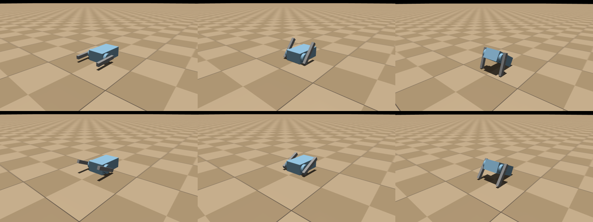

# Silly Walks Simulated (HW8)

A LEGO robot with no wheels: one LEGO Education Double Motor with a 1x8 Technic brick "leg" on each motor, so spinning the motors makes it shuffle and flop across the table. The goal is to build a physics model of this robot in MuJoCo, exported straight from its Onshape CAD, check that the model matches the real robot, and later use MJLab to train a policy that makes it walk straight. The interesting part is that this robot's walking comes entirely from contact: the legs reach 48 mm below the axle but the table is only 15 mm below it, so every turn they dig in, lever the body up and throw it forward. The robot only gets anywhere through contact with the table, which makes it a good test of whether the simulator handles contact and friction correctly before any training happens.

*Status: the CAD-to-MuJoCo model is built and checked, and the walk-straight training task is built and checked. The first training run (300 rounds) is finished: over 100 lopsided test robots, the policy cut the median heading error from 65° to 5° and the median sideways drift from 448 mm to 58 mm, with no flips (see `docs/process_log.md`).*



Video: [walk_test_-60rpm.mp4](docs/media/walk_test_-60rpm.mp4) (upright walk) · [walk_test_+60rpm.mp4](docs/media/walk_test_+60rpm.mp4) (the other direction, which flips it over)

## How it works

**From CAD to a model**
- **Onshape:** Part Studio 1 has three parts: `body`, `leg_right` and `leg_left`. In Assembly 1, the body is fixed and each leg is attached with a revolute mate named `dof_right` / `dof_left`.
- **Export:** [onshape-to-robot](https://github.com/Rhoban/onshape-to-robot) downloads the assembly. Every mate whose name starts with `dof_` becomes a joint named after the rest of the name (`right`, `left`). It writes `cad/robot.xml` with each part's mesh, mass and inertia.
- **Masses:** these come from custom materials set by a FeatureScript feature ("Assign LEGO materials"), not from mass overrides. Onshape computes mass and inertia from each part's shape and density, and the export carries them over.
- **The raw export is never edited by hand.** All additions live in `sim/`, so re-exporting after a CAD change can't erase them.

**Making it simulation-ready** ([sim/build_scene.py](sim/build_scene.py))

MuJoCo's model-editing API (`MjSpec`) loads `cad/robot.xml` and adds four things:

| Addition | Why it's needed |
|---|---|
| **Free joint** on the body | The body is *fixed* in the Onshape assembly, so the export bolts it to the world. onshape-to-robot 1.8.3 has no setting for this. The free joint lets the robot slide, tip and fall. |
| **Simple collision shapes** | A box for the body, a cylinder per motor hub and a box per leg. A flat box face on a flat table gives a few steady contact points, while a triangle mesh gives many small, jittery ones. The CAD meshes are kept for looks only (they don't collide). Leg boxes are measured from the leg meshes, and the body box and hubs come from [sim/settings.py](sim/settings.py). |
| **Velocity motors**, one per leg | They behave like cruise control: torque = `MOTOR_KV × (target speed − actual speed)`, capped at `MOTOR_MAX_TORQUE`. The real motor spins its leg continuously, so the leg joints have no limits. |
| **Table** | A flat plane with 10 cm checker squares, gravity 9.81 m/s², with the robot dropped from 2 mm above it |

It then writes `sim/scene.xml`, a plain MuJoCo file that opens without Python.

**Coordinates** (the same as the CAD)

The origin is the centre of the motor axle. +X = robot's right, +Y = toward the leg tips (the front), +Z = up. The table is 15 mm below the axle. A positive motor speed turns the legs by the right-hand rule around +X: the tips swing up first.

**Checks**
- [sim/check_model.py](sim/check_model.py) checks:
  - masses
  - joint axes and positions
  - collision shapes against the CAD meshes
  - a 2 s resting test
- [sim/walk_test.py](sim/walk_test.py) drives both legs at the same speed, then measures the distance moved, sideways drift, turning, tilt and contact quality. It saves the video and plots.

## Hardware

- **Motor:** one LEGO Education Double Motor (two motors in one housing, on one axle line).
- **Legs:** two 1x8 Technic bricks (64 × 9.6 × 7.8 mm), one on each motor hub, with the pivot 16 mm from the inner end (48 mm long arm, 16 mm short arm).
- **Sizes:** the dimensions were estimated from photos by counting studs (8 mm per stud).
  - Body: 80 × 48 × 30 mm, with the axle 15 mm from the front end.
  - Hubs: 25 mm across, sticking out 8 mm per side.
- **Masses:** body ≈ 100 g (an estimate), legs 2.85 g each.

## Files

```
HW8 - Silly Walks Simulated/
├── requirements.txt     the two extra packages
├── .env                 Onshape API keys (only on this laptop, never committed)
├── cad/                 Onshape export: settings, connection test, robot model, meshes
├── sim/                 simulation: settings, scene builder, checks, walking test, viewer
├── train/               MJLab training (own Python 3.12 environment): task, speed test
└── docs/                process log + media/ (screenshots, plots, videos)
```

| File | What it does |
|---|---|
| **cad/** | |
| [config.json](cad/config.json) | onshape-to-robot settings: which document and assembly to export, MuJoCo format, no collision meshes and no default motors (those are added in `sim/`) |
| [test_connection.py](cad/test_connection.py) | Read-only check that the API keys work: lists the document's tabs |
| `robot.xml`, `assets/` | The export: the robot model and each part's mesh (`.stl`) and Onshape IDs (`.part`). **Generated; don't edit by hand.** |
| `scene.xml` | Preview file that onshape-to-robot also writes. Its robot is bolted in place, so use `sim/scene.xml` instead. |
| **sim/** | |
| [settings.py](sim/settings.py) | **Every number you might change:** motor speed, motor strength, joint friction, collision sizes, friction, contact stiffness, timestep |
| [build_scene.py](sim/build_scene.py) | Adds the free joint, collision shapes, motors and table to the export, and saves `scene.xml` |
| [check_model.py](sim/check_model.py) | Prints the checks with PASS/WARN |
| [walk_test.py](sim/walk_test.py) | Both-motors walking test, with numbers, video, frame strip and path plot |
| [view.py](sim/view.py) | Interactive 3D viewer with the motors running |
| `scene.xml` | The complete scene. **Generated by build_scene.py, rebuilt every run.** |
| **train/** | Runs in `.venv-mjlab` (MuJoCo 3.11), not the shared `.venv` |
| [requirements-mjlab.txt](train/requirements-mjlab.txt) | The MJLab install, version pinned (see Setup) |
| [robot_spec.py](train/robot_spec.py) | The robot for MJLab: the CAD export plus a free joint and the same simple collision shapes as `sim/` |
| [walk_straight_task.py](train/walk_straight_task.py) | **The training task:** upright-only leg speeds, sensor-only inputs, the reward, and the left/right randomization. All tunable numbers are at the top. |
| [reward_check.py](train/reward_check.py) | Scores scripted behaviors (walking straight, standing still, off course, lopsided, jerky) to check the reward before training |
| [train.py](train/train.py) | Starts a PPO training run |
| [plot_training.py](train/plot_training.py) | Turns a run's log into reward and drift curves |
| [evaluate.py](train/evaluate.py) | **Main result:** baseline (equal motor speeds) vs. trained policy on the same 100 lopsided robots: table, path plot, videos |
| [speedtest_task.py](train/speedtest_task.py) | Minimal placeholder task used only by the speed test |
| [speed_test.py](train/speed_test.py) | Measures simulation and training speed on this computer |
| `logs/` | Training logs and checkpoints (ignored by git) |
| **docs/** | |
| [process_log.md](docs/process_log.md) | What was tried, what failed and what fixed it |
| `media/` | `rest_pose.png`, plus `walk_test_*.mp4`, `walk_test_frames_*.png` and `walk_trajectory_*.png` for +60 and −60 rpm |

## Setup and run

Everything runs from the repo's shared virtual environment:

```bash
cd ME193-Robotics
.venv/bin/python -m pip install -r "Mohammed's Projects/HW8 - Silly Walks Simulated/requirements.txt"
```

### Exporting from Onshape (only after a CAD change)

1. Make Onshape API keys at <https://cad.onshape.com/user/developer/apiKeys>.
2. Put the keys in `HW8 - Silly Walks Simulated/.env`:
   ```
   ONSHAPE_API=https://cad.onshape.com
   ONSHAPE_ACCESS_KEY=...
   ONSHAPE_SECRET_KEY=...
   ```
   The root `.gitignore` ignores every `.env`.
3. Test the keys: `.venv/bin/python "Mohammed's Projects/HW8 - Silly Walks Simulated/cad/test_connection.py"`
4. Export, running from the HW8 folder so the tool finds `.env`:
   ```bash
   cd "Mohammed's Projects/HW8 - Silly Walks Simulated"
   ../../.venv/bin/onshape-to-robot cad
   ```

### Running the simulation

Run these from the HW8 folder:

```bash
../../.venv/bin/python sim/check_model.py              # verification report
../../.venv/bin/python sim/walk_test.py --rpm -60      # walking test + video (about 5 s)
../../.venv/bin/python sim/walk_test.py --rpm 60 --seconds 5 --no-video
../../.venv/bin/python sim/view.py --rpm -60           # interactive viewer
```

In the viewer:
- **Space** pauses and resumes; **Backspace** resets.
- **3** shows or hides the collision shapes; **2** shows or hides the CAD meshes.

### MJLab (training)

MJLab 1.6.0 needs Python 3.10 to 3.13, so it gets its own environment. Under Python 3.14, pip silently installs an old placeholder (0.0.4) instead; that's why the version is pinned. From the repo root:

```bash
/Library/Frameworks/Python.framework/Versions/3.12/bin/python3.12 -m venv .venv-mjlab
.venv-mjlab/bin/python -m pip install -r "Mohammed's Projects/HW8 - Silly Walks Simulated/train/requirements-mjlab.txt"
cd "Mohammed's Projects/HW8 - Silly Walks Simulated"
../../.venv-mjlab/bin/python train/speed_test.py          # about 3 minutes
../../.venv-mjlab/bin/python train/reward_check.py        # about 8 minutes
../../.venv-mjlab/bin/python train/train.py --envs 256 --iters 300 --name my_run   # about 2.5 h
../../.venv-mjlab/bin/python train/plot_training.py
../../.venv-mjlab/bin/python train/evaluate.py            # newest checkpoint; --timestep 0.001 for the robustness check
```

## Tuning and notes

- **Motor speed:** `MOTOR_SPEED_RPM` in [sim/settings.py](sim/settings.py) (default 60 rpm, not yet measured), or `--rpm` on the command line. Motor strength (`MOTOR_KV`, `MOTOR_MAX_TORQUE`), joint friction and rotor inertia are also guesses there, clearly marked.
- **Verification results** (`check_model.py`, 15/15 checks passed):
  - **Masses:** body 100.006 g, legs 2.850 g each.
  - **Joint axes:** both along +X, on the axle line.
  - **Joint positions:** the left joint sits at x = −32.0 mm. The right one sits at x = +39.8 mm, because its mate connector is on the outer face of the leg (7.8 mm further out). That only slides the hinge point along its own axis, so it changes nothing physically. The leg shapes themselves sit symmetrically, at ±(32 to 39.8) mm.
  - **Collision shapes:** they match the CAD bounding boxes to 0.00 mm, and the hub radius is 12.50 mm.
  - **Resting:** the robot settles with the axle at 15.000 mm above the table, with no sinking or jitter.
- **Walking test results** (10 s, both legs the same speed):

  | Speed | Result |
  |---|---|
  | **−60 rpm** (tips swing down first) | Walks toward **+Y, the leg tips**: 260 mm (26 mm/s, about one 26 mm step per leg turn). Tilts up to 34° each step and never flips. |
  | **+60 rpm** (tips swing up first) | **Flips onto its back at 0.8 s**, then shuffles toward −Y upside down (22 mm/s) |
  | ±30, ±120 rpm | Same pattern: + always flips, − always walks upright |

  Sideways drift is **0.0 mm** in every run. The motors never reach their torque limit, and the legs turn at 58.9 of 60 rpm.
- **Why zero drift isn't the real answer:** the model is perfectly mirror-symmetric (identical legs, motors, masses and friction, and both legs exactly in step), so the simulation has no reason to turn. The real robot will drift from small differences between the two motors, the leg angles and the friction. Those differences have to be added to the model (for example, randomized during training) before it can tell us anything about drift.
- **Contact stiffness:** with MuJoCo's default contact softness, the legs sank 5 to 10 mm into the table (they're only 9.6 mm tall), and the walking distance came out about 40% too long. `CONTACT_TIMECONST = 0.002 s` with `TIMESTEP = 0.0005 s` keeps sinking under 1 mm. Stiffer settings change the distance by only about 3%. The full story is in [docs/process_log.md](docs/process_log.md).
- **Friction model:** the training task uses MuJoCo's *elliptic* friction. MJLab's default (*pyramidal*) is tied to the world's x/y axes and made perfect-twin robots turn up to 35° in 10 s whenever they faced diagonally. Elliptic friction is correct but about 5× slower.
- **Two causes of drift** in the model:
  - the two motors running at different speeds
  - **the legs being out of step**, which turns even a perfectly matched robot
  The policy senses leg angles, so it can correct both.
- **MJLab on this Mac** runs on the CPU, and only on one core:
  - Simulation: about 3,200 policy steps/s with 1024 robots at a 0.002 s step.
  - PPO training: about 7 s per iteration.
  - The task's reset lifts the body so no randomly angled leg starts inside the table. Without that, robots were launched up to 0.8 m.
  - Details are in the process log.
- **Re-exporting:** onshape-to-robot caches downloads in `~/.cache/onshape-to-robot`. If a CAD change doesn't show up, run `onshape-to-robot-clear-cache`.
