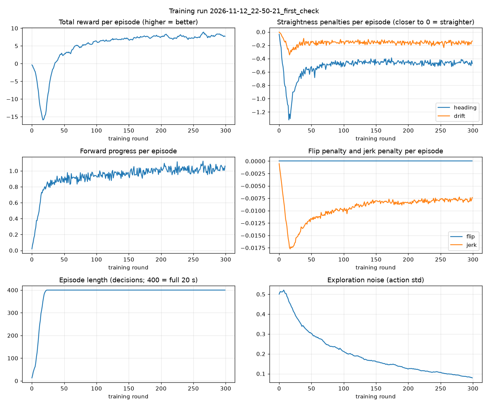
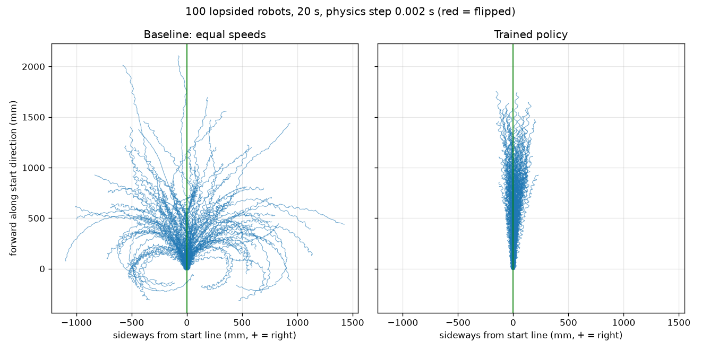

# HW8 process log

A running record of what was tried, what failed and what fixed it.

## 2026-11-12: Setup

**Tried / decided**
- Created the folder layout: `cad/` (onshape-to-robot config + exported robot), `sim/` (scene + test scripts), `docs/` (this log, `media/` for screenshots and video).
- The exported robot file in `cad/` will be left exactly as onshape-to-robot writes it. Everything added by hand (simple collision shapes, motors, floor) goes in `sim/`, so re-exporting after a CAD change doesn't erase that work.
- Python environment: install into the repo's shared `.venv` (Python 3.14.7). A pip dry-run showed onshape-to-robot 1.8.3 and MuJoCo 4.0.1 install with no version conflicts. HW8 gets its own `requirements.txt`, like HW4/HW6/HW7. MJLab (training, later) may need its own environment; to be checked then.

**Problem found**
- The root `.gitignore` ignores everything, then re-includes all of `Mohammed's Projects/**`. A `.env` file with the Onshape API keys inside the HW8 folder would therefore have been **committed**. `git check-ignore` confirmed it was not ignored.

**Fix**
- Added `**/.env` at the very end of the root `.gitignore` (the last matching rule wins, so it beats the re-include). Checked with `git check-ignore` and `git status`.
- Created `.env` with the three Onshape lines and empty key values. Keys are pasted in by hand and are never printed, logged or committed.

## 2026-11-12: Install, connection test, export

**Install:** `onshape-to-robot` 1.8.3 and `mujoco` 4.0.1 went into the shared `.venv` without problems.

**Reading the current docs and source code first.** Findings:
- Mate names: mates whose names start with `dof_` still become joints, named after the rest of the name. So `dof_right` and `dof_left` work, and give joints `right` and `left`. (An `_inv` ending would flip the axis.)
- Keys: the tool loads `.env` by searching from the current folder upward, so the export must be run from the HW8 folder (or below it).
- **Problem:** the body is *fixed* in the Onshape assembly. The MuJoCo exporter only adds a free joint to a base link that is *not* fixed (`exporter_mujoco.py`, line 365). So the exported robot would hang bolted in mid-air. The online docs mention a `"freejoint": false` setting, but 1.8.3's code has no such setting.
  - **Fix:** leave Onshape as it is, and add the free joint in our own scene builder (`sim/build_scene.py`, using MuJoCo's MjSpec editing API).

**Connection test** (`cad/test_connection.py`):
- First try: crashed with `OSError: is not a file`. The Onshape client insists on reading a JSON config file, even when the keys come from environment variables.
  - **Fix:** pass it `cad/config.json`, which has no keys in it, so the client falls back to the `.env` values (the real export does the same).
- Second try: connected, and listed 4 tabs: Part Studio 1, Assembly 1, a BOM, and the "Assign LEGO materials" FeatureScript.
  - **Found:** the document URL points at **Part Studio 1** (`e/24361...`), not the assembly. So the config finds the assembly by name (`"assembly_name": "Assembly 1"`) instead of using the URL.

**Export:**
- `onshape-to-robot cad` found both DOFs (warning "no limits", which is right for legs that spin all the way round) and 1 root link (body).
- Settings: `no_collision_meshes` is on, and all joints have `actuated: false`, so no default position servos are made.
- **What came out:**
  - Masses: body 100.006 g, legs 2.850 g each.
  - Body inertia agrees with a uniform 80×48×30 mm, 100 g box to within about 13% (Ixx 1%, Iyy 13%, Izz 6%). The hubs account for the difference.
- **Suspicious item 1:** the right joint is at x = +39.8 mm, not +32 mm.
  - 39.8 − 32 = 7.8 mm, the leg thickness, so the right mate connector is on the leg's outer face.
  - Both joints lie on the axle line, and both axes are +X. Moving a hinge point along its own axis changes nothing.
  - The leg *meshes* sit symmetrically: x = 32 to 39.8 and −39.8 to −32.
  - Conclusion: harmless, so the CAD was left alone.
- **Suspicious item 2:** the exporter's default joint settings (`frictionloss 0.1`, `armature 0.005`) are sized for big robots.
  - 0.1 N·m of friction is about the whole torque of a LEGO motor. 0.005 kg·m² is about 5000× the leg's own inertia.
  - **Fix:** both are overridden from `sim/settings.py` (guesses: 0.002 N·m and 1e-5 kg·m²).

## 2026-11-12: Building the scene

`sim/build_scene.py` adds to the untouched `cad/robot.xml`:
- the free joint
- collision shapes:
  - body box (48×80×30 mm, centre y = −25 mm)
  - two hub cylinders (r 12.5 mm, 8 mm long)
  - a leg box measured from each leg mesh
- velocity motors
- a table plane

Physics settings: `implicitfast` integrator (stable with stiff speed control), gravity −9.81. It saves `sim/scene.xml`, with mesh paths relative to `sim/`.

**Checks** (`sim/check_model.py`):
- 14/14 passed on the first run.
- **Gap noticed:** the bounding-box check can't see the hubs, because they sit inside the body box's height range. A wrong hub radius would have passed unnoticed.
  - Added a direct check: CAD vertices outside the main box are all within 12.50 mm of the axle. 15/15 passed.
- Resting: the axle settles at 15.000 mm, with 4 contacts (the box's corners), no motion and no warnings.

## 2026-11-12: Walking test

- **Small problem first:** making the renderer failed with "Image width 960 > framebuffer width 640".
  - **Fix:** set the off-screen buffer to 1280×720 in the scene.
- **First run** (+60 rpm, default soft contact): the robot **flipped onto its back** at 0.8 s, then shuffled −325.8 mm toward −Y upside down. Drift 0.0 mm. The reported heading change of +180° was a side effect of the flip, not a turn (upside down, the "front" arrow points backward). The walk test now says so.
- **Problem: the axle dipped to 9.3 mm,** which should be impossible, since the hubs alone hold it 12.5 mm up.
  - **Investigation:** measured the deepest contact overlap. The legs were sinking **5 to 10 mm** into the table, almost their whole 9.6 mm height. MuJoCo's default contact responds over 0.02 s, which is too soft when a motor drives a light leg into the floor.
  - **Tests** at ±60 rpm, varying contact time constant and timestep:

    | timeconst / timestep | sinking (mm) | distance at −60 rpm |
    |---|---|---|
    | 0.02 / 0.001 (default) | 6.7–8.2 | +378 mm |
    | 0.005 / 0.001 | 1.7–1.8 | +286 mm |
    | 0.002 / 0.001 | 0.9–1.1 | +270 mm |
    | **0.002 / 0.0005 (chosen)** | **0.7–0.9** | **+260 mm** |
    | 0.001 / 0.0005 | 0.4 | +253 mm |

  - **Fix:** `CONTACT_TIMECONST = 0.002`, `TIMESTEP = 0.0005`. The soft default had inflated the walking distance by about 40%. At the chosen setting, the distance is within about 3% of the stiffest one. The flip and the direction were the same at every setting.
- **Direction matters** (tried ±30, ±60, ±120 rpm):
  - **negative speed** (tips swing down first): walks upright toward **+Y (the leg tips)**, tilting at most about 34°, never flipping
  - **positive speed**: always flips onto its back (at 0.4 s at 120 rpm, 0.8 s at 60, 1.6 s at 30)
- **Final results at 60 rpm:**
  - −60 rpm: +260.0 mm in 10 s (26 mm/s, about one 26 mm step per leg turn)
  - +60 rpm: flips at 0.80 s, then −223.4 mm
  - both: drift 0.0 mm, motors never at their torque limit, legs at 58.9 rpm, sinking under 0.9 mm, no MuJoCo warnings
- **A misreading, caught:** in the angled frame strip, one frame looked as if the body was lifted at a moment when the plot said the axle was low. Rendering side views at known times showed the leg was pointing *up* behind the body, and the plot was right.
- **Zero drift is expected, not a result:** the model is perfectly symmetric, so it can't turn. The real robot's motor-to-motor and friction differences aren't modelled yet.

## 2026-11-12: Can MJLab run on this Mac? (research only, nothing installed)

Machine: Apple M1 Pro, 8 cores, 16 GB, no NVIDIA graphics card. Pythons on the laptop: 3.14 (the `.venv`) and 3.12.

**What MJLab's own docs say:**
- README: "mjlab requires an NVIDIA GPU for training. macOS is supported for evaluation only."
- FAQ: on macOS it runs CPU-only, through MuJoCo Warp. "Training is not recommended on macOS"; evaluation works but is "significantly slower".
- NVIDIA Warp's Mac version runs on the CPU only. It can't use the Mac's own graphics chip (no Metal support).
- MuJoCo Warp: "requires an NVIDIA GPU for fast simulation but supports CPU for development and debugging." No speed numbers are published.

**Python version and package versions:**
- Latest PyPI release: mjlab 1.6.0 (Aug 2026).
  - Requires Python `>=3.10, <3.14`.
  - Pins `mujoco~=3.11.0` and `mujoco-warp~=3.11.0`.
- GitHub `main` (not released yet): allows Python up to 3.14 and uses MuJoCo 4.0.1.
- **Trap found with a pip dry run** in the `.venv` (Python 3.14):
  - pip quietly skipped every real release, because they don't allow Python 3.14.
  - It picked **mjlab 0.0.4**, an old placeholder version, and reported success.
  - Installing into the `.venv` would therefore have "worked" while giving the wrong package. 1.6.0 would also downgrade the `.venv`'s MuJoCo from 4.0.1 to 3.11.

**Conclusion:**
- MJLab needs its own environment on Python 3.12 or 3.13.
- Training should happen on an NVIDIA GPU (Colab, a lab or university computer, or a paid cloud GPU).
- The Mac is fine for building the task, quick checks and watching trained policies (CPU).
- Whether CPU training is bearable for this tiny robot (3 bodies, 2 motors) is unknown. It can be measured with a short speed test once a separate environment exists.
- MJLab's default physics step is 0.002 s. Our contact setting (0.002 s) needs a step of at most 0.001 s, so that has to be reconciled for training.

## 2026-11-12: MJLab environment, step size, and CPU speed test

**Separate environment**
- Created `.venv-mjlab/` (repo root) from Python 3.12.10. The shared `.venv` and `sim/` are untouched.
- Installed with the version pinned (`mjlab==1.6.0`, in `train/requirements-mjlab.txt`) so pip can't fall back to the 0.0.4 placeholder.
- Installed versions: mjlab 1.6.0, mujoco 3.11.0, mujoco-warp 3.11.0, warp-lang 1.19.0, torch 2.15.0, rsl-rl-lib 5.4.2.
- Warp reports a single device, `cpu` (arm). Size: 1.5 GB; the install took about 1.5 minutes.
- `.gitignore`:
  - `.venv-mjlab/` (already ignored by the root `*` rule; listed explicitly)
  - `train/logs/`, `train/wandb/`, `train/**/*.pt`
  - Tested with `git check-ignore` before anything was written. After the training test, `git status` shows only the four `train/` code files.

**Step size vs. contact**

Plain MuJoCo, our `sim/` model, 10 s at ±60 rpm. Only settings in memory were changed.

| step | contact timeconst | sinking | distance −60 rpm | CPU per sim-second |
|---|---|---|---|---|
| 0.0005 | 0.002 | 0.7–0.9 mm | 260 mm | 28.9 ms (4×) |
| 0.001 | 0.002 | 0.9–1.1 mm | 270 mm (+4%) | 14.4 ms (2×) |
| 0.001 | 0.004 | 1.5–1.6 mm | 276 mm | 15.0 ms |
| 0.002 | 0.004 | 2.0 mm | 310 mm (+19%) | 7.6 ms (1×) |
| 0.002 | 0.006 | 2.2–2.3 mm | 305 mm | 7.8 ms |
| 0.002 | 0.004, stiffer solimp | 1.9 mm | 300–310 mm | 7.5 ms |
| 0.002 | 0.02 (default) | 6.5–7.2 mm | 379 mm (+46%) | 8.2 ms |

- `solimp` (how quickly contact firms up as shapes overlap) made almost no difference.
- At a 0.002 s step the gait covers about 12% more ground than at 0.001 s, *even with the same contact setting* (310 vs 276 mm). So the step size itself changes the gait slightly, not just the sinking.
- The flip direction and upright gait were the same in every case.

**MJLab task** (`train/robot_spec.py`, `train/silly_walker_task.py`)
- Robot: `cad/robot.xml` plus a free joint and the same simple collision shapes as `sim/` (sizes from `sim/settings.py`).
- Motors: MJLab's built-in velocity motors with our gain, torque limit, friction and rotor inertia.
- Policy: picks a speed target per leg (±120 rpm), 50 times per second.
- Reward: PLACEHOLDER (speed toward +Y). Episodes end after 10 s, or early when tilt passes 70°.
- **Trap 1, contact averaging:** MuJoCo averages the contact settings of two touching shapes. MJLab's floor keeps the soft default (0.02 s), which would dilute ours. Fix: our shapes get `priority=1`, so their settings win.
- **Trap 2, launched robots:** the first smoke test showed robots shooting up to 195 mm (0.002 s step) and 774 mm (0.001 s step) right after a reset, with the motors holding still.
  - **Cause:** the robots started *inside* the table.
    - (a) My test had removed the reset events, so the robot started with its axle at z = 0.
    - (b) More importantly, the task's random leg angles can point a leg straight down. A leg reaches 48 mm below the axle, while the table is only 15 mm below it.
    - The stiff contact then shoved the robot out at about 3.7 m/s.
  - **Check:** plain C MuJoCo on the same compiled model, started at the right height, sat still. So the model was fine and the reset was at fault.
  - **Fix:** a custom reset event (`reset_robot_clear_of_table`) finds the lowest leg corner for the chosen angles and starts the axle at max(15 mm, that depth) + 2 mm.
  - **Result:** 256 random resets rose at most 1.8 mm, with no launches.
- **Same physics as `sim/`:** walking 10 s at −60 rpm in MJLab gave 307 mm (0.002 s step) and 270 mm (0.001 s step). Plain MuJoCo gave 310 and 270 mm. So MuJoCo Warp agrees with regular MuJoCo for this robot.

**Speed test** (`train/speed_test.py`, M1 Pro, CPU only)

| step | robots | policy steps/s | physics steps/s |
|---|---|---|---|
| 0.002 | 64 | 812 | 8,122 |
| 0.002 | 256 | 1,968 | 19,680 |
| 0.002 | 1024 | 3,203 | 32,025 |
| 0.002 | 4096 | 3,933 | 39,330 |
| 0.001 | 64 | 440 | 8,809 |
| 0.001 | 256 | 1,101 | 22,010 |
| 0.001 | 1024 | 1,867 | 37,347 |

- **Only 1 of the 8 CPU cores is used** (CPU time ÷ wall time = 1.0 in every case). Warp's CPU backend runs single-threaded.
- **Real PPO training,** 1024 robots, 0.002 s step, 10 iterations: 72.7 s in total, about 7.2 s per iteration (24,576 policy steps each), 3,381 policy steps/s including learning.
  - It ran with no errors. Mean reward went from −0.01 to 0.02, which means nothing after 10 iterations.
  - Logs and checkpoints: 332 KB in `train/logs/` (ignored).
- **For comparison:** plain C MuJoCo (not MJLab) did 66,000 physics steps/s for a single robot on one core. MJLab-on-CPU is the bottleneck here, not the robot.

**Estimated full training time on this Mac** (0.002 s step, 1024 robots, 7.2 s per iteration):

| iterations | policy steps | time |
|---|---|---|
| 300 | 7.4 M | about 36 min |
| 1000 | 25 M | about 2 h |
| 3000 | 74 M | about 6 h |

At a 0.001 s step, everything takes about 1.7× longer.

## 2026-11-12: What can the real Double Motor (45651) sense? (research)

- **Online docs: a dead end.** LEGO's product pages don't document the Double Motor's sensors, and PyPI blocked automated reading.
- **Source used instead:** the installed `legoeducation` 1.2.0 package (LEGO's own Python library, already in `.venv`), plus real data recorded in MT1.

**What it reports** (from `rpc_message.py` and `device.py`)

Per motor (`MotorNotification`, one for each side):
- `absolutePosition`: uint16, an absolute encoder angle. Probably degrees, 0–359 (inferred).
- `position`: int32, a running position that counts full turns.
- `speed`: int8, a small whole number. Probably percent, −100..100 (inferred).
- `power` and `motorState`.

Motion sensor (`ImuDeviceNotification`):
- `yaw`, `pitch`, `roll`: int16
- `accelerometerX/Y/Z`: int16
- `gyroscopeX/Y/Z`: int16
- `orientation` (which face is up) and `yawFace`

Units:
- **Accelerometer:** **milli-g**. MT1 data reads about 986 at rest.
- **Gyroscope:** **degrees per second**, *inferred*. Paddle swings peaked around 1,160; if the unit were tenths of a degree that would only be 116 °/s, too slow for a swing.
- **Yaw/pitch/roll:** units not documented. To be checked on the real robot.
- **Yaw comes from the gyro and can be reset** with `imu_reset_yaw_axis()`. No magnetometer is mentioned, so yaw will slowly drift (inferred). `imu_set_yaw_face()` picks which face of the motor yaw is measured around.

**Rate:**
- Reports arrive at a set interval, **15 to 1000 ms** (`device_notification_delay` in `connect()`). The default is 100 ms (10 per second).
- **Measured:** MT1 requested 20 ms, but its recorder (which checked every 5 ms) logged new readings **every 31 ms on average** (10th–90th percentile: 25–34 ms), so about **32 per second** in practice over Bluetooth on this Mac.

**Commands:**
- `movement_move_tank(speed_left, speed_right)` sets both sides in **one** Bluetooth message.
- `motor_set_speed(speed, motor=...)` sets one side.
- Speeds are **percent, −100..100**. What 100% means in rpm is not documented, so it has to be measured.
- `blocking=False` sends without waiting for the reply.
- No documented limit on how often commands can be sent.

**Conclusion for the policy:**
- It can use tilt, turning rate, heading relative to the start (yaw after a reset), each leg's angle and speed, and its own last command.
- It can NOT use position or speed across the table (there's no sensor for that).
- One decision every 0.02 s (50 Hz) is faster than the readings actually arrive (about 32 Hz), so the decision rate will be lowered.

## 2026-11-12: The real training task (walk straight)

**Decisions (approved):**
- Physics step 0.002 s for training; a robustness check at 0.001 s at the end
- Mac CPU, with Colab as the backup
- Upright-only actions
- 20 decisions per second
- Heading as the main straightness term
- Flipping must never be a better deal than continuing

**Design** (`train/walk_straight_task.py`; all tunable numbers are at the top)

*Decisions and actions:*
- One decision every 0.05 s. The real sensor delivered readings about every 31 ms, so 50 per second was too fast.
- Actions: two numbers clipped to −1..1 → each leg's speed, from stopped (−1) to MAX_SPEED_RPM = 120 rpm (+1), upright direction only.

*Policy inputs* (16 numbers, only what the real robot can sense, with noise):
- tilt
- gyro
- heading since the start (sin/cos, with slow random drift)
- leg angles (sin/cos, with calibration error)
- leg speeds
- last command

The critic also gets the true body velocity and sideways offset. It's only used during training, so that's allowed.

*Reward* (per second):

| Term | Weight | Cap |
|---|---|---|
| forward speed along the start direction / 30 mm/s | +1.0 | 0..1.5 |
| heading error per 10° (the main term) | −1.0 | −2.0 |
| sideways offset per 3 cm (tie-breaker: the robot can't sense it) | −0.2 | −0.4 |
| command change² (jerk) | −0.02 | ≤ −0.16 |

- **Flip:** −75 once, and the episode ends.
- **Why flipping can never pay:** the worst a robot can score per second while continuing is −2.56. So a whole 20 s episode loses at most −51.2, which is better than −75. Discounting only makes the future losses smaller, so the guarantee still holds.

*Randomized per robot at every reset:*

| What | Range |
|---|---|
| Motor speed per side | ×0.9–1.1 |
| Motor torque limit per side | ×0.8–1.2 |
| Friction per leg and for the body | 0.4–0.9 |
| Body mass (mass and inertia together) | ×0.8–1.3 |
| Center of mass, left/right | ±3 mm |
| Leg start angles | independent random |
| Start heading | any direction |
| Command delay | 0–40 ms, shared by both motors (as in one Bluetooth message) |

Plus sensor noise, gyro yaw drift (±0.5°/s) and leg calibration error (±2°).

**Problems found while building it**
1. **MJLab's motor-strength randomizer (`dr.effort_limits`) doesn't support velocity motors.**
   - **Fix:** a small custom event that scales each motor's `actuator_forcerange` per robot.
2. **First reward check: "perfect twins" scored −21.8 per episode.**
   - They should have scored well, but were turning up to 47° in 10 s.
3. **Test of each factor separately** (10 s, perfect twins):

   | Setup | Max heading error |
   |---|---|
   | facing an axis, legs together | 0.0° |
   | **random facing direction** | **32°** |
   | legs together at random angles | 1.8° |
   | command delay | 0.0° |
   | random facing + **elliptic friction** | **0.0°** |

   - **Cause:** MJLab's default **pyramidal** friction approximates friction with a 4-sided shape fixed to the world's x/y axes. A robot facing diagonally gets lopsided friction and turns, which is **a simulator artifact**. Every earlier `sim/` test faced along an axis, which is why it never showed up there.
   - **Fix:** `cone="elliptic"`. Accuracy (twins, 10 s at 60 rpm, random headings):

     | Friction | Solver iterations | Max heading error | Distance | Decisions/s (512 robots) |
     |---|---|---|---|---|
     | pyramidal | 100 | 35.4° | 288 mm | 1,144 |
     | elliptic | 100 | 0.0° | **310 mm (= plain MuJoCo)** | 170 |
     | **elliptic (chosen)** | **20** | 0.0° | 310 mm | 224 |
     | elliptic | 10 | 0.0° | 308 mm | 211 |
     | elliptic | 5 | 0.0° | 302 mm | 306 |

   - **Cost:** correct friction makes training **about 5× slower**.
   - **Note:** `sim/` (plain MuJoCo) also uses pyramidal by default. It was only tested facing along an axis, so it's unaffected. Switching it to elliptic before any off-axis tests there is recommended.
4. **A real physics finding (with elliptic friction): legs out of step make even a perfect twin turn.**
   - 16 twins with random leg phase reached up to 83° in 10 s; larger phase differences generally turned more.
   - So drift has two sources: motor differences and leg phase.
   - The policy can sense leg angles, so it can correct both. Legs start at independent random angles in training.

**Reward check** (`train/reward_check.py`, 16 robots × 20 s per scenario, elliptic friction)

| Scenario | Return per episode | Per term (/s) |
|---|---|---|
| A twins, legs in step, 60 rpm (ideal) | **+11.0** | forward +0.58, heading −0.02, drift −0.01 |
| A2 twins, legs out of step | −18.4 | forward +0.74, heading −1.35, drift −0.31 |
| B standing still | −7.5 | forward +0.01, heading −0.35 |
| C off course by 45° all episode | −36.2 (min −36.4) | heading −2.00 (capped), drift −0.37 |
| D lopsided robots (full randomization), 60 rpm | −22.3 | heading −1.52, drift −0.31 |
| E jerky random commands | −25.2 | jerk only −0.03 |

- **All 5 checks pass:**
  - B < A
  - D < A
  - A2 < A
  - C (−36.4 at worst) beats flipping (−75)
  - the guaranteed worst case (−51.2) beats flipping
- With the pyramidal friction, A had scored −26 and the checks failed.
- **Observation:** the ideal gait earns only +0.58/s forward (not 1.0). Its speed comes in bursts (the forward "fall" after each vault), and the 1.5× cap trims the peaks. Heading therefore dominates, as intended.

**Evaluation script** (`train/evaluate.py`)
- Seeded randomization, and the script confirms both drivers get identical robots.
- The baseline runs at the policy's own average command.
- Outputs: a table (`docs/eval_results_<tag>.md`), a path plot, and two videos (start line green, trail white, 2× speed).
- Tested on the untrained round-0 checkpoint (8 robots, 4 s). It ran end to end.
- Two bugs fixed:
  - relative checkpoint paths didn't work
  - the camera looked backward
- Small issue: mediapy can't *read* videos back with this ffmpeg version (an old option was removed). Writing works; checked with OpenCV (40 frames, 20 fps).

**First training run** (`train/train.py --envs 256 --iters 300 --name first_check`)
- Started 22:50.
- About 30 s per round, so about 2.5 h for 300 rounds. That's slightly over the 2 h budget, because of the elliptic friction. 256 robots instead of 512 was chosen to keep it near the budget.

## 2026-11-13: Results of the first training run (`first_check`)

**Run facts**
- Run folder `train/logs/rsl_rl/walk_straight/2026-11-12_22-50-21_first_check/`. Final checkpoint `model_299.pt`.
- 256 robots, 300 rounds, physics step 0.002 s.
- Took **1 h 56 min** (22:50 to 00:46), inside the 2 h budget. The first rounds took about 30 s each and later ones about 21 s.
- The Mac was kept awake with `caffeinate -i -s -w <training PID>`, plugged into power. No restarts.
- No new training runs were started after this one. Nothing has been committed.

**Training curves** (`docs/media/training_2026-11-12_22-50-21_first_check.png`)

- **Total reward per episode:** −0.4 at round 0, a dip to −16 around round 18, then a steady climb to **+7.7** at round 300.
  - The dip is not the robot getting worse. MJLab starts robots partway through their episodes, so the first episodes are short. As episodes lengthen to the full 20 s, the penalties add up over more time.
  - Most of the gain came by round 100. Rounds 100–300 improved slowly, from about +6 to +7.7, and the curve was still creeping up at the end.
- **Heading penalty** (per second): about −1.3 at its worst (round 18), settling near **−0.46**. That is roughly a 4.6° average heading error, since the penalty is error ÷ 10°.
- **Drift penalty** (per second, weight 0.2): from about −0.33 to about **−0.15**.
- **Forward reward** (per second): from 0 to about **1.0**, still rising slowly. The ideal scripted gait in the reward check earned only +0.58/s, so the policy found a faster gait than "both legs at 60 rpm".
- **Flips:** none in training (the flip penalty stayed at 0).
- **Jerk penalty:** tiny (−0.008/s).
- **Episode length:** full 400 decisions from round 25 on.
- **Exploration noise** (action std): from 0.50 down to 0.08. The policy has become fairly sure of itself. If a later run needs more exploration, this is the knob (entropy coefficient).

**Evaluation: baseline vs trained policy**
- 100 randomly lopsided robots (seed 7), 20 s each. Both drivers got the same robots (fingerprint check: YES).
- Baseline: both legs at a constant speed equal to the policy's own average command (65 rpm at 0.002 s, 64 rpm at 0.001 s).
- Values are mean / median / worst 5 % of the absolute value at the end of 20 s.

| Measure | Baseline, 0.002 s | **Policy, 0.002 s** (training step) | Baseline, 0.001 s | **Policy, 0.001 s** (robustness check) |
|---|---|---|---|---|
| Sideways drift (mm) | 453 / 448 / 998 | **67 / 58 / 148** | 447 / 432 / 932 | **86 / 75 / 188** |
| Heading error (deg) | 72 / 65 / 168 | **6 / 5 / 14** | 72 / 63 / 171 | **6 / 5 / 14** |
| Forward distance (mm) | 596 / 614 / −175 | **1144 / 1090 / 840** | 612 / 608 / −211 | **1343 / 1311 / 945** |
| Flipped | 0 / 100 | **0 / 100** | 0 / 100 | **0 / 100** |

(For forward distance the third number is the worst 5 %, the low end. A negative baseline value means the robot turned around and ended up behind its start line.)

- Videos:
  - `docs/media/eval_dt0.002_baseline.mp4` / `eval_dt0.002_policy.mp4` (robot #37: baseline heading error −65°, policy −3°)
  - `eval_dt0.001_*.mp4` (robot #25: +61° vs +6°)
  - Full tables: `docs/eval_results_dt0.002.md` and `docs/eval_results_dt0.001.md`.

**"Standing still" cheating check: PASSED (not cheating)**
- The policy moved **1144 mm** on average along the start direction vs the baseline's **596 mm**. That is **192 %** of the baseline, far above the 70 % warning line.
- Even its worst 5 % (840 mm) beats the baseline's average.
- At 0.001 s the ratio is 1343 / 612 = **219 %**.
- **Honest caveat:** "forward distance" counts progress along the start direction. Baseline robots that curve away lose distance on this measure even while walking at full speed. So the 192 % mostly says "the policy goes where it should", not "the policy's legs are faster".
  - The fairest speed comparison is against the straightest baseline robots. In the path plot they reach 1500–2000 mm, while the policy's longest paths reach about 1750 mm.
  - So the policy walks at roughly the same speed as an unsteered robot, maybe slightly slower. It does not hold back to avoid penalties.

**What this means**
- **Straightness:** median heading error fell from 65° to 5°, and median drift from 448 mm to 58 mm (about 8× less). The policy steers by speeding one leg up and slowing the other, using only sensors the real robot has (IMU tilt/gyro/yaw, leg angles and speeds), with noise and calibration errors added.
- **0.001 s robustness check:** heading is identical (6° / 5° / 14°). Drift is a little worse (median 75 vs 58 mm). The robot also walks further (1343 vs 1144 mm), because the finer contact gives a slightly different gait. The policy did not fall apart on the more accurate physics. That is a good sign it did not exploit a quirk of the 0.002 s step.
- **Remaining drift:** the policy cannot sense sideways position, only heading. A small, steady heading error early on therefore turns into sideways offset that it never removes. That is why drift (about 6 cm) did not shrink to zero, as expected when heading was made the main term.
- **Not tested yet:** the real robot. Sim-to-real gaps (real motor speed/torque, the real IMU update rate, table friction) are still unknown.

## 2026-11-13: Pushed; longer training run started

- Pushed commit `ab772b5` to GitHub; `main` matched `origin/main` afterwards.
- `train/train.py` gained `--resume <run> --checkpoint <file>`. It continues a run through MJLab's own resume (weights, optimizer state, round counter), saving into a new run folder.
  - The checkpoint name must be given explicitly. MJLab's default pattern picks the alphabetically last file, which would be `model_50.pt`, not `model_299.pt`.
- Started 17:19: `--envs 256 --iters 500 --name longer_run --resume 2026-11-12_22-50-21_first_check --checkpoint model_299.pt` (rounds 300 → 799).
  - caffeinate is attached to the training process.
  - It loaded round 299 correctly: the round counter continued at 300, and the action std was still 0.08.
  - About 29 s per round while other tests share the CPU. Round 374 reached mean reward +8.3 (the first run ended at +7.7).

## 2026-11-13: Robot-side control code, tested against a fake robot

**Folder `robot/`** (runs in the main `.venv`; no MJLab needed):

| File | What it does |
|---|---|
| `config.py` | Every real-robot assumption, each with its default and the calibration that measures it: which LEGO side is the right leg, upright direction sign, encoder sign and zero, rpm-per-percent table, IMU axis mapping, angle unit, pitch/roll/yaw/gyro signs, leg-speed source, safety limits |
| `robot_interface.py` | The interface: `connect / read / send(right %, left %) / stop / close`, plus a clock. Readings are always in the hub's units |
| `units.py` | The ONLY conversion between hub units and the policy's 16 inputs, and from policy output to whole percents (with clipping report and the speed-limit warning) |
| `real_robot.py` | LEGO Double Motor via `legoeducation`, the same calls as MT1. A notification callback timestamps every sensor message so stale data can be detected |
| `fake_robot.py` | The training simulator pretending to be the hub (details below) |
| `policy.py` | The trained network in plain numpy |
| `run_policy.py` | The 20 Hz control loop with safety stops and a CSV log per run (`robot/runs/`, ignored by git) |
| `check_fake_vs_eval.py` | 100 fake robots through the real loop vs `evaluate.py`'s table |
| `sim_hand_tests.py` | Julian's hand tests in simulation |
| `tests/` | `test_units.py`, `test_policy.py`, `test_safety.py`, `test_real_robot_dryrun.py`, plus reference data |
| `model/` | Exported policy and physics model (committed, as agreed) |

**Policy export** (`train/export_policy.py`, run once in `.venv-mjlab`)
- Writes `policy.pt` (TorchScript), `policy_weights.npz`, `scene.xml` and `policy_meta.json` (all shared numbers, written from `walk_straight_task.py`), plus reference data recorded in the real training environment with noise switched off.
- The network is `action = MLP((obs − mean)/(std + 0.01))`, 16 → 64 → 64 → 2, ELU. The numpy version matches MJLab's output to 6e-7 on 800 recorded inputs.
- TorchScript also matches, but PyTorch warns it "is not supported on Python 3.14", so the robot side uses numpy.

**Making the fake robot's physics identical to training: three bugs found and fixed**
1. MJLab applies the solver settings after building the model, so the saved XML had no `<option>`. Plain MuJoCo would have used its defaults, **pyramidal friction** (the turning artifact). The export now copies time step, elliptic cone, implicitfast, Newton, iterations 20/10, tolerances and gravity from the compiled training model.
2. Read back from a file, the free joint inherited the exporter's default **frictionloss 0.1 / armature 0.005** (a big drag on the whole body); in training it had 0/0. It is now pinned explicitly.
3. A dump of every MuJoCo option found `ccd_iterations` 50 vs MuJoCo 4's default 35; this is now pinned too.
- Also: MuJoCo 4 rejects an empty `<default/>` that MuJoCo 3.11 writes; it is now removed.
- The export now reloads the file and **refuses to finish unless 45 physics fields match MJLab's compiled model**, including elliptic friction and the contact settings (addition b).

**Units: what the LEGO hub reports** (from the library source and MT1's recorded data)
- Accelerometer: milli-g. At rest it reads ≈ +1000 on "up" (MT1: median 1009, z up when flat).
- Gyro: almost certainly °/s (MT1's hardest swings peaked around 1,100).
- Messages: every 31 ms (MT1).
- Pitch/roll/yaw: int16, unit unknown (degrees or tenths); it is a config value, measured by `calibration/imu_axes.py`.
- Design choices in `units.py`:
  - **Tilt from the hub's filtered pitch/roll**, not the raw accelerometer. Training's tilt is pure gravity, while a real accelerometer also feels every jolt of the gait. Accelerometer mode is kept as a fallback.
  - The accelerometer's "+1 g up" sign is handled: gravity = −reading.

**Unit test** (`tests/test_units.py`, 25/25 pass)
- Recorded training states → FakeRobot → hub units → `units.py` → compared with the 16 inputs the policy saw in training.
  - Tilt, gyro, heading and leg angle match within whole-degree rounding (≤ 0.0087).
  - Last command matches exactly.
- The same holds for a deliberately different hub setup (axes swapped, all signs flipped, tenths of a degree), so the config values are really used.
- Command path: action → percent → fake motor equals training's −120 rpm·(a+1)/2 within whole-percent rounding (0.6 rpm).
- Speed-limit warning (addition a): a 100 rpm motor triggers the warning, and a full-speed action is clipped to 100% and reported.
- Two findings along the way:
  - Each robot's first recorded decision has leg angles about 1° off. This is an MJLab quirk right after reset, before the first physics step; the other 796 match exactly, so the first decision is skipped.
  - Building the PPO runner resets the robots, which redrew the sensor errors I had zeroed. They are now zeroed after it.

**Gap found: leg speed**
- Training gave the policy the simulator's *instantaneous* leg speed, which turned out very spiky (−1.44 … +0.09 of full speed between consecutive decisions).
- A real robot can give:
  - the encoder average over 0.05 s (smooth): median difference from training 0.078 of full speed, 90th percentile 0.69; or
  - the hub's speed report (filtering unknown).
- Via the hub-speed path, the conversion matches training within whole-percent rounding. 7.8% of training's values were beyond what a hub can even report (over 127%).
- Both are selectable (`LEG_SPEED_SOURCE`); default is "encoder".

**Cause of the spikes: the simulated motor vibrates (leg chatter)**
- The leg + motor rotating inertia is tiny (armature 1e-5 from `sim/settings.py`). At the 0.1 N·m torque limit the leg's speed changes about 23 rad/s in one 2 ms step, so the speed controller overshoots back and forth every step.
- While the policy drives: leg speed flips sign between consecutive physics steps **16.8%** of the time, and the torque sits at its limit **35.5%** of the time. A stopped leg in the air vibrates at ±10 rad/s while its angle stays put (±0.6°).
- At a *steady* command there is almost none (0%, 0.6%). It is triggered by the policy's speed changes every 0.05 s.
- Armature experiment (FakeRobot, no training), policy driving, 10 robots:

  | Armature (kg·m²) | Sign flips | Torque at limit |
  |---|---|---|
  | 1e-5 | 16.8% | 35.5% |
  | 5e-5 | 0.0% | 2.6% |
  | 1e-4 | 0.0% | 3.3% |
  | 2e-4 | 0.0% | 4.5% |
  | 5e-4 | 0.0% | 9.0% |

  The gait's natural rocking (34° peak tilt) is unchanged. A geared LEGO motor's real reflected inertia is very likely in this higher range.

**FakeRobot** (`fake_robot.py`)
- Loads `robot/model/scene.xml`. Draws one lopsided robot from the training ranges: friction per leg and for the body, mass and inertia, center-of-mass shift, motor strength and speed per side.
- Same command delay model as MJLab: per physics step, keep the lag with 95% probability, otherwise draw 0–20 steps.
- A sensor message every 31 ms, with the same noise amounts as training, rounded to whole numbers like the hub:
  - accelerometer = specific force (gravity + the body's acceleration);
  - encoders: absolute 0..359 plus a counted position.
- Test hooks: `disconnect`, `freeze_sensors`, `tip_over`. If MuJoCo blows up and resets its clock, it raises an error instead of waiting forever.

**Safety** (`tests/test_safety.py`, 17/17 pass)
- Ctrl-C, frozen sensors (stopped 0.30 s after the freeze), tip-over, time limit, and a crash inside the loop all end with the motors stopped: legs turn under 1 rpm on average 0.4 s later.
- Lost connection ends the loop at once. The laptop cannot send a stop over a dead link; the hub's own behaviour must be checked at the session, on a stand.
- Bugs found while writing these:
  - the first tip-over shove (3 N) blew up the simulation, and MuJoCo's clock reset made FakeRobot wait forever; it is now a twist about the robot's front-to-back axis plus a clock check;
  - FakeRobot's `stop()` now fails when disconnected, as the real one would.

**RealRobot dry run** (`tests/test_real_robot_dryrun.py`, 19/19 pass)
- Every library call exists with the parameter names used.
- A stand-in device built from the library's own message classes runs the real loop: ~20 decisions/s, whole percents, (LEGO left, LEGO right) order for both side mappings, stop then disconnect.
- Dropped and silent links are caught.

**Real-time rehearsal** (`run_policy.py --fake --realtime`)
- 20.3 s wall time, decisions exactly 50 ms apart, sensor data 15 ms old on median (max 30), 400-row CSV with 45 columns.

**Does FakeRobot reproduce the evaluation?** (`check_fake_vs_eval.py` → `docs/fake_robot_check.md`, `docs/media/fake_robot_paths.png`)
- Medians match:

  | Driver | Heading (FakeRobot vs eval) | Drift | Forward |
  |---|---|---|---|
  | Policy | 6° vs 5° | 64 / 55 mm vs 58 mm | ~1050 vs 1090 mm |
  | Baseline | 75° vs 65° | 444 vs 448 mm | 599 vs 614 mm |

- No commands were clipped.
- **Flips do not match:** the policy tipped **6–9 of 100** fake robots, vs 0 of 100 in `evaluate.py`.
- Diagnosis:
  - The flips are real: all went past 90°.
  - Fresh sensors every 2 ms instead of 31 ms changed nothing (7 flips).
  - All MuJoCo settings now match.
  - Replaying MJLab's recorded robots open-loop in plain MuJoCo, the paths agree within 1 mm for the first 0.35–1.5 s, then drift apart (normal for impacts: tiny numerical differences grow).
- **500-robot MJLab check: 0 flips, and not a single robot past 45°.** In FakeRobot, 12 of 100 passed 45°.
- Conclusion: the policy is reliably upright only in the exact physics it trained in. Slightly different (equally valid) physics tips 6–9%. The real robot differs far more, so **the policy keeps too little margin from tipping**.

**Julian's hand tests in simulation** (`robot/sim_hand_tests.py` → `docs/hand_tests_sim.md`, `docs/data/hand_tests_sim.csv`, `docs/media/hand_tests_sim_paths.png`)
- Model values: mass 106 g; axle 15.0 mm above the table at rest, legs forward; full speed 120 rpm (assumed).
- The other spin direction flips (as before).
- 10 s at 120 rpm, no policy:

  | | Nominal robot | 20 lopsided robots |
  |---|---|---|
  | Legs in step | 410 mm, straight | median 559 mm; **4 of 20 flipped** |
  | Legs 180° out of step | 388 mm, turned +56° | **2 of 20 flipped** |

- So at top speed the robot is near tipping even without a policy.
- When Julian's numbers arrive: rerun with `--rpm <his value>` and fill in the empty column.

## 2026-11-13 evening: v2 started; calibration scripts, session checklist, sim drift test

**v2 training**
- Approved with changes:
  - start tonight (Julian's numbers come Monday);
  - randomize the motor top speed 80–140 rpm;
  - widen the mass range (×0.6–1.6);
  - use the encoder-average leg speed;
  - stop the old long run (stopped at round ~450; its checkpoints remain in `train/logs/`).
- `train/walk_straight_v2_task.py`; every change and its reason is listed at the top of the file:
  - motor armature 2e-4 nominal, randomized 5e-5–5e-4 per leg;
  - joint friction ×0.5–2.5;
  - contact stiffness 0.004–0.008 s;
  - top speed 80–140 rpm per robot (then ±10% per side);
  - mass ×0.6–1.6;
  - leg-speed input = leg turn during the last decision / 0.05 s / 120 rpm, plus noise 0.02;
  - tilt penalty: 0 below 40°, rising to −1/s at 70°;
  - flip penalty 100, so the worst continuing episode (−71.2) stays above it;
  - random pushes every 3–6 s, up to ±5 rad/s about each horizontal world axis;
  - the critic also sees the top speed.
- **Action meaning changed:** it is now a fraction of the robot's top speed, so on the hub percent = 100·(a+1)/2, whatever the real top speed is.
- **Push size came from a FakeRobot experiment** (nominal robot walking at 60 rpm, kicked at 4 points in the stride, both directions):
  - a sideways (roll) kick up to 20 rad/s never tipped it;
  - a front-back (pitch) kick tipped it 1 of 8 times at 15 rad/s and 2 of 8 at 20.
  - So the robot is hard to push over sideways; its flips come from pitching over its own legs.
- Pre-flight checks:
  - The randomization only takes effect after `env.reset()`. It then varied as intended across 4 robots: armature 6e-5–4.9e-4, mass 101–155 g, top speed 81–102 rpm.
  - The leg-speed input matched "half of each robot's top speed / 120 rpm".
  - A 2-round smoke run worked; it was deleted.
- Started 18:36: `train/train.py --task v2 --envs 256 --iters 800 --name v2` (logs in `train/logs/rsl_rl/walk_straight_v2/`), caffeinate attached.
  - About 20 s per round; round 40 had full 400-decision episodes.
  - Expected end about 23:20.
  - **The Mac was on battery (59%, about 2 h 20 min left) when last checked.**
- `train/train.py` gained `--task v1/v2`.

**Committed** the robot-side work and the v2 task as `445323c` (29 files; `.env`, environments, logs, checkpoints and run CSVs checked to be excluded). Not pushed.

**Robot interface: two levels**
- `read_lego()` / `send_lego(left, right)`: the LEGO library's own motor sides, no assumptions. Used by calibration.
- `read()` / `send(right, left)`: robot legs, mapped with `config.py`. Used by the control loop. RealRobot and FakeRobot only implement the LEGO level.

**FakeRobot now has a hidden "true hub"**
- Wiring, motor and encoder directions, leg zeros, rpm table, sensor axes, units, signs and pitch/roll field order are all settable, independently of `config.py`. The laptop side still uses `config.py`, i.e. what it believes, as on the real robot.
- New "hands" for calibration tests:
  - `on_stand()`: the body is clamped in place before every physics step;
  - `pose_legs()`;
  - `hold_pose()` / `hold_turn()`: physics paused, time passing, sensor messages from the held pose;
  - `armature=` override;
  - `turn_unwrapped_deg`.
- **Bug found and fixed:** the first stand made the body 10⁶× heavier. That left MuJoCo's equations so badly scaled that a leg's angle advanced while its speed read 0. Replaced by the clamp.

**Chatter, seen again and worse:** with v1's armature (1e-5), an UNLOADED leg on the stand alternates between −17 rad/s and 0 on every physics step, at the torque limit. It averages about 81 rpm *whatever the command* (20%, 25% and 100% all gave about 80 rpm). The calibration rehearsals therefore use v2's armature 2e-4, which gives 29.6 / 59.6 / 89.6 / 119.6 rpm for 25 / 50 / 75 / 100% (true values 30 / 60 / 90 / 120).

**Calibration scripts** (`robot/calibration/`, each with `--fake` to rehearse)
- Each computes its results from raw hub readings only and prints the lines to paste into `config.py`.

| Script | What it measures |
|---|---|
| `motor_direction.py` | Each LEGO motor at +20% alone. The person says which leg and whether it turned the walking way. Gives `ROBOT_RIGHT_IS_LEGO`, `UPRIGHT_PERCENT_SIGN`, and `ENCODER_SIGN` = sign(encoder change) × (−1 if walking way, else +1) |
| `leg_zero.py` | Legs set by hand to forward/flat; circular mean of the absolute encoder. Gives `LEG_ZERO_DEG`, plus a quarter-turn check |
| `measure_rpm.py` | 25/50/75/100% on the stand, rpm from the counted encoder over 3 s. Gives `RPM_AT_PERCENT`. Also reports the left/right difference, what the hub's speed report means (actual or target), and warns if the top speed is outside the policy's trained range (addition a; 3% allowance for rounding) |
| `imu_axes.py` | Poses flat / front down / right side down / quarter turn left. Up axis from the resting accelerometer, front axis from the forward lean, right = front × up. The pitch/roll convention is the one of all 16 combinations (swapped, unit, two signs) that best reproduces the accelerometer's gravity through `units.py`'s formula. Yaw sign from the turn; gyro sign and unit from the gyro summed over the turn |
| `drift_test.py` | Both legs at a fixed percent for 10 s, legs in step or out of step (left leg a quarter turn ahead). Logs heading (counting whole turns) and leg angles, then takes the hand measurements |

- **New config setting:** `PITCH_ROLL_SWAPPED`. The hub's own axis naming depends on how the motor sits in the robot.

**Calibration test** (`robot/tests/test_calibration.py`, 34/34 pass)
- Two hidden hubs, each different from every default guess:
  1. LEGO sides swapped, one motor reversed, encoders mixed, zeros 200°/37°, 95 rpm, sensor turned 90°, tenths of a degree, pitch/yaw/gyro signs flipped, pitch/roll swapped;
  2. sensor upside down, both motors reversed, 130 rpm, zeros 355°/90°.
- Every value is recovered: leg zeros within 0.2°, rpm within 0.5%.
- **With the calibrated config, the v1 policy walks both oddly wired robots** (heading −5° / −9°, 581 / 634 mm in 10 s). With the default config both tip over.
- **The test caught a real bug in `imu_axes.py`.** It compared the hub's pitch field with the robot's forward lean, but the hub reports pitch/roll about its own axes. With a turned sensor it chose the wrong sign, and the "calibrated" robot still veered 32°. This led to the 16-combination fit.
- **A second mismatch was in FakeRobot.** The fake hub applied pitch/roll signs after swapping the fields, while `units.py` reads them before swapping. Both now use the `units.py` meaning.

**Other robot-side changes**
- `run_policy.py --constant PCT`: a baseline at a fixed percent through the same loop, safety stops and log (checked: 54% sent on every decision).
- `units.action_for_percent()`.

**Session checklist:** `docs/real_robot_checklist.md` — the steps in order, with what to paste after each:
- before the session: tests and set-up;
- calibration;
- safety checks on a stand, including what the hub does when Bluetooth drops;
- drift tests, baseline and policy runs, filmed and measured by hand;
- afterwards.

**Step 4, the sim drift test**
- `robot/sim_hand_tests.py` now also saves every robot's heading over time (`docs/data/hand_tests_sim_heading.csv`) and takes `--armature`.
- `robot/compare_drift.py --real <drift_test csv>` overlays the real heading curve on the simulated nominal + 20 lopsided ones, and tabulates the hand measurements against them (inside the lopsided range or not).
- Tested end to end with FakeRobot drift runs. Those demo outputs were deleted so they cannot be mistaken for real results.
- Headings now count whole turns: before, a −184° turn showed as +176°.

**Effect of v2's armature on Julian's tests, simulated** (`--armature 2e-4`, 120 rpm, 10 s)

| | Nominal robot | 20 lopsided robots (median) | Flipped |
|---|---|---|---|
| In step | 477 mm, 0° | 598 mm | 0 of 20 (v1 armature: 4) |
| Out of step | 455 mm, turned −184° | 563 mm | 1 of 20 (v1: 2) |

- The chatter was making the simulated robot tip over more.
- `docs/hand_tests_sim.md` currently shows these armature-2e-4 numbers. It will be regenerated from the v2 export.

## 2026-11-14 night: v2 results, the real motor's specs, robustness test

**Committed** steps 3–4 as `f78d827` (calibration scripts, checklist, sim drift comparison). Not pushed.

**v2 training finished** (`train/logs/rsl_rl/walk_straight_v2/2026-11-13_18-36-30_v2/`)
- All 800 rounds ran (4 h 25 min; the Mac stayed plugged in). Latest checkpoint: `model_799.pt`.
- Curves: `docs/media/training_2026-11-13_18-36-30_v2.png`.
  - Total reward rose from −0.19 to 12.4 and levelled off by about round 300.
  - Zero flips in training after the first rounds.
  - Every episode ran the full 20 s.
  - Exploration noise shrank to 0.02.

**Julian's real specs** (logged with their sources, not yet confirmed)
- Motor weight **80 g**. Source: the merlinsbricks.com set database; approximate, and it may include packaging.
- Motor at 4.2 V (full battery), source to be confirmed:
  - no-load speed **322–346 rpm**;
  - **192–220 rpm at 50 mN·m**;
  - stall torque **148–173 mN·m**.
- **Compared with our simulator's motor** (0.10 N·m limit at any speed, top speed guessed at 80–140 rpm): the real one is about 2.5× faster and 1.6× stronger at a standstill.
- **Torque falls with speed:** a DC motor's torque drops as it speeds up, stall × (1 − speed / no-load speed). At 110 rpm it has about 0.11 N·m, almost exactly the simulator's 0.10.
- **The numbers are only roughly consistent:** a straight line through 334 rpm and 0.16 N·m gives about 230 rpm at 50 mN·m, against the quoted 192–220.
- All stored in `robot/config.py` as `MOTOR_SPEC`, used only by simulator tests.

**1. Export and the usual checks**
- `train/export_policy.py --task v2` is new. It exports the v2 meaning:
  - `action_mode` "top_speed_fraction";
  - `top_speed_rpm_range` 80–140;
  - `leg_speed_norm_rpm` 120;
  - v2's randomizations;
  - the reference recording with pushes off.
- The physics model again matches MJLab in all 45 fields.
- **evaluate.py** (MJLab, the same 100 lopsided robots, seed 7, training pushes off): `docs/eval_results_v2_dt0.002.md`, `docs/media/eval_v2_dt0.002_paths.png`, videos `eval_v2_dt0.002_{baseline,controller,policy}.mp4`.

| Measure (mean / median / worst 5%) | Baseline (equal speeds) | Trained policy v2 | v1 policy, for comparison (`eval_results_dt0.002.md`) |
|---|---|---|---|
| Sideways drift (mm) | 566 / 551 / 1222 | 101 / 74 / 237 | 67 / 58 / 148 |
| Heading error (deg) | 94 / 95 / 163 | 7 / 6 / 18 | 6 / 5 / 14 |
| Forward distance (mm) | 392 / 338 / −462 | 1609 / 1587 / 1033 | 1144 / 1090 / 840 |
| Flipped | 0 of 100 | 0 of 100 | 0 of 100 |

  - **v2 vs v1 on straightness:** about as straight, slightly more drift.
  - **Distance:** v2 walks 40% farther.
  - **Conditions are harder for v2:** unknown top speed, a wider mass range, and an uncertain motor and contact model. Its baseline is also worse than v1's (heading 94° vs 72°).
- **FakeRobot check** (`robot/check_fake_vs_eval.py`, now reading evaluate.py's table instead of hardcoded numbers; `docs/fake_robot_check.md`):

| | Baseline: evaluate / FakeRobot | Policy: evaluate / FakeRobot (encoder) |
|---|---|---|
| Sideways drift (mm, mean) | 566 / 523 | 101 / 101 |
| Heading error (deg, mean) | 94 / 82 | 7 / 8 |
| Forward (mm, mean) | 392 / 457 | 1609 / 1538 |
| Flipped | 0 / 0 | 0 / **1 of 100** |

  - **Flip target met:** v1 flipped 6–9 robots in 100 in FakeRobot; v2 flips 1, which meets the "at most 1" target.
  - **The one flip** was robot 60, the heaviest end of the range (mass ×1.59, about 158 g), on the stiffest contacts (0.004 s) with a low-friction left leg. The real 80 g motor is ×0.8.
  - **The two simulators now agree** within a few percent, with v2's encoder leg-speed input (what the robot really measures).
  - FakeRobot gained v2's extra randomizations: armature log-uniform, gearbox friction, contact stiffness.

**2. Robustness test: the real motor's specs** (`robot/check_spec_motor.py` → `docs/spec_motor_check.md`, `docs/media/spec_motor_paths.png`)
- **Setup:** 100 FakeRobots (seeds 0–99, the same robots in every row), 20 s each, through the real control loop.
- **Spec motor:** each side draws its stall torque and no-load speed from the ranges above. Body 80 g.
- **How the hub drives the motor is unknown**, so both cases are tested:
  - **"hub holds speed"** (`motor="regulated"`): training's speed controller, but limited to what the DC motor can give at its current speed;
  - **"no speed control / PWM"** (`motor="pwm"`): percent = voltage, torque = stall × (percent/100 − speed/no-load speed), so the speed sags under load.
- Both are built on MuJoCo's own velocity actuator, with the limits updated every physics step, so they stay numerically stable with light legs.

| Setup (full action = 110 rpm unless noted) | Policy: heading mean (deg) | Policy: drift mean (mm) | Policy: forward (mm) | Policy flips | Baseline: heading mean (deg) | Baseline flips |
|---|---|---|---|---|---|---|
| Training motor | 8 | 101 | 1538 | 1 | 82 | 0 |
| Spec motor, hub holds speed, 80 g | 8 | 86 | 1543 | 1 | 87 | 0 |
| Spec motor, PWM, 80 g | 6 | 86 | 1245 | 0 | 95 | 0 |
| Spec, hub holds speed, top 80 rpm | 7 | 72 | 1354 | 0 | 82 | 0 |
| Spec, hub holds speed, top 140 rpm | 9 | 113 | 1694 | 2 | 87 | 2 |

- **Verdict: v2 passes.** On the spec motor with an 80 g body it still walks straight (heading 6–8° vs the baseline's 82–95°) and flips 0–1 of 100 at the default 110 rpm.
- **At 140 rpm** 2 robots flip, but the constant-speed baseline flips the same 2 robots. These lopsided robots tip at that speed, whoever drives.
- **Lower top speed is a little safer and straighter:** at 80 rpm, 0 flips and the least drift.
- **PWM case:** the legs slow down under load, so the robot walks about 20% less far. It still walks straight.
- **So no v3 is needed for Saturday.**

**3. The rpm table placeholder → the specs**
- `config.RPM_AT_PERCENT` is now a straight line through **334 rpm at 100%**, the middle of the no-load range. Monday's `measure_rpm.py` replaces it.
- Under load and with a part-empty battery the real speed will be lower.

**4. The action → rpm FIRST, inside the trained range** (`robot/units.py`, `config.POLICY_TOP_RPM = 110`)
- **The problem:** v2's action is "a fraction of the top speed". Sending percent = 100·(a+1)/2 to the hub (as planned yesterday) would drive the ~334 rpm motor at up to 334 rpm, far outside the 80–140 rpm the policy trained on.
- **The fix:** the laptop now converts the action first to rpm = `POLICY_TOP_RPM` × (a+1)/2, with `POLICY_TOP_RPM` inside the trained range. Only then does it convert to percent through the rpm table.
- **Result:** a full action is now **33%** (110 of 334 rpm). A faster motor just means smaller percents.
- **Safety checks:**
  - `units.py` refuses to start if `POLICY_TOP_RPM` is outside the trained range;
  - every command asserts its rpm stays at or below the range's top;
  - the speed warning now fires only if the motor cannot reach `POLICY_TOP_RPM`, and suggests lowering it.
- **Leg-speed input:** it keeps its own fixed 120 rpm scale (`leg_speed_norm_rpm`), as in training.
- **New tests in `robot/tests/test_units.py`** (now 31/31; section 3b):
  - over 301 actions from −1.5 to 1.5, the fastest rpm the motor is asked for is 110.2 (≤ 110 + whole-percent rounding, ≤ 140);
  - a full action gives 33%, not 100%;
  - **end to end:** a spec-motor FakeRobot on a stand, legs free (the fastest they can go), full action: the legs ran at **109.8 rpm** (hub holds speed) and **106.1 rpm** (PWM), not ~330;
  - `POLICY_TOP_RPM` = 200 or 50 is refused.
- **Leg-speed comparison against the v2 training recording:**
  - the encoder-average input now **matches training** (max difference 0.028, the whole-degree limit);
  - the hub's instantaneous speed report is now the mismatched one, which v2 never saw.
- **All robot-side tests pass:** units 31/31, policy 3/3, safety 17/17, dry run 19/19, calibration 34/34.
- `measure_rpm.py`'s warning was rewritten the same way.

**5. Julian's hand tests with the spec motor** (`robot/sim_hand_tests.py --motor regulated|pwm --percent 35|100 --body-mass-kg 0.080 --tag ...` → `docs/hand_tests_sim_spec_{regulated,pwm}_{35,100}.md`, plus csv/png)

| Spec motor, 80 g body | 35% (≈117 rpm no load): in step | 35%: out of step | 100% (≈334 rpm): in step | 100%: out of step |
|---|---|---|---|---|
| Hub holds speed: nominal robot | 461 mm, 0°, upright | 706 mm, −139°, upright | **flipped at 0.4 s** | **flipped at 0.6 s** |
| Hub holds speed: 20 lopsided, flips | 0 of 20 | 1 of 20 | **19 of 20** (median 0.4 s) | **20 of 20** |
| PWM: nominal robot | 472 mm, 0°, upright | 501 mm, +4°, upright | **flipped at 0.8 s** | **flipped at 0.8 s** |
| PWM: 20 lopsided, flips | 0 of 20 | 0 of 20 | **20 of 20** | **19 of 20** |

- **At full power the simulated robot flips within about half a second**, in both motor models. At 35% it walks like the 120 rpm runs before.
- **What this means for the session:**
  - if the real motor is as fast as the specs say, the 100% hand tests will mostly be flips;
  - the checklist's drift tests now use **`--percent 35`** first;
  - try 100% only afterwards, with a hand ready.
  - It also means the policy's ≤110 rpm cap matters.
- **Script fixes found while running these:**
  - At 100%, a robot spinning its legs the other way flips, is thrown into the air and spins at hundreds of rad/s, faster than the 0.002 s step can follow (MuJoCo "unstable", `MUJOCO_LOG.TXT`, deleted). Such a run now counts as a flip.
  - A flipped robot's run now stops when it flips, and its distance and turn are taken at that moment. Before, a robot on its back reported turns like 7200°.
  - Lopsided medians use only the robots that stayed upright.
- `compare_drift.py` gained `--sim <heading csv>` to compare with these files.

**Step 5: simple controller vs policy** (in `train/evaluate.py`; results above in `docs/eval_results_v2_dt0.002.md`)
- **The controller:** a proportional heading controller on the policy's own noisy, drifting heading input: right = c − K·h, left = c + K·h, with c = the baseline's speed.
- **Fair tuning:** K was tuned on 100 *other* robots (seed 1), then tested on the evaluation robots (seed 7).
- **The first grid (K = 0.25–8) chose its largest gain**, so I reran with K up to 32 so as not to sell the controller short. The tuning flattens out: 7.5° at K = 8, 7.0° at 16, 6.8° at 32. The policy and baseline numbers were identical in both runs (deterministic).
- Test robots (seed 7), K = 32:

| Measure (mean / median / worst 5%) | Baseline | Simple controller (K = 32) | Trained policy v2 |
|---|---|---|---|
| Sideways drift (mm) | 566 / 551 / 1222 | **59 / 49 / 137** | 101 / 74 / 237 |
| Heading error (deg) | 94 / 95 / 163 | 7 / 6 / 18 | 7 / 6 / 18 |
| Forward distance (mm) | 392 / 338 / −462 | 853 / 814 / 566 | **1609 / 1587 / 1033** |
| Flipped | 0 | 0 | 0 |

- **Honest verdict:**
  - **For walking straight, the simple controller does as well as the policy:** the same heading error, and *less* sideways drift.
  - **The policy's real advantage is distance:** at the same average command it walks **1.9× farther** (1609 vs 853 mm in 20 s). It also never flips, like the controller.
  - **What the controller gives up:** with a gain this high, a 2° heading error already sends one leg to full speed and stops the other. It steers by stopping a leg, which costs forward progress, and on the real robot would look jerky. The policy has learned to time each leg's speed within the stride, so it corrects without losing speed.
  - **So "is the network needed?"** Not to go straight; yes, to go straight *and* keep walking at speed.
- Videos of the same typical robot under all three drivers: `docs/media/eval_v2_dt0.002_{baseline,controller,policy}.mp4` (baseline −94°, controller +5°, policy +1°).

## 2026-11-14: Class demo (live sim + demo script)

**Goal:** a live demo for Tuesday's class, with the v2 policy and the baseline walking side by side in the MuJoCo viewer on the same lopsided robot, plus a demo script with a backup plan.

**What was built:**
- **`robot/demo_live.py`.** One command: `../../.venv/bin/mjpython robot/demo_live.py`. On a Mac the live viewer only opens through `mjpython`.
  - **Robots:** two FakeRobots with the same seed, so they are the same lopsided robot.
    - Left, orange: the baseline, both legs at the policy's average command on this robot (19%).
    - Right, blue: the policy.
  - **Pacing:** real time, 15 s per run (default).
  - **On screen:** green start lines, a trail for each robot, and a text box with heading error, drift and both leg commands.
  - **Controls:** SPACE pauses.
  - **Options:** `--loop`, `--seed`, `--motor regulated|pwm`, `--record` (video, no window), `--headless`.
  - **How it drives the robots:** it uses `run_policy.py`'s functions in the same order (read → stale check → inputs → tip-over check → policy → percent → send), one decision every 0.05 s. Only the CSV log is left out.
  - **Display:** the robots are drawn in a separate two-robot model that is never simulated. Each robot's pose is turned so that its own random start heading points up the screen.
- **`robot/tests/test_demo.py`, 14/14.**
  - For seeds 6, 3, 17 and 60, with both drivers, the headless demo ends **exactly** where `run_policy.run` ends (same heading, drift and number of decisions). The demo shows the tested loop, not a look-alike.
  - The default robot is a clear example.
  - The display model is right.
  - A 2 s video renders.
- **`docs/media/demo_side_by_side.mp4`:** the backup video (the same view, 15 s + 3 s hold, H.264).
- **`docs/demo_script.md`:**
  - before class (the night before and the morning)
  - sim demo commands and what to say
  - real-robot commands
  - backup plan
- **Two values in the script are deliberately left blank** until Monday's calibration: the baseline percent and `POLICY_TOP_RPM`.

**How the demo robot was picked (said openly in the demo):**
- **Scan:** I ran seeds 0–99 headless for 15 s.
  - Over all 100, the policy's mean heading error was 5.6° and the baseline's 80.5°, with 0 flips.
  - Candidates had to meet all of these:
    - the policy within 5° and 60 mm;
    - the policy walked more than 1 m;
    - the baseline turned 60–150° but still moved forward;
    - nobody flipped.
- **Result:** 8 robots qualified. Default: **seed 6**.
  - Baseline: turned +131°, drifted 710 mm left, forward 334 mm.
  - Policy: −4.9°, 4 mm drift, forward 1053 mm.
- **It also holds with the spec motor:**

  | Motor | Baseline turn | Policy heading | Policy drift |
  |---|---|---|---|
  | Regulated | 141° | +0.1° | 102 mm |
  | PWM | 84° | −5.3° | 116 mm |

- **Second example: seed 34**, which curves the other way (baseline −121°; policy −4.8°, 48 mm).
- **This robot is chosen, not typical.** That is why the script says so and then shows the 100-robot path plot (`eval_v2_dt0.002_paths.png`) as the overall result.

**Problems and fixes:**
- **Hang:** the first live launch hung. `viewer.set_texts` takes the viewer's lock itself, and I called it inside `with viewer.lock()`, which deadlocks. Moved it outside the lock.
  - Tested by launching with `--close-after 6`: the window opened, ran and closed, with exit code 0.
- **Camera:** in the first recorded video, the camera followed the robots' average forward distance, so the baseline curved out of the picture. It now frames both robots and backs off as they spread apart.
- **Text:** outlined text left ghost letters in the video, so it now uses a darkened box behind the text.

## 2026-11-14 afternoon: Preparing Monday's robot session (time-boxed plan, one-command calibration, presentation figures)

**1. Session plan: `docs/real_robot_checklist.md` rewritten as a time-boxed plan.**
- Each step is marked ESSENTIAL or OPTIONAL, with a time estimate and a running clock.
- **The ESSENTIAL path takes about 55 min:**

  | Step | Time |
  |---|---|
  | Connect | 5 min |
  | Calibration | 12 min |
  | Stand check | 3 min |
  | 35 % drift tests, in step and out of step (filmed) | 2 × 5 min |
  | Policy ×3 (filmed) | 10 min |
  | Baseline ×2 (filmed) | 7 min |
  | Demo rehearsal | 5 min |
  | Saving data and weighing the robot | 3 min |

- **Policy before baseline:** the policy runs come before the baseline because the baseline needs the policy's average command. A tested one-liner computes it from the logs.
- **Running late:** a "cut here" line marks the end of the essential steps. The optional steps follow in priority order: rpm under load, lost-connection test, more runs, 100 % drift tests, Julian's hand tests.
- **Julian measures the robot during calibration** (ESSENTIAL, in parallel, no extra time). There is a table for body length, width and height; axle height; hub diameters; how far each hub sticks out; which leg hole the axle uses; and leg length and thickness. Each row has the current model value next to it, for updating the CAD and the drawing.
  - The model values come from the collision shapes in `robot/model/scene.xml`:
    - body box 80 × 48 × 30 mm
    - hubs 25 mm across, standing 8 mm out from the body box
    - leg 64 mm, short arm 16 mm and long arm 48 mm
    - axle 15.0 mm above the table

**2. One-command calibration: `robot/calibrate.py`.**
- It runs motor_direction → leg_zero → measure_rpm → imu_axes by calling the existing scripts' `measure()` functions. The questions and the maths are unchanged.
- **Backup:** it first copies `config.py` to `robot/config_backups/config_<date-time>.py`. That folder is git-ignored (`**/config_backups/`), and the undo command is printed.
- **How values are written:** after each step it replaces only that step's assignment lines.
  - It finds them with Python's own parser, so multi-line values work.
  - Trailing comments are kept, and a `# measured by calibrate.py on <date> (was: <old value>)` note is added, replaced rather than stacked on reruns.
  - The new text is checked before saving (it must run and give back exactly the measured values), then swapped in all at once.
- **Bad measurements:** a warning (quarter-turn check off, motor too slow for the trained range, the motion sensor never matching) asks whether to keep the result. The fake robot says no and stops. `--from <step>` restarts partway through.
- **New, found while testing:** the "turned-90" fake hub's motor reaches only 95 rpm, below `POLICY_TOP_RPM` = 110. The first version stopped there; that was safe, but on Monday it would have left the robot unusable.
  - It now **proposes lowering `POLICY_TOP_RPM`** to 90 % of the motor's top speed (here 85), never below the trained 80 rpm, and asks before writing it.
  - This can happen for real if the motor under a part-charged battery is slower than the specs.
- **At the end it prints:**
  - a before → after table;
  - what percent a full action becomes;
  - a **suggested baseline percent** (the policy's average command on 10 simulated robots with the new config). The real policy logs confirm it.
- The two mis-wired fake hubs moved from `test_calibration.py` into `robot/calibration/_fake_hubs.py`, shared by both tests and `--fake --fake-hub`.
- `measure_rpm.report()` gained `paste=False`; its printed output is otherwise unchanged.
- **`robot/tests/test_calibrate.py`: 54/54.** For both mis-wired hubs, run on a temporary copy of `config.py`:
  - every value in the **written file** (read on its own) matches the hidden truth (leg zeros within 1.5°, rpm within 2 %);
  - `POLICY_TOP_RPM` fits the motor;
  - the backup equals the original, and every comment is kept;
  - there is one note per value;
  - the policy walks 5 robots with that wiring using the written config (0/5 flips, median heading 2–3°), but with the original config 5/5 flip;
  - `--from imu_axes` rewrites only the imu values, without stacking notes;
  - a failed leg_zero check stops calibration without writing that step;
  - the real `robot/config.py` is never touched (checksum before and after).

  `test_calibration.py` still passes 34/34.
- **An honest note on the walk check:** at first it was one symmetric robot, as in `test_calibration.py`. With the lowered top speed of 85 rpm it ended at −36° (it walked the full 10 s, but past the 20° limit).
  - Probe: at 80 or 90 rpm the same robot ends at −11° / −8°. At 85 rpm, four random robots end within 3°.
  - So it was a single-run outlier, not a calibration error. The check now uses 5 robots and requires no flips and a median heading under 15°.

**3. Presentation figures: `train/presentation_figures.py` → `docs/media/presentation/`** (1920×1080, 20–30 pt text, a one-line message as each title, the same colors throughout).
- **Colors:** the first three slots of the validated reference palette (baseline orange, controller aqua, policy blue), plus grey for v1. Every bar and panel is also labeled in text, so color is never the only cue.
- **Not run:** the palette validator script needs Node, which isn't installed. I used that palette's documented all-pairs validation for its first three slots.

| Figure | Message (title) | Data |
|---|---|---|
| `1_three_drivers.png` | "Both steer straight; the policy walks 1.9× farther" | heading / drift / distance means |
| `2_tipping_fix.png` | "v2 fixed the tipping: 1 flip in 100 robots instead of 6–9" | **Recorded numbers, sources on the figure.** v1 FakeRobot 6 (encoder) / 9 (hub speed): `docs/fake_robot_check.md` at commit 445323c. v2: 1. MJLab: 0 / 0 |
| `3_training_curve.png` | "v2 training: straight within ~100 rounds, then faster" | v2 TensorBoard log |
| `4_paths_100_robots.png` | "100 lopsided robots, 20 s each, seen from above" | saved paths, one panel per driver, means in the panel titles |

- **The path figure needed the paths as numbers:** `evaluate.py` only saved a picture. `--save-paths` now writes `docs/data/eval_v2_dt0.002_paths.npz`.
  - I reran the v2 evaluation with the same seeds and gains.
  - **The table came out byte-identical** to the committed `docs/eval_results_v2_dt0.002.md`, and the old path plot too.
  - The figure script also checks that the means match that table before drawing.
- **Corrections made while checking the figures:**
  - My first training-curve title ("then kept straightening") was wrong: the heading penalty levels off by about round 100. The reward keeps rising because the robots walk farther (forward-progress reward 1.14 at round ~100 → 1.33 at the end). Retitled.
  - Figure 1 lost its worst-5 % markers, which collided with the value labels; one message per figure. They are in the evaluation table.
  - Text wrapping fixed so nothing runs off the edge.
- **From the training log:** v2 had **no flip terminations in any of its 800 training rounds**.

## 2026-11-16: Julian runs the robot session alone, on his own laptop

**Why:** Mohammed is sick, so Julian runs Monday's session alone on his laptop.

**`docs/partner_setup.md`, the fresh-laptop guide (Mac and Windows):**
- **Steps:** install Python 3.12+ and Git → clone → create `.venv` **at the repo root** → `pip install -r robot/requirements.txt` → tests → calibration rehearsal → Bluetooth check → demo.
- **Why the repo root:** the root `.gitignore` ignores everything there except the project folders. A virtual environment inside the HW8 folder would show up as thousands of untracked files, and the checklist's `../../.venv/...` commands expect the root.
- **Windows differences:**
  - `.venv\Scripts\python.exe`
  - PowerShell activation
  - `$env:TEMP` instead of `/tmp`
  - no mjpython (plain `python` opens the viewer)
- **macOS Bluetooth:** a terminal must be allowed to use Bluetooth, which macOS asks about the first time.
- **New `robot/requirements.txt`:** only the robot side's 5 packages (numpy, mujoco, matplotlib, opencv-python, legoeducation, which brings in bleak), pinned to the versions already working in the shared `.venv`. The shared `.venv` has many more packages (torch, scipy, onshape-to-robot, …) that the robot side doesn't use.
- **Tested from the guide only.** A fresh `git clone` of the repo, with a new Python **3.12** `.venv` at its root and only `robot/requirements.txt` installed:

  | Check | Result |
  |---|---|
  | All 7 test scripts | units 31/31, policy 3/3, safety 17/17, dry run 19/19, calibration 34/34, calibrate 54/54, demo 14/14 |
  | `calibrate.py --fake --fake-hub upside-down` on a temporary copy | same table as on the main `.venv`; the clone's `config.py` untouched |
  | Demo, headless | same numbers |
  | `legoeducation` + `bleak` import | OK |
  | `mjpython` | present |
  | Activate shortcut | OK |
  | Option A branch commands (except the push) | OK |

  `git status` stayed clean with `.venv` at the root.
- **Not tested: Windows.** The guide says so.
- **Found while testing:** without a robot, `run_policy.py --real` stops with a Python traceback whose last line is the friendly "Could not connect…" message. Nothing is sent to the motors (it fails while connecting). The guide now says to expect exactly that. The code is not changed today; a tidier message could come later.

**`docs/real_robot_checklist.md`: new section "Running the session alone":**
- floor, not table
- the laptop within reach (Ctrl-C)
- the phone propped up, filming from above, one long recording with each run's name said out loud
- answering the calibration questions yourself
- ruler measurements during measure_rpm or afterwards
- **time:** about 65 min instead of 55
- **skip order:** optional steps → ruler measurements (at home later) → second baseline run → third policy run → demo rehearsal (only if Mohammed presents)
- **never skip:** calibration, the stand check, both 35 % drift tests, at least 1 policy and 1 baseline run, saving the data

Step 0 now also lists `test_demo.py` and points Windows users to the guide.

**Sending results back (in the guide):**
- **Option A:** a branch `julian-robot-session`, with the CSVs copied into `docs/data/session_julian/` (because `robot/runs/` is git-ignored) and `config.py`. This needs push access (collaborator).
- **Option B:** a zip of `robot/runs/`, `config.py`, `config_backups/` and photos, through Google Drive.
- **Videos:** always through Google Drive, never git.

## Open questions / next steps
- Monday: follow the time-boxed plan in `docs/real_robot_checklist.md` (calibration with `robot/calibrate.py`; Julian's ruler measurements → CAD and drawing).
- Monday night: fill in the two blanks in `docs/demo_script.md` (baseline percent, `POLICY_TOP_RPM`) and rehearse the demo once.
- Monday's session (`docs/real_robot_checklist.md`):
  - calibrate;
  - check whether the hub holds speed under load (step 3b: regulated vs PWM);
  - set `POLICY_TOP_RPM` (110 by default; 80 was slightly safer in simulation);
  - do the drift tests at 35% before any 100% run.
- Confirm the motor spec source and the 80 g (packaging?). Weigh the robot.
- Julian's hand measurements: fill in `docs/hand_tests_sim*.md`. If the real top speed or weight is far outside v2's ranges, recentre and retrain (none needed for the published specs: see the robustness test).
- ~~v2: plot, evaluate, FakeRobot check, export, units for v2, rerun hand tests~~ Done 2026-11-14.
- ~~Simple-controller comparison (step 5)~~ Done; see above.
- ~~Calibration scripts, sim fixed-speed test~~ Done.
