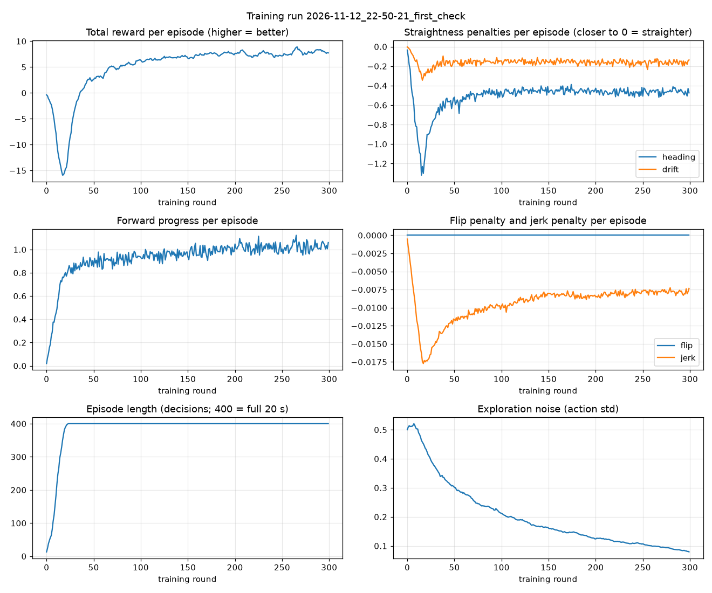
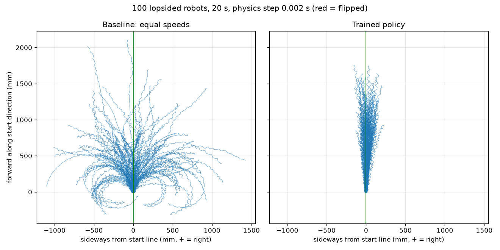

# HW8 process log

A running record of what was tried, what failed and what fixed it.

## 2026-11-12: Setup

**Tried / decided**
- Created the folder layout: `cad/` (onshape-to-robot config + exported robot), `sim/` (scene + test scripts), `docs/` (this log, `media/` for screenshots and video).
- The exported robot file in `cad/` will be left exactly as onshape-to-robot writes it. Everything added by hand (simple collision shapes, motors, floor) goes in `sim/`, so re-exporting after a CAD change doesn't erase that work.
- Python environment: install into the repo's shared `.venv` (Python 3.14.7). A pip dry-run showed onshape-to-robot 1.8.3 and MuJoCo 4.0.1 install with no version conflicts. HW8 gets its own `requirements.txt`, like HW4/HW6/HW7. MJLab (training, later) may need its own environment; to be checked then.

**Problem found**
- The root `.gitignore` ignores everything, then re-includes all of `Mohammed's Projects/**`. A `.env` file with the Onshape API keys inside the HW8 folder would therefore have been **committed**. `git check-ignore` confirmed it was not ignored.

**Fix**
- Added `**/.env` at the very end of the root `.gitignore` (the last matching rule wins, so it beats the re-include). Checked with `git check-ignore` and `git status`.
- Created `.env` with the three Onshape lines and empty key values. Keys are pasted in by hand and are never printed, logged or committed.

## 2026-11-12: Install, connection test, export

**Install:** `onshape-to-robot` 1.8.3 and `mujoco` 4.0.1 went into the shared `.venv` without problems.

**Reading the current docs and source code first.** Findings:
- Mate names: mates whose names start with `dof_` still become joints, named after the rest of the name. So `dof_right` and `dof_left` work, and give joints `right` and `left`. (An `_inv` ending would flip the axis.)
- Keys: the tool loads `.env` by searching from the current folder upward, so the export must be run from the HW8 folder (or below it).
- **Problem:** the body is *fixed* in the Onshape assembly. The MuJoCo exporter only adds a free joint to a base link that is *not* fixed (`exporter_mujoco.py`, line 365). So the exported robot would hang bolted in mid-air. The online docs mention a `"freejoint": false` setting, but 1.8.3's code has no such setting.
  - **Fix:** leave Onshape as it is, and add the free joint in our own scene builder (`sim/build_scene.py`, using MuJoCo's MjSpec editing API).

**Connection test** (`cad/test_connection.py`):
- First try: crashed with `OSError: is not a file`. The Onshape client insists on reading a JSON config file, even when the keys come from environment variables.
  - **Fix:** pass it `cad/config.json`, which has no keys in it, so the client falls back to the `.env` values (the real export does the same).
- Second try: connected, and listed 4 tabs: Part Studio 1, Assembly 1, a BOM, and the "Assign LEGO materials" FeatureScript.
  - **Found:** the document URL points at **Part Studio 1** (`e/24361...`), not the assembly. So the config finds the assembly by name (`"assembly_name": "Assembly 1"`) instead of using the URL.

**Export:**
- `onshape-to-robot cad` found both DOFs (warning "no limits", which is right for legs that spin all the way round) and 1 root link (body).
- Settings: `no_collision_meshes` is on, and all joints have `actuated: false`, so no default position servos are made.
- **What came out:**
  - Masses: body 100.006 g, legs 2.850 g each.
  - Body inertia agrees with a uniform 80×48×30 mm, 100 g box to within about 13% (Ixx 1%, Iyy 13%, Izz 6%). The hubs account for the difference.
- **Suspicious item 1:** the right joint is at x = +39.8 mm, not +32 mm.
  - 39.8 − 32 = 7.8 mm, the leg thickness, so the right mate connector is on the leg's outer face.
  - Both joints lie on the axle line, and both axes are +X. Moving a hinge point along its own axis changes nothing.
  - The leg *meshes* sit symmetrically: x = 32 to 39.8 and −39.8 to −32.
  - Conclusion: harmless, so the CAD was left alone.
- **Suspicious item 2:** the exporter's default joint settings (`frictionloss 0.1`, `armature 0.005`) are sized for big robots.
  - 0.1 N·m of friction is about the whole torque of a LEGO motor. 0.005 kg·m² is about 5000× the leg's own inertia.
  - **Fix:** both are overridden from `sim/settings.py` (guesses: 0.002 N·m and 1e-5 kg·m²).

## 2026-11-12: Building the scene

`sim/build_scene.py` adds to the untouched `cad/robot.xml`:
- the free joint
- collision shapes:
  - body box (48×80×30 mm, centre y = −25 mm)
  - two hub cylinders (r 12.5 mm, 8 mm long)
  - a leg box measured from each leg mesh
- velocity motors
- a table plane

Physics settings: `implicitfast` integrator (stable with stiff speed control), gravity −9.81. It saves `sim/scene.xml`, with mesh paths relative to `sim/`.

**Checks** (`sim/check_model.py`):
- 14/14 passed on the first run.
- **Gap noticed:** the bounding-box check can't see the hubs, because they sit inside the body box's height range. A wrong hub radius would have passed unnoticed.
  - Added a direct check: CAD vertices outside the main box are all within 12.50 mm of the axle. 15/15 passed.
- Resting: the axle settles at 15.000 mm, with 4 contacts (the box's corners), no motion and no warnings.

## 2026-11-12: Walking test

- **Small problem first:** making the renderer failed with "Image width 960 > framebuffer width 640".
  - **Fix:** set the off-screen buffer to 1280×720 in the scene.
- **First run** (+60 rpm, default soft contact): the robot **flipped onto its back** at 0.8 s, then shuffled −325.8 mm toward −Y upside down. Drift 0.0 mm. The reported heading change of +180° was a side effect of the flip, not a turn (upside down, the "front" arrow points backward). The walk test now says so.
- **Problem: the axle dipped to 9.3 mm,** which should be impossible, since the hubs alone hold it 12.5 mm up.
  - **Investigation:** measured the deepest contact overlap. The legs were sinking **5 to 10 mm** into the table, almost their whole 9.6 mm height. MuJoCo's default contact responds over 0.02 s, which is too soft when a motor drives a light leg into the floor.
  - **Tests** at ±60 rpm, varying contact time constant and timestep:

    | timeconst / timestep | sinking (mm) | distance at −60 rpm |
    |---|---|---|
    | 0.02 / 0.001 (default) | 6.7–8.2 | +378 mm |
    | 0.005 / 0.001 | 1.7–1.8 | +286 mm |
    | 0.002 / 0.001 | 0.9–1.1 | +270 mm |
    | **0.002 / 0.0005 (chosen)** | **0.7–0.9** | **+260 mm** |
    | 0.001 / 0.0005 | 0.4 | +253 mm |

  - **Fix:** `CONTACT_TIMECONST = 0.002`, `TIMESTEP = 0.0005`. The soft default had inflated the walking distance by about 40%. At the chosen setting, the distance is within about 3% of the stiffest one. The flip and the direction were the same at every setting.
- **Direction matters** (tried ±30, ±60, ±120 rpm):
  - **negative speed** (tips swing down first): walks upright toward **+Y (the leg tips)**, tilting at most about 34°, never flipping
  - **positive speed**: always flips onto its back (at 0.4 s at 120 rpm, 0.8 s at 60, 1.6 s at 30)
- **Final results at 60 rpm:**
  - −60 rpm: +260.0 mm in 10 s (26 mm/s, about one 26 mm step per leg turn)
  - +60 rpm: flips at 0.80 s, then −223.4 mm
  - both: drift 0.0 mm, motors never at their torque limit, legs at 58.9 rpm, sinking under 0.9 mm, no MuJoCo warnings
- **A misreading, caught:** in the angled frame strip, one frame looked as if the body was lifted at a moment when the plot said the axle was low. Rendering side views at known times showed the leg was pointing *up* behind the body, and the plot was right.
- **Zero drift is expected, not a result:** the model is perfectly symmetric, so it can't turn. The real robot's motor-to-motor and friction differences aren't modelled yet.

## 2026-11-12: Can MJLab run on this Mac? (research only, nothing installed)

Machine: Apple M1 Pro, 8 cores, 16 GB, no NVIDIA graphics card. Pythons on the laptop: 3.14 (the `.venv`) and 3.12.

**What MJLab's own docs say:**
- README: "mjlab requires an NVIDIA GPU for training. macOS is supported for evaluation only."
- FAQ: on macOS it runs CPU-only, through MuJoCo Warp. "Training is not recommended on macOS"; evaluation works but is "significantly slower".
- NVIDIA Warp's Mac version runs on the CPU only. It can't use the Mac's own graphics chip (no Metal support).
- MuJoCo Warp: "requires an NVIDIA GPU for fast simulation but supports CPU for development and debugging." No speed numbers are published.

**Python version and package versions:**
- Latest PyPI release: mjlab 1.6.0 (Aug 2026).
  - Requires Python `>=3.10, <3.14`.
  - Pins `mujoco~=3.11.0` and `mujoco-warp~=3.11.0`.
- GitHub `main` (not released yet): allows Python up to 3.14 and uses MuJoCo 4.0.1.
- **Trap found with a pip dry run** in the `.venv` (Python 3.14):
  - pip quietly skipped every real release, because they don't allow Python 3.14.
  - It picked **mjlab 0.0.4**, an old placeholder version, and reported success.
  - Installing into the `.venv` would therefore have "worked" while giving the wrong package. 1.6.0 would also downgrade the `.venv`'s MuJoCo from 4.0.1 to 3.11.

**Conclusion:**
- MJLab needs its own environment on Python 3.12 or 3.13.
- Training should happen on an NVIDIA GPU (Colab, a lab or university computer, or a paid cloud GPU).
- The Mac is fine for building the task, quick checks and watching trained policies (CPU).
- Whether CPU training is bearable for this tiny robot (3 bodies, 2 motors) is unknown. It can be measured with a short speed test once a separate environment exists.
- MJLab's default physics step is 0.002 s. Our contact setting (0.002 s) needs a step of at most 0.001 s, so that has to be reconciled for training.

## 2026-11-12: MJLab environment, step size, and CPU speed test

**Separate environment**
- Created `.venv-mjlab/` (repo root) from Python 3.12.10. The shared `.venv` and `sim/` are untouched.
- Installed with the version pinned (`mjlab==1.6.0`, in `train/requirements-mjlab.txt`) so pip can't fall back to the 0.0.4 placeholder.
- Installed versions: mjlab 1.6.0, mujoco 3.11.0, mujoco-warp 3.11.0, warp-lang 1.19.0, torch 2.15.0, rsl-rl-lib 5.4.2.
- Warp reports a single device, `cpu` (arm). Size: 1.5 GB; the install took about 1.5 minutes.
- `.gitignore`:
  - `.venv-mjlab/` (already ignored by the root `*` rule; listed explicitly)
  - `train/logs/`, `train/wandb/`, `train/**/*.pt`
  - Tested with `git check-ignore` before anything was written. After the training test, `git status` shows only the four `train/` code files.

**Step size vs. contact**

Plain MuJoCo, our `sim/` model, 10 s at ±60 rpm. Only settings in memory were changed.

| step | contact timeconst | sinking | distance −60 rpm | CPU per sim-second |
|---|---|---|---|---|
| 0.0005 | 0.002 | 0.7–0.9 mm | 260 mm | 28.9 ms (4×) |
| 0.001 | 0.002 | 0.9–1.1 mm | 270 mm (+4%) | 14.4 ms (2×) |
| 0.001 | 0.004 | 1.5–1.6 mm | 276 mm | 15.0 ms |
| 0.002 | 0.004 | 2.0 mm | 310 mm (+19%) | 7.6 ms (1×) |
| 0.002 | 0.006 | 2.2–2.3 mm | 305 mm | 7.8 ms |
| 0.002 | 0.004, stiffer solimp | 1.9 mm | 300–310 mm | 7.5 ms |
| 0.002 | 0.02 (default) | 6.5–7.2 mm | 379 mm (+46%) | 8.2 ms |

- `solimp` (how quickly contact firms up as shapes overlap) made almost no difference.
- At a 0.002 s step the gait covers about 12% more ground than at 0.001 s, *even with the same contact setting* (310 vs 276 mm). So the step size itself changes the gait slightly, not just the sinking.
- The flip direction and upright gait were the same in every case.

**MJLab task** (`train/robot_spec.py`, `train/silly_walker_task.py`)
- Robot: `cad/robot.xml` plus a free joint and the same simple collision shapes as `sim/` (sizes from `sim/settings.py`).
- Motors: MJLab's built-in velocity motors with our gain, torque limit, friction and rotor inertia.
- Policy: picks a speed target per leg (±120 rpm), 50 times per second.
- Reward: PLACEHOLDER (speed toward +Y). Episodes end after 10 s, or early when tilt passes 70°.
- **Trap 1, contact averaging:** MuJoCo averages the contact settings of two touching shapes. MJLab's floor keeps the soft default (0.02 s), which would dilute ours. Fix: our shapes get `priority=1`, so their settings win.
- **Trap 2, launched robots:** the first smoke test showed robots shooting up to 195 mm (0.002 s step) and 774 mm (0.001 s step) right after a reset, with the motors holding still.
  - **Cause:** the robots started *inside* the table.
    - (a) My test had removed the reset events, so the robot started with its axle at z = 0.
    - (b) More importantly, the task's random leg angles can point a leg straight down. A leg reaches 48 mm below the axle, while the table is only 15 mm below it.
    - The stiff contact then shoved the robot out at about 3.7 m/s.
  - **Check:** plain C MuJoCo on the same compiled model, started at the right height, sat still. So the model was fine and the reset was at fault.
  - **Fix:** a custom reset event (`reset_robot_clear_of_table`) finds the lowest leg corner for the chosen angles and starts the axle at max(15 mm, that depth) + 2 mm.
  - **Result:** 256 random resets rose at most 1.8 mm, with no launches.
- **Same physics as `sim/`:** walking 10 s at −60 rpm in MJLab gave 307 mm (0.002 s step) and 270 mm (0.001 s step). Plain MuJoCo gave 310 and 270 mm. So MuJoCo Warp agrees with regular MuJoCo for this robot.

**Speed test** (`train/speed_test.py`, M1 Pro, CPU only)

| step | robots | policy steps/s | physics steps/s |
|---|---|---|---|
| 0.002 | 64 | 812 | 8,122 |
| 0.002 | 256 | 1,968 | 19,680 |
| 0.002 | 1024 | 3,203 | 32,025 |
| 0.002 | 4096 | 3,933 | 39,330 |
| 0.001 | 64 | 440 | 8,809 |
| 0.001 | 256 | 1,101 | 22,010 |
| 0.001 | 1024 | 1,867 | 37,347 |

- **Only 1 of the 8 CPU cores is used** (CPU time ÷ wall time = 1.0 in every case). Warp's CPU backend runs single-threaded.
- **Real PPO training,** 1024 robots, 0.002 s step, 10 iterations: 72.7 s in total, about 7.2 s per iteration (24,576 policy steps each), 3,381 policy steps/s including learning.
  - It ran with no errors. Mean reward went from −0.01 to 0.02, which means nothing after 10 iterations.
  - Logs and checkpoints: 332 KB in `train/logs/` (ignored).
- **For comparison:** plain C MuJoCo (not MJLab) did 66,000 physics steps/s for a single robot on one core. MJLab-on-CPU is the bottleneck here, not the robot.

**Estimated full training time on this Mac** (0.002 s step, 1024 robots, 7.2 s per iteration):

| iterations | policy steps | time |
|---|---|---|
| 300 | 7.4 M | about 36 min |
| 1000 | 25 M | about 2 h |
| 3000 | 74 M | about 6 h |

At a 0.001 s step, everything takes about 1.7× longer.

## 2026-11-12: What can the real Double Motor (45651) sense? (research)

- **Online docs: a dead end.** LEGO's product pages don't document the Double Motor's sensors, and PyPI blocked automated reading.
- **Source used instead:** the installed `legoeducation` 1.2.0 package (LEGO's own Python library, already in `.venv`), plus real data recorded in MT1.

**What it reports** (from `rpc_message.py` and `device.py`)

Per motor (`MotorNotification`, one for each side):
- `absolutePosition`: uint16, an absolute encoder angle. Probably degrees, 0–359 (inferred).
- `position`: int32, a running position that counts full turns.
- `speed`: int8, a small whole number. Probably percent, −100..100 (inferred).
- `power` and `motorState`.

Motion sensor (`ImuDeviceNotification`):
- `yaw`, `pitch`, `roll`: int16
- `accelerometerX/Y/Z`: int16
- `gyroscopeX/Y/Z`: int16
- `orientation` (which face is up) and `yawFace`

Units:
- **Accelerometer:** **milli-g**. MT1 data reads about 986 at rest.
- **Gyroscope:** **degrees per second**, *inferred*. Paddle swings peaked around 1,160; if the unit were tenths of a degree that would only be 116 °/s, too slow for a swing.
- **Yaw/pitch/roll:** units not documented. To be checked on the real robot.
- **Yaw comes from the gyro and can be reset** with `imu_reset_yaw_axis()`. No magnetometer is mentioned, so yaw will slowly drift (inferred). `imu_set_yaw_face()` picks which face of the motor yaw is measured around.

**Rate:**
- Reports arrive at a set interval, **15 to 1000 ms** (`device_notification_delay` in `connect()`). The default is 100 ms (10 per second).
- **Measured:** MT1 requested 20 ms, but its recorder (which checked every 5 ms) logged new readings **every 31 ms on average** (10th–90th percentile: 25–34 ms), so about **32 per second** in practice over Bluetooth on this Mac.

**Commands:**
- `movement_move_tank(speed_left, speed_right)` sets both sides in **one** Bluetooth message.
- `motor_set_speed(speed, motor=...)` sets one side.
- Speeds are **percent, −100..100**. What 100% means in rpm is not documented, so it has to be measured.
- `blocking=False` sends without waiting for the reply.
- No documented limit on how often commands can be sent.

**Conclusion for the policy:**
- It can use tilt, turning rate, heading relative to the start (yaw after a reset), each leg's angle and speed, and its own last command.
- It can NOT use position or speed across the table (there's no sensor for that).
- One decision every 0.02 s (50 Hz) is faster than the readings actually arrive (about 32 Hz), so the decision rate will be lowered.

## 2026-11-12: The real training task (walk straight)

**Decisions (approved):**
- Physics step 0.002 s for training; a robustness check at 0.001 s at the end
- Mac CPU, with Colab as the backup
- Upright-only actions
- 20 decisions per second
- Heading as the main straightness term
- Flipping must never be a better deal than continuing

**Design** (`train/walk_straight_task.py`; all tunable numbers are at the top)

*Decisions and actions:*
- One decision every 0.05 s. The real sensor delivered readings about every 31 ms, so 50 per second was too fast.
- Actions: two numbers clipped to −1..1 → each leg's speed, from stopped (−1) to MAX_SPEED_RPM = 120 rpm (+1), upright direction only.

*Policy inputs* (16 numbers, only what the real robot can sense, with noise):
- tilt
- gyro
- heading since the start (sin/cos, with slow random drift)
- leg angles (sin/cos, with calibration error)
- leg speeds
- last command

The critic also gets the true body velocity and sideways offset. It's only used during training, so that's allowed.

*Reward* (per second):

| Term | Weight | Cap |
|---|---|---|
| forward speed along the start direction / 30 mm/s | +1.0 | 0..1.5 |
| heading error per 10° (the main term) | −1.0 | −2.0 |
| sideways offset per 3 cm (tie-breaker: the robot can't sense it) | −0.2 | −0.4 |
| command change² (jerk) | −0.02 | ≤ −0.16 |

- **Flip:** −75 once, and the episode ends.
- **Why flipping can never pay:** the worst a robot can score per second while continuing is −2.56. So a whole 20 s episode loses at most −51.2, which is better than −75. Discounting only makes the future losses smaller, so the guarantee still holds.

*Randomized per robot at every reset:*

| What | Range |
|---|---|
| Motor speed per side | ×0.9–1.1 |
| Motor torque limit per side | ×0.8–1.2 |
| Friction per leg and for the body | 0.4–0.9 |
| Body mass (mass and inertia together) | ×0.8–1.3 |
| Center of mass, left/right | ±3 mm |
| Leg start angles | independent random |
| Start heading | any direction |
| Command delay | 0–40 ms, shared by both motors (as in one Bluetooth message) |

Plus sensor noise, gyro yaw drift (±0.5°/s) and leg calibration error (±2°).

**Problems found while building it**
1. **MJLab's motor-strength randomizer (`dr.effort_limits`) doesn't support velocity motors.**
   - **Fix:** a small custom event that scales each motor's `actuator_forcerange` per robot.
2. **First reward check: "perfect twins" scored −21.8 per episode.**
   - They should have scored well, but were turning up to 47° in 10 s.
3. **Test of each factor separately** (10 s, perfect twins):

   | Setup | Max heading error |
   |---|---|
   | facing an axis, legs together | 0.0° |
   | **random facing direction** | **32°** |
   | legs together at random angles | 1.8° |
   | command delay | 0.0° |
   | random facing + **elliptic friction** | **0.0°** |

   - **Cause:** MJLab's default **pyramidal** friction approximates friction with a 4-sided shape fixed to the world's x/y axes. A robot facing diagonally gets lopsided friction and turns, which is **a simulator artifact**. Every earlier `sim/` test faced along an axis, which is why it never showed up there.
   - **Fix:** `cone="elliptic"`. Accuracy (twins, 10 s at 60 rpm, random headings):

     | Friction | Solver iterations | Max heading error | Distance | Decisions/s (512 robots) |
     |---|---|---|---|---|
     | pyramidal | 100 | 35.4° | 288 mm | 1,144 |
     | elliptic | 100 | 0.0° | **310 mm (= plain MuJoCo)** | 170 |
     | **elliptic (chosen)** | **20** | 0.0° | 310 mm | 224 |
     | elliptic | 10 | 0.0° | 308 mm | 211 |
     | elliptic | 5 | 0.0° | 302 mm | 306 |

   - **Cost:** correct friction makes training **about 5× slower**.
   - **Note:** `sim/` (plain MuJoCo) also uses pyramidal by default. It was only tested facing along an axis, so it's unaffected. Switching it to elliptic before any off-axis tests there is recommended.
4. **A real physics finding (with elliptic friction): legs out of step make even a perfect twin turn.**
   - 16 twins with random leg phase reached up to 83° in 10 s; larger phase differences generally turned more.
   - So drift has two sources: motor differences and leg phase.
   - The policy can sense leg angles, so it can correct both. Legs start at independent random angles in training.

**Reward check** (`train/reward_check.py`, 16 robots × 20 s per scenario, elliptic friction)

| Scenario | Return per episode | Per term (/s) |
|---|---|---|
| A twins, legs in step, 60 rpm (ideal) | **+11.0** | forward +0.58, heading −0.02, drift −0.01 |
| A2 twins, legs out of step | −18.4 | forward +0.74, heading −1.35, drift −0.31 |
| B standing still | −7.5 | forward +0.01, heading −0.35 |
| C off course by 45° all episode | −36.2 (min −36.4) | heading −2.00 (capped), drift −0.37 |
| D lopsided robots (full randomization), 60 rpm | −22.3 | heading −1.52, drift −0.31 |
| E jerky random commands | −25.2 | jerk only −0.03 |

- **All 5 checks pass:**
  - B < A
  - D < A
  - A2 < A
  - C (−36.4 at worst) beats flipping (−75)
  - the guaranteed worst case (−51.2) beats flipping
- With the pyramidal friction, A had scored −26 and the checks failed.
- **Observation:** the ideal gait earns only +0.58/s forward (not 1.0). Its speed comes in bursts (the forward "fall" after each vault), and the 1.5× cap trims the peaks. Heading therefore dominates, as intended.

**Evaluation script** (`train/evaluate.py`)
- Seeded randomization, and the script confirms both drivers get identical robots.
- The baseline runs at the policy's own average command.
- Outputs: a table (`docs/eval_results_<tag>.md`), a path plot, and two videos (start line green, trail white, 2× speed).
- Tested on the untrained round-0 checkpoint (8 robots, 4 s). It ran end to end.
- Two bugs fixed:
  - relative checkpoint paths didn't work
  - the camera looked backward
- Small issue: mediapy can't *read* videos back with this ffmpeg version (an old option was removed). Writing works; checked with OpenCV (40 frames, 20 fps).

**First training run** (`train/train.py --envs 256 --iters 300 --name first_check`)
- Started 22:50.
- About 30 s per round, so about 2.5 h for 300 rounds. That's slightly over the 2 h budget, because of the elliptic friction. 256 robots instead of 512 was chosen to keep it near the budget.

## 2026-11-13: Results of the first training run (`first_check`)

**Run facts**
- Run folder `train/logs/rsl_rl/walk_straight/2026-11-12_22-50-21_first_check/`. Final checkpoint `model_299.pt`.
- 256 robots, 300 rounds, physics step 0.002 s.
- Took **1 h 56 min** (22:50 to 00:46), inside the 2 h budget. The first rounds took about 30 s each and later ones about 21 s.
- The Mac was kept awake with `caffeinate -i -s -w <training PID>`, plugged into power. No restarts.
- No new training runs were started after this one. Nothing has been committed.

**Training curves** (`docs/media/training_2026-11-12_22-50-21_first_check.png`)

- **Total reward per episode:** −0.4 at round 0, a dip to −16 around round 18, then a steady climb to **+7.7** at round 300.
  - The dip is not the robot getting worse. MJLab starts robots partway through their episodes, so the first episodes are short. As episodes lengthen to the full 20 s, the penalties add up over more time.
  - Most of the gain came by round 100. Rounds 100–300 improved slowly, from about +6 to +7.7, and the curve was still creeping up at the end.
- **Heading penalty** (per second): about −1.3 at its worst (round 18), settling near **−0.46**. That is roughly a 4.6° average heading error, since the penalty is error ÷ 10°.
- **Drift penalty** (per second, weight 0.2): from about −0.33 to about **−0.15**.
- **Forward reward** (per second): from 0 to about **1.0**, still rising slowly. The ideal scripted gait in the reward check earned only +0.58/s, so the policy found a faster gait than "both legs at 60 rpm".
- **Flips:** none in training (the flip penalty stayed at 0).
- **Jerk penalty:** tiny (−0.008/s).
- **Episode length:** full 400 decisions from round 25 on.
- **Exploration noise** (action std): from 0.50 down to 0.08. The policy has become fairly sure of itself. If a later run needs more exploration, this is the knob (entropy coefficient).

**Evaluation: baseline vs trained policy**
- 100 randomly lopsided robots (seed 7), 20 s each. Both drivers got the same robots (fingerprint check: YES).
- Baseline: both legs at a constant speed equal to the policy's own average command (65 rpm at 0.002 s, 64 rpm at 0.001 s).
- Values are mean / median / worst 5 % of the absolute value at the end of 20 s.

| Measure | Baseline, 0.002 s | **Policy, 0.002 s** (training step) | Baseline, 0.001 s | **Policy, 0.001 s** (robustness check) |
|---|---|---|---|---|
| Sideways drift (mm) | 453 / 448 / 998 | **67 / 58 / 148** | 447 / 432 / 932 | **86 / 75 / 188** |
| Heading error (deg) | 72 / 65 / 168 | **6 / 5 / 14** | 72 / 63 / 171 | **6 / 5 / 14** |
| Forward distance (mm) | 596 / 614 / −175 | **1144 / 1090 / 840** | 612 / 608 / −211 | **1343 / 1311 / 945** |
| Flipped | 0 / 100 | **0 / 100** | 0 / 100 | **0 / 100** |

(For forward distance the third number is the worst 5 %, the low end. A negative baseline value means the robot turned around and ended up behind its start line.)

- Videos:
  - `docs/media/eval_dt0.002_baseline.mp4` / `eval_dt0.002_policy.mp4` (robot #37: baseline heading error −65°, policy −3°)
  - `eval_dt0.001_*.mp4` (robot #25: +61° vs +6°)
  - Full tables: `docs/eval_results_dt0.002.md` and `docs/eval_results_dt0.001.md`.

**"Standing still" cheating check: PASSED (not cheating)**
- The policy moved **1144 mm** on average along the start direction vs the baseline's **596 mm**. That is **192 %** of the baseline, far above the 70 % warning line.
- Even its worst 5 % (840 mm) beats the baseline's average.
- At 0.001 s the ratio is 1343 / 612 = **219 %**.
- **Honest caveat:** "forward distance" counts progress along the start direction. Baseline robots that curve away lose distance on this measure even while walking at full speed. So the 192 % mostly says "the policy goes where it should", not "the policy's legs are faster".
  - The fairest speed comparison is against the straightest baseline robots. In the path plot they reach 1500–2000 mm, while the policy's longest paths reach about 1750 mm.
  - So the policy walks at roughly the same speed as an unsteered robot, maybe slightly slower. It does not hold back to avoid penalties.

**What this means**
- **Straightness:** median heading error fell from 65° to 5°, and median drift from 448 mm to 58 mm (about 8× less). The policy steers by speeding one leg up and slowing the other, using only sensors the real robot has (IMU tilt/gyro/yaw, leg angles and speeds), with noise and calibration errors added.
- **0.001 s robustness check:** heading is identical (6° / 5° / 14°). Drift is a little worse (median 75 vs 58 mm). The robot also walks further (1343 vs 1144 mm), because the finer contact gives a slightly different gait. The policy did not fall apart on the more accurate physics. That is a good sign it did not exploit a quirk of the 0.002 s step.
- **Remaining drift:** the policy cannot sense sideways position, only heading. A small, steady heading error early on therefore turns into sideways offset that it never removes. That is why drift (about 6 cm) did not shrink to zero, as expected when heading was made the main term.
- **Not tested yet:** the real robot. Sim-to-real gaps (real motor speed/torque, the real IMU update rate, table friction) are still unknown.

## Open questions / next steps
- Measure the real motor speed (rpm) and, if possible, its torque.
- Check on the real robot: does + speed really flip it, and does − speed walk toward the leg tips?
- Measure the real robot's drift, then compare it with the randomization ranges used in training.
- ~~Decide the training step size.~~ Done: trained at 0.002 s, and the policy holds up at 0.001 s.
- Possible next run (waiting for review; not started): more rounds (the reward was still rising slowly), and maybe a small sideways-offset term, if the real robot can estimate it.
- Export the policy for the real robot (actor network, 16 inputs → 2 leg speeds) and write the code that reads the Double Motor's sensors at 20 Hz.
