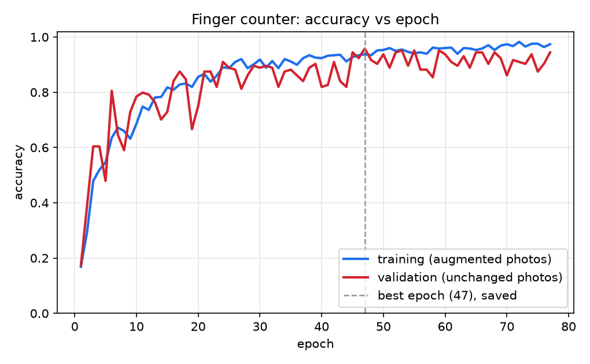
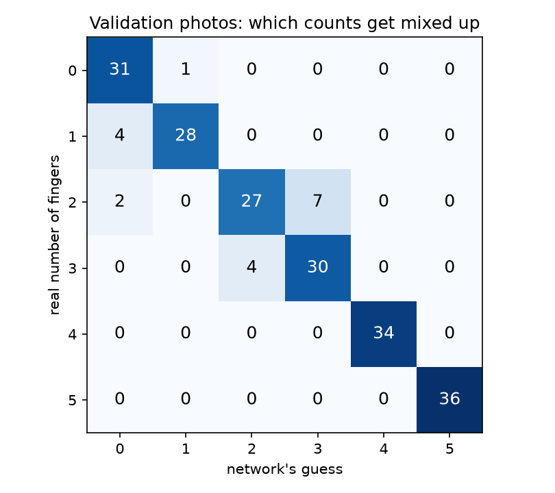
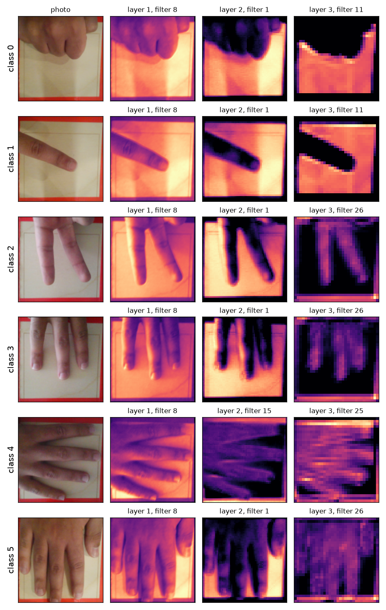

# The Impenetrable Safe (MT2)

A laser-cut box that opens only for the right hand signals. A webcam watches
you hold up fingers, a PyTorch neural network counts how many (0 to 5), and
if you show the correct three-number code in order, an Arduino UNO Q drives a
small TT motor through a Cytron Maker Drive to swing a latch and unlock the
box. Show the wrong code and the latch stays shut. The project runs the whole
chain a robot needs, from seeing (camera), to deciding (neural network and
code check), to acting (motor and latch), on one small board.

> **Status:** in progress. The folder layout, the motor wiring and the motor
> test app are set up; the camera code and trained model are still to come. See the
> [build log](#build-log) at the bottom.

## How it works

### From one neuron to a full image network

The project is built in steps that each add one idea:

1. **One neuron** (`01_warmup_gradient_descent/`): a single neuron with a
   ReLU is fitted to V-shaped data by gradient descent, with every
   derivative written out by hand in Python and worked through in Excel.
   This shows the basic "guess, measure the error, nudge the numbers,
   repeat" loop that all neural network training uses. A second script
   fits the same data with a hidden layer of two neurons in PyTorch, for
   comparison.
2. **Many neurons that look at pictures** (`03_training/`): the same loop,
   run by PyTorch on thousands of numbers at once, trains a convolutional
   neural network (CNN). A CNN slides small pattern-finders over the image,
   so it can spot a finger wherever it is in the frame instead of only in
   one fixed spot.

### Training on the laptop, running on the board

Training a network takes a lot of computing, so it happens on the laptop.
The finished network is just a file of numbers, small enough to copy to the
UNO Q, where it only has to *use* what it learned (much less work than
learning it). The UNO Q has two brains: a Linux computer that runs the
camera and the network in Python, and a microcontroller that drives the
motor. The two talk over the board's built-in Bridge.

### Turning a shaky guess into a code

A camera network does not give one clean answer: it guesses every frame,
and the guess can flicker while your hand moves. The safe only accepts a
number once the guess stays the same for a set time, and it needs a pause
(no hand) between numbers, so a code with a repeated number like 3-3-1 can
still be entered. The exact timings will be tuned once the network is
trained.

### A latch with no position sensor

A TT motor has no sensor that says where it is. The latch is moved by
running the motor in one direction for a short, measured time, then
stopping. `05_hardware_tests/latch_motor_test/` exists to find that time and
the speed that swings the latch reliably without straining the motor.

## Hardware

- Arduino UNO Q
- Arduino USB-C hub: the webcam plugs into its USB-A port, and its PD
  (power) port is fed by a 5 V / 2.4 A power bank, which powers the board
  and the camera
- USB webcam (icspring), looking down at the red square
- Cytron Maker Drive (2-channel motor driver; only channel 1 is used)
- TT gear motor driving the latch
- MPU-6050 motion sensor, stuck flat on the floor of the box away from the
  motor (tamper alarm)
- Laser-cut box and latch arm

### Wiring

| From | To | What it does |
|---|---|---|
| Maker Drive M1A (input) | UNO Q D9 | speed signal for one direction |
| Maker Drive M1B (input) | UNO Q D10 | speed signal for the other direction |
| Maker Drive GND | UNO Q GND | shared ground so the signals make sense |
| Maker Drive VB+ / VB- | UNO Q 5V / GND | motor power |
| Motor wires | Maker Drive M1A / M1B (output terminals) | the motor itself |
| MPU-6050 VCC / GND | UNO Q 3.3V / GND | sensor power |
| MPU-6050 SCL / SDA | UNO Q SCL / SDA | I2C: the sketch reads the sensor |

How the driver is told what to do: when D9 sends a speed signal and D10 is
off, the motor turns one way; swap them and it turns the other way; both
off and it stops. The "speed signal" is PWM: the pin switches on and off
very fast, and the share of time it is on sets the speed. Both D9 and D10
can do PWM on the UNO Q (checked in the board's own pin table, see the
build log).

## Files

```
MT2 - The Impenetrable Safe/
  README.md
  01_warmup_gradient_descent/
    annacode-v.tsv              the V data (120 points) from Anna's Code
    single_neuron.py            one ReLU neuron, gradients written by hand
    gradient_descent_5_iterations.xlsx   the same first steps as spreadsheet formulas
    two_neurons.py              hidden layer of 2 ReLU neurons, in PyTorch
    requirements.txt            Python packages for the scripts above
    *.png                       the data and the fits (made by the scripts)
  02_data_collection/
    capture.py                  webcam tool that takes labeled 0-5 finger photos
    hand_crop.py                the crop box and 128x128 resize, shared with training and the UNO Q
    crop_config.json            the saved crop box (created by capture.py)
    requirements.txt            Python packages for capture.py
    data/0 ... data/5           the photos (kept on the laptop only, not in Git)
    data_old_640x360/           80 early class-2 photos taken in the wrong camera mode (kept aside, not in Git)
  03_training/                  PyTorch CNN training (runs on the laptop)
    model.py                    the network (3 conv layers + 1 linear), shared by everything below
    train.py                    trains it: split, augmentation, early stopping, plots
    live_test.py                live webcam window with the network's guess and confidence
    feature_maps.py             pictures of what each layer "sees" (for the stop-action movie)
    requirements.txt            Python packages for the scripts above
    finger_cnn.pt               the trained network (made by train.py)
    loss.png, accuracy.png      training curves (made by train.py)
    confusion_matrix.png        which counts get mixed up (made by train.py)
    mistakes.png                the validation photos it gets wrong (made by train.py)
    feature_maps/overview.png   one row per class for this README (the 30 movie frames stay on the laptop)
  04_unoq_app/                  the lock itself
    laptop_lock.py              the lock on the laptop (the first version): camera, network, code, screen
    prepare_board_files.py      copies the camera code, crop box, code and trained network into safe_app
    safe_code.txt               the unlock code (not in Git)
    safe_app/                   the UNO Q app: runs the whole lock on the board
      app.yaml                  the app's name tag for App Lab (web server on port 7000)
      python/main.py            camera -> network -> rules -> latch and LED matrix; demo page
      python/lock_logic.py      the lock's rules, shared with laptop_lock.py
      python/finger_net.py      the trained network in plain numpy (no PyTorch on the board)
      python/matrix_patterns.py the LED matrix pictures for each state
      python/tamper.py          the tamper alarm rule and its calibrated thresholds
      python/hand_crop.py       copy of 02_data_collection/hand_crop.py (made by prepare_board_files.py)
      python/crop_config.json   copy of the crop box (made by prepare_board_files.py)
      python/finger_net.npz     the trained numbers from finger_cnn.pt (made by prepare_board_files.py)
      python/safe_code.txt      copy of the code (made by prepare_board_files.py, not in Git)
      python/link_secret.txt    secret word for the laptop's commands (not in Git)
      sketch/sketch.ino         the tuned latch moves, the LED matrix, and the motion sensor
      assets/index.html         the demo page: camera view, guess and state
  05_hardware_tests/
    latch_motor_test/           UNO Q app that spins the latch motor both ways
      app.yaml                  the app's name tag for App Lab
      sketch/sketch.ino         the motor test code (runs on the microcontroller)
      python/main.py            empty Linux side that just keeps the app running
  06_movie/                    the computer-made stop-motion movie of how the network works
    make_stopmotion.py          the paper-cutout stop-motion version (12 fps), using make_movie.py's real data
    make_movie.py               the real data from the network, and the first smooth version
    clean_background.py         cleans the desk photo into background_paper.png
    background_paper.png        the cleaned paper-on-desk photo behind every scene
    source_frame.png            the real 640x480 webcam frame (2 fingers) the movie follows
    safe_photo.jpg              a real photo of the safe, for the ending
    training_loss.csv           the real loss of every epoch of the training run
    how_the_network_works.mp4   the stop-motion movie: 1920x1080, 12 fps, 95 s, no sound
    how_the_network_works_smooth.mp4   the first, smooth version (same scenes and timing; laptop only, not in Git)
    contact_sheet.png           two frames per scene, for reviewing (laptop only, not in Git)
    scene_times.txt             when each scene starts, for the voiceover
  media/                        photos, videos and screenshots
```

Empty folders hold a `.gitkeep` file only so Git keeps them; delete it once
the folder has real files.

### 01_warmup_gradient_descent

The warm-up, on the V example from Anna's Code (`output = 2·|x − 60|` plus
noise, x from 20 to 100). Both scripts first rescale the data to
x' = (x − 60)/40 and y' = y/100, so the numbers are small and centered on 0.

- `single_neuron.py` fits y_hat = ReLU(m·x' + b), starting at m = 1, b = 0
  (Anna's Code's default), with mean squared error and a learning rate of
  0.5. The gradients dL/dm and dL/db are written out as formulas, not left
  to PyTorch. It prints iterations 0 to 5 as a table, trains 200 epochs and
  saves `single_neuron_fit.png` (in the original units) and
  `single_neuron_loss.png`.
- `gradient_descent_5_iterations.xlsx` does the same iterations with live
  formulas: a `Data` sheet (x, y, x', y'), one `Iter` sheet per iteration
  with a row per point, and a `Summary` sheet. The learning rate and the
  starting m and b are the yellow cells on `Summary`; change one and every
  sheet updates.
- `two_neurons.py` trains a hidden layer of 2 ReLU neurons and a plain
  output neuron with PyTorch, from 10 random starts, keeps the best, and
  saves `two_neurons_vs_one.png` comparing it with the single neuron.
- `v_data_scatter.png` is a plain scatter plot of the data.

### 02_data_collection

The external webcam hangs off the laptop screen, looking down at a red
square taped on the desk. `capture.py` shows its live picture with a crop
box, which is lined up with the red square once and saved to
`crop_config.json`. Then each press of a number key 0-5 saves the inside of
the box, shrunk to 128x128 pixels, as `data/<number>/<person>_<number>_<time>.png`.
Holding the key saves about 5 photos per second, so the hand can move a
little between shots. The side panel counts each class's photos toward a
goal of 80 per class per person, so the classes stay balanced. Class 0 is a
fist **or** an empty square; the lock will use it as the pause between
code digits.

Two rules shape the tool:

- **The same camera for training and for the safe.** Each camera sees
  color, brightness and sharpness a little differently, so `--list`
  helps pick the external webcam and tells it apart from the laptop's
  built-in camera and from iPhones (Continuity Camera).
- **The same crop for training and for the safe.** `hand_crop.py` is the
  only code that cuts and shrinks the picture, and the training code and
  the UNO Q app will import it too, with the same `crop_config.json`. A
  network only recognizes the kind of picture it practiced on; a box a few
  pixels off on the safe would quietly make it guess worse.
- **The same picture size, always 640x480.** The webcam shows a different
  slice of the desk at a different picture shape, so the tool forces
  640x480 and checks every single frame. If the size is ever different, it
  stops with an error instead of saving photos. `crop_config.json` records
  the picture size its box was made for, and the tool refuses a box saved
  for any other size. The UNO Q app must force and check 640x480 the same way.

The photos stay out of Git (hundreds of pictures, including friends'
hands); a sample strip goes in `media/` (`capture.py --samples`).

### 03_training

The PyTorch code that trains the finger-counting CNN on the laptop and
saves the trained network (`finger_cnn.pt`) that the UNO Q app will load.

**The network** (`model.py`) follows the professor's hint: three
convolution layers, each followed by ReLU and 2x2 max pooling, then one
linear layer with 6 outputs.

- **Convolution:** each filter is a 3x3 pattern detector that slides over
  the whole photo.
- **Max pooling:** halves the picture after each layer.
- **Filter counts:** 8, then 16, then 32, while the picture shrinks
  128 → 64 → 32 → 16.
- **Final layer:** weighs the last 32x16x16 = 8,192 numbers into six
  scores.

It has 55,190 parameters (about 216 KB) and takes about 13 million
multiply-adds per photo: 5 ms per guess on the laptop, light enough for the
UNO Q.

**Training** (`train.py`):

- **Split:** 80% training and 20% validation, the same share of every
  class and of every capture session (daylight and evening), with a fixed
  seed. Photos were taken in bursts of near copies, so each session of each
  class is cut in time order into 10 blocks, and 2 whole blocks go to
  validation. Otherwise nearly every validation photo would have a twin in
  training, and validation would test memory rather than understanding.
- **Augmentation, training photos only:** each time a training photo is
  used, it is randomly rotated (±15°), shifted (±8%), brightened or darkened
  (×0.8–1.2), and mirrored half the time. Real hands are never at exactly
  the same angle, spot or lighting, and mirroring teaches left hands from
  right-hand photos. Validation photos are never changed, because they
  stand in for the real camera: changing them would measure the network on
  pictures the safe will never see.
- **Loss and optimizer:** cross-entropy loss (it punishes confident wrong
  guesses the most), and Adam at a step size of 0.001.
- **When to stop:** training stops when validation accuracy hasn't
  improved for 30 epochs, and the best epoch is kept.
- **Starting values:** "Kaiming" starting weights with a small positive
  bias, so no filter starts out dead (see the build log).

**Prepared the same way everywhere:** photos are turned into network input
by `hand_crop.to_network_input`, the same function that `live_test.py` and
the UNO Q app use. Live frames go through `hand_crop.frame_to_network_input`,
which checks the 640x480 size, crops the saved box and shrinks it.

**Results** (1,020 photos of one person's hand from three sessions:
daylight, evening with finger shadows, and an evening session aimed at the
poses the board struggled with; 204 for validation):




- **Best epoch:** 91.2% on validation (186 of 204).
- **Typical:** about 87% (average of the last 10 epochs, 86–89%). The best
  epoch is partly luck; expect the typical number on new photos.
- **By session** (`train.py` prints this):

  | Validation photos | Network before session 3 | Current network |
  |---|---|---|
  | Daylight (96) | 94.8% | 93.8% |
  | Evening (48) | 97.9% | 97.9% |
  | Session 3, hard poses (60) | 66.7% | **81.7%** |

- **Fixed by session 3:** the open palm read as 4 (5 mistakes before, 0
  now), and 4 read as 2 or 3.
- **Still hard:** a single fingertip just poking in at the edge (read as
  0), and 2 fingers pointing down from the top edge with the other
  knuckles showing (read as 3 or 0, confidently). That pose was only in
  validation, never in training, so it was a fair but tough test.
- **Not tested on other hands:** every photo is the same hand, so friends'
  hands will probably do worse.

**What each layer sees** (`feature_maps.py`): for each class, the photo and
the most active map of each layer. Layer 1 still looks like the photo,
layer 2 cuts out the fingers, and layer 3 is a blocky outline of the
finger shapes.



### 04_unoq_app

The lock was built on the laptop first (`laptop_lock.py`). Now the UNO Q runs
the whole lock by itself (`safe_app/`), with no laptop in the loop:

```
webcam (USB-C hub) -> hand_crop.py: forced 640x480, every frame checked, the saved box, 128x128
                   -> finger_net.py: the trained network, in numpy
                   -> lock_logic.py: the rules
                   -> Bridge -> sketch.ino: latch motor + LED matrix
```

**Running the network on the board.** PyTorch would be about a 1 GB
install. The board's OpenCV can't run ONNX files: it was built without
that part. But the app's base image already has numpy and OpenCV. The
network is small (3 convolutions and one linear layer), so `finger_net.py`
does the same maths in about 60 lines of numpy, using the trained numbers
from `finger_cnn.pt`. `prepare_board_files.py` checks that it gives the
same guess as PyTorch on all 144 validation photos. On the board, the
camera, crop and network take about 41 ms per guess, with nothing installed.

**Same pipeline as training.** The board only receives the `safe_app`
folder, so `prepare_board_files.py` copies `hand_crop.py`, `crop_config.json`
and the code into it from their one true source. Run it after retraining or
moving the crop box, then deploy.

**The lock's rules** live in `safe_app/python/lock_logic.py`. Both the
board and `laptop_lock.py` import that one file, so they can't drift apart.
The network guesses 10 times a second, and single guesses are shaky: a hand
moving into place can look like any number for a moment. So an answer
only counts if it stays the same, at least 85% sure, for a while.

- **IDLE:** asleep. The "button" is an **open palm (5), held about 1 s**.
  On the laptop, SPACE also works. The palm is judged more forgivingly than
  a digit, because waking up (or locking) can't open anything. It counts
  when at least 80% of the guesses in the last 1.2 s say "5", each at
  least 70% sure. Digits need every guess for 1 s, each at least 85% sure.
- **Wake-up pause:** then a fist (or no hand) for 0.5 s, so the open palm
  isn't taken as the first digit 5.
- **Digits:** a digit 1–5 is accepted when the same answer is held for
  1 s. Between digits, a fist for 0.5 s again. That stops one held finger
  from typing 1-1-1, and still allows repeated digits: 1, fist, 1, fist, 2.
- **After 3 digits:** the right code unlocks the latch. A wrong code is a
  strike; the digits are cleared, and a fist comes before the next try.
- **3 strikes in a row:** a 30-second lockout where everything is ignored.
  Trying all 125 possible codes would take over 20 minutes.
- **No progress for 15 s** while entering a code: back to IDLE.
- **UNLOCKED:** hold an open palm (same forgiving rule) to lock again. On
  the laptop, L also works.
- **The palm counts only after a fist or an empty box.** Without this, a
  code ending in 5 would lock again at once, as the hand keeps holding the
  5 after the latch opens. The same goes for waking straight after locking.

All the numbers (85%, 1 s, 0.5 s; for the palm 1.2 s, 80%, 70%; 3 strikes,
30 s, 15 s) are settings
at the top of `lock_logic.py`. The code is in `safe_code.txt`, kept out of
Git so it isn't public. Without that file the lock won't start; it never
falls back to a default code.

**The LED matrix** (13 × 8) shows the state:

| Pattern | Meaning |
|---|---|
| closed padlock | IDLE: asleep and locked. A bar along the bottom row fills while the open palm is held. |
| three dim empty boxes | awake: ready for the code |
| boxes fill in, bright | one box per digit entered (dots, never the digits themselves) |
| bottom-row bar | fills while a digit or the fist is held; the step counts when it is full |
| check mark (2 s), then open padlock | right code: unlocked. The bar fills while the palm is held to lock again. |
| X (2 s) | wrong code: a strike |
| seconds counting down, with a "!" flashing between | lockout |
| "?" | the latch's state isn't known yet (the board is starting up) |
| flashing warning triangle | **tamper alarm**: the locked box was knocked, shaken or pried (5 s) |
| small camera | the webcam isn't working (unplugged, or not 640×480) |

**The tamper alarm.** An MPU-6050 motion sensor sits on the floor of the
box. The sketch reads it 100 times a second and turns each reading into two
movement numbers:
- **shake:** how far the acceleration jumps from its recent average, in mg
  (thousandths of gravity). A still box reads about 10.
- **turn:** how fast the box rotates, in degrees per second.

The sketch keeps the biggest value of each, and Python reads them 10 times
a second (`tamper.py`). The alarm goes off when **shake ≥ 80 mg or turn ≥
12°/s**, but only while the board reports the latch **locked**. The matrix
then flashes a warning and the demo page shows TAMPER ALERT for 5 s. It only
warns; it doesn't change the lock's rules.

The safe's own motor never sets it off: the sketch ignores all movement
while the latch moves and for 1 s after.

The thresholds come from calibrating the real box:

| What happened | Shake (mg) | Turn (°/s) | Alarm? |
|---|---|---|---|
| Box still | ≤ 25 | ≤ 2 | no |
| Gentle taps | 31–64 | ≤ 11 | no (a tap isn't prying) |
| Lifting the locked lid | 71–251 | 15–38 | yes |
| Firm knocks, sliding, shaking | 47–2,800 | 6–140 | yes |
| Hand resting on the locked lid | ~70 | ~15 | yes (can't be told apart from the gentlest lid try) |

**The demo page** (`http://Mohammed.local:7000` on the same Wi-Fi) shows
the board's camera view with the crop box, the guess and how sure it is,
LOCKED/UNLOCKED, the state, the dots and the hold bar. During a tamper
alarm it shows a blinking TAMPER ALERT banner and plays a high-low beep.
The beep is made by the browser itself (Web Audio), so there is no sound
file. Browsers block sound until the page is clicked, so the page says
"Click anywhere on the page to enable the alarm sound" until it is. It refreshes 5 times
a second for the demo video. It has no buttons. Anyone on the same network
can watch it, and it shows the live guess, so it would reveal the code
while someone enters it.

**The laptop link** (from the laptop version; still in the app as a
backup: the laptop can open or shut the latch with the secret word, even
while the board runs the lock). When the code is right, the laptop sends UNLOCK to the
UNO Q app (`safe_app/`) as a web request, by USB cable first and by Wi-Fi
if USB gets no answer:

```
laptop_lock.py --(web request, USB cable or Wi-Fi)--> safe_app/python/main.py
               --(Bridge)--> safe_app/sketch/sketch.ino --> motor
```

- **Why the USB cable:** `adb forward` (the USB tool App Lab installs)
  links the laptop's port 7007 to the board's port 7000, so the request
  can only reach this board. It needs no Wi-Fi and no board address.
  Campus addresses change and get reused by classmates' boards.
- **Wi-Fi fallback:** `http://Mohammed.local:7000` (`WIFI_HOST`, a setting
  at the top of `laptop_lock.py`). It is used because USB data hasn't
  worked yet (see the build log). It works on home Wi-Fi. It is weaker:
  - the secret word travels unencrypted, so someone listening on an open
    network could copy it;
  - on campus, `.local` names often don't work, and addresses change.
  A classmate's board would just refuse the command (wrong secret word).
- **Link order:** the link that last worked is tried first. The screen shows
  which one is in use: "UNO Q by USB" in green, "UNO Q by Wi-Fi" in orange.
- **Sending twice is harmless:** if a command arrives but its answer is
  lost, the retry over the other link can deliver it a second time. The
  sketch ignores a second UNLOCK or LOCK.
- **Other option considered:** MQTT through a public server (anyone who
  guesses the topic could unlock it).
- **The secret word:** the board's port is also reachable over Wi-Fi, so
  every UNLOCK / LOCK must carry the word in `safe_app/python/link_secret.txt`.
  That file is made once, kept out of Git, and deployed with the app.
- **No fake success:** the big LOCKED / UNLOCKED / MOVING text shows only
  what the board itself reports. The laptop asks the board every second, in
  the background. Without an answer, the screen shows "UNKNOWN - board not
  connected", because the arm could be in either position.
- **Following the board:** if the board reports the latch open while the
  lock is idle (for example, left open last time), the lock switches to
  UNLOCKED so L can shut it. If the board restarts, it homes and locks the
  arm, and the lock goes back to IDLE.
- **The sketch:** it moves only when asked. It ignores a second LOCK while
  already locked, because nothing stops the arm at 90°.
- **At power-up:** the sketch homes the arm against the wall, then locks.
  The safe always starts LOCKED, but it is open for about half a second
  during startup.

This link is only for the laptop stage. Once the webcam and the network run
on the UNO Q, the board checks the code itself.

### 05_hardware_tests/latch_motor_test

A small UNO Q app that only swings the latch arm. UNLOCKED means the arm is
folded back against the box wall; LOCKED means it sticks straight out
(90°). The sketch first swings to the wall, then repeats: wait 3 s, LOCK,
wait 3 s, UNLOCK.

- **LOCK** runs 215 ms at speed 150 (out of 255).
- **UNLOCK** runs 90 ms at speed 150, then 450 ms at speed 75. Slowing
  down for the second half lets the arm reach the wall gently; the slow
  part is deliberately long, so the arm always gets there and leans on it.

The motor has no position sensor, so UNLOCK runs a little longer than
needed and the arm presses gently on the wall. The wall stops it in the
same spot every time, so small timing errors can't build up into drift.

Numbers to tune at the top of `sketch/sketch.ino`:
- `SPEED` and `LOCK_MS`
- `UNLOCK_FAST_MS`, `SOFT_SPEED` and `UNLOCK_SOFT_MS`
- `WALL_IS_M1A`: which motor pin turns the arm toward the wall
- `DIRECTION_CHECK`: when `true`, the sketch makes one swing out and one back, then stops

### 06_movie

A 95-second computer-made **stop-motion "paper cutout"** animation of how the
network turns one photo into "2", for the stop-action movie (approved by the
professor). The voiceover is recorded separately, and real safe footage is
added after it in iMovie.

```
python make_stopmotion.py        # how_the_network_works.mp4 + contact_sheet.png (about 3 minutes)
python make_stopmotion.py --test conv   # a 5-second test of the convolution scene
python make_movie.py             # the first, smooth version: how_the_network_works_smooth.mp4
```

**The stop-motion look:**
- **12 frames per second, each pose held for 2 frames**, so pieces move in
  visible jumps 6 times a second, never gliding.
- **Every piece is a paper cutout:** a white border, a soft shadow on the
  desk, and a tiny random tilt and shift that changes every frame, like a
  piece nudged by hand between photos.
- **The desk:** a real photo of paper on a desk (`background_paper.png`)
  with a vignette and a slight light flicker. Only the desk gets these; the
  photo and map cutouts keep their true colours.
- **Words:** marker writing (Marker Felt) on taped paper notes, with the tape
  only on the corners, never over letters. **Numbers:** handwriting
  (Noteworthy) on index cards.
- **The filter** is a cardboard window that hops one cell at a time over a
  close-up of the fingertip edge. A matching close-up of the output fills in
  one cell per hop, beside it.
- **Score bars** are paper strips that grow in steps. **Training** is a
  paper ball hopping down the real loss curve. **The ending** is a real
  photo of the safe, then three code dots and UNLOCKED. No digits are shown.
- **Same scenes, same lengths:** the stop-motion version keeps every scene
  at the same start time as the smooth one, so `scene_times.txt` is
  unchanged.

**The background** (`clean_background.py`): the phone photo of a sheet of
paper, cleaned up:
- the paper edge on the left cropped off
- the faint printing showing through from the back removed, keeping the
  paper grain
- faint vertical bands smoothed out
- the left-to-right light reduced to a quarter
- tinted a light cream, darker than the cutouts' white borders so they
  stand out

**Everything shown is real:**
- **The photo** is one real frame from the safe's webcam on the UNO Q, with
  2 fingers. It's cropped with the same `hand_crop.py`, and the trained
  network reads it as 2 at 98%.
- **The numbers:** every number on screen comes from `finger_cnn.pt`
  running on that photo: the pixel values, filter 3's 27 weights and bias,
  the worked multiply-and-add (checked against the network's own output
  before rendering), the ReLU and pooling values, the 8 / 16 / 32 feature
  maps and the six final confidences.
- **The training curve** is the real loss of each of the 86 epochs.
- **The ending** shows the code as dots only, never digits.

| Scene | Shows |
|---|---|
| The photo | the 640 × 480 frame, the saved box, the crop shrinking to 128 × 128 |
| A photo is numbers | zoom to a fingertip edge; each pixel's 3 numbers; 3 grids = 49,152 numbers; ÷ 255 |
| Convolution | filter 3 (3 × 3 weights per colour) sliding; one spot worked out = +0.38; the map filling in |
| ReLU | the map's negatives (63% of it) fading from red to white |
| Pooling | 2 × 2 blocks, keep the biggest; 128 × 128 → 64 × 64 |
| Going deeper | layer 1 (8 maps) → layer 2 (16) → layer 3 (32) |
| The answer | 8,192 numbers → six score bars; 2 wins at 98% |
| How it learned | a ball rolling down the real training-loss curve |
| Unlocked | three code dots fill, UNLOCKED |

**Choices:** each scene opens with a 2-second title card, so there is room
to talk. Captions are short and change every 2–4 s. The colours mean the
same thing in every scene (blue,
green and red for the three colour channels; red for negative, blue for
positive). Real pixels are enlarged blocky on purpose, so it's clear the
network sees only 128 × 128.

### media

Photos and videos of the build and the safe opening.

## Setup and run

### Warm-up (laptop)

From the repo root, with the shared virtual environment:

```
source .venv/bin/activate
pip install -r "Mohammed's Projects/MT2 - The Impenetrable Safe/01_warmup_gradient_descent/requirements.txt"
cd "Mohammed's Projects/MT2 - The Impenetrable Safe/01_warmup_gradient_descent"
python single_neuron.py
python two_neurons.py
```

Each takes a few seconds; the plots are rewritten in the same folder. The
Excel file needs nothing installed: open it in Excel, which recalculates
it on opening. (Previewers that don't calculate, like Quick Look, show the
formula cells empty.)

### Data collection (laptop)

From the repo root, with the shared virtual environment, and the external
webcam plugged in:

```
source .venv/bin/activate
cd "Mohammed's Projects/MT2 - The Impenetrable Safe/02_data_collection"
python capture.py --list                              # find the webcam's number
python capture.py --camera 1 --person mohammed        # 1 = the number from --list
python capture.py --samples --person mohammed         # sample strip for media/
```

Keys (click the preview window first): `w a s d` move the box (Shift for
bigger steps), `[ ]` shrink and grow it (`{ }` for bigger steps), `f` fits
it to the red square, `c` saves it, `0`-`5` save photos, `q` or Esc quits.
Number keys are refused while the box has unsaved changes.

### Training and live test (laptop)

From the repo root, with the shared virtual environment. Training takes
about 3 minutes on the laptop's processor; the live test needs the webcam
and a saved crop box.

```
source .venv/bin/activate
cd "Mohammed's Projects/MT2 - The Impenetrable Safe/03_training"
python train.py            # trains and saves finger_cnn.pt and the plots
python live_test.py        # live window: guess + confidence (q or Esc quits)
python feature_maps.py     # movie frames in feature_maps/
```

The same seed gives the same network every time. In the live window the
guess is green when the network is at least 80% sure, orange when it isn't.

### The lock on the laptop

```
source .venv/bin/activate
cd "Mohammed's Projects/MT2 - The Impenetrable Safe/04_unoq_app"
python laptop_lock.py      # SPACE start, L lock again, q or Esc quits
```

Before the first run, deploy the board half once, with the board plugged
in by USB (`safe-app` in ArduinoApps is a link to `04_unoq_app/safe_app`):

```
cd ~/Documents/GitHub/ArduinoApps
export PATH="$HOME/Library/Arduino15/packages/arduino/tools/adb/32.0.0:$PATH"
python3 tools/deploy.py safe-app
```

The arm swings to the wall and back out about 3 s after the app starts.
`link_secret.txt` must exist before deploying. If it is ever lost, make a
new one and deploy again:
`python3 -c "import secrets; print(secrets.token_urlsafe(24))" > safe_app/python/link_secret.txt`

The code is in `safe_code.txt` next to `laptop_lock.py` (3 digits, each 1-5,
e.g. `echo "3 1 4" > safe_code.txt`; not in Git). Hold each digit until
its dot fills, make a fist until the next dot is ready, then show the next
digit. The panel shows "UNO Q by USB: locked" or "UNO Q by Wi-Fi: locked"
when the board answers, and "not connected" when it doesn't. The lock still
runs without the board, but the latch won't move.

The safe app starts by itself whenever the board powers on (see "The lock
on the UNO Q" below).

The laptop's camera 0 is the webcam only when it is plugged into the
laptop. With the webcam on the board, camera 0 is probably the Mac's
built-in camera.

### The lock on the UNO Q (no laptop)

Webcam in the USB-C hub, hub powered by the power bank, board on Wi-Fi.
Whenever the network, the crop box or the code changes:

```
source .venv/bin/activate
cd "Mohammed's Projects/MT2 - The Impenetrable Safe/04_unoq_app"
python prepare_board_files.py      # copies + checks numpy = PyTorch
cd ~/Documents/GitHub/ArduinoApps
python3 tools/deploy.py safe-app   # over Wi-Fi (Mohammed.local) or USB
```

About 3 s after the app starts, the arm homes and locks, and the matrix shows
the padlock. Then: open palm for about 1 s, fist, digit, fist, digit, fist,
digit. To lock again: fist, then open palm.

To see what the network guessed (for tuning), the board keeps the last 10
minutes of guesses: `curl "http://10.0.0.242:7000/guesses?secret=$(cat safe_app/python/link_secret.txt)"`
(it needs the secret word, because it would reveal the code as it is entered). Demo page:
`http://Mohammed.local:7000`.

**Starting by itself at power-on.** App Lab starts one "default" app when the
board boots. That is now the safe:

```
python3 tools/deploy.py --cmd "arduino-app-cli properties set default /home/arduino/ArduinoApps/safe-app"
python3 tools/deploy.py --cmd "arduino-app-cli properties get default"   # check
```

So the power bank alone runs the whole lock. About a minute after power-on,
the board has booted, the arm homes and locks, and the padlock shows. This
replaced HW7's Step Recorder as the power-up app; set the default back to
`/home/arduino/ArduinoApps/step-recorder` to record steps again. The setting
lives on the board, not in this repo.

**Finding the demo page on another Wi-Fi network.** The board joins the
first network it knows, in this order: home ("Mohammed"), the iPhone
hotspot, then the campus networks Tufts_Robot and tufts_eecs. The page is
always port 7000 at the board's address:

1. **Try `http://Mohammed.local:7000`** from a phone or laptop on the same
   network. It works at home and usually on a phone hotspot. Campus Wi-Fi
   often blocks these `.local` names.
2. **On campus, the most reliable way is the iPhone hotspot.** Turn the
   hotspot on before powering the board. The board prefers it over the
   campus networks (priority 5 vs 0), and a phone or laptop on the hotspot
   can open `http://Mohammed.local:7000`.
3. **Ask the board over USB:** plug it into the laptop and run
   `python3 tools/deploy.py --cmd "ip -4 addr show wlan0"`. USB always
   reaches this board, so the address it prints is certainly its own.
4. **Check it's your safe:** campus addresses change and get reused by
   classmates' UNO Qs, which also serve pages on port 7000. The right page
   has the title "Impenetrable Safe" and shows your box's red square.

### Latch motor test

The app is linked into the local `ArduinoApps` folder as `latch-motor-test`
(a shortcut pointing to `05_hardware_tests/latch_motor_test/`), so the
usual deploy tool can find it. With the UNO Q plugged in by USB-C:

```
cd ~/Documents/GitHub/ArduinoApps
export PATH="$HOME/Library/Arduino15/packages/arduino/tools/adb/32.0.0:$PATH"
python3 tools/deploy.py latch-motor-test
```

The `export` line lets the deploy tool find `adb` (the USB link to the
board), which App Lab installed but didn't add to the terminal's search
path. The board compiles the sketch itself, so nothing else is needed on
the laptop. The motor starts moving 5 s after the app starts. Without USB,
`deploy.py` uses the board's Wi-Fi address instead.

To stop it:

```
python3 tools/deploy.py --cmd "arduino-app-cli app stop /home/arduino/ArduinoApps/latch-motor-test"
```

The rest will be filled in as each part is finished.

## Tuning and notes

### Why one neuron fits only one side of the V

A ReLU neuron draws a hockey stick: flat at 0, then one straight ramp. It
can bend once, but a V needs two ramps, so the best it can do is one side.
It ends up on the right side because it starts at m = 1: a positive slope
puts the ramp on the right (starting at m = −1 would give the left side).

It then never moves over to the left points, even though they cause almost
all of the remaining loss (0.0947 of 0.0950). Those points sit on the
neuron's flat part, where ReLU's slope (`active`) is 0, so they add nothing
to dL/dm or dL/db: gradient descent gets no signal from them at all. That
is why the loss curve drops fast and then goes flat at 0.095. With two
hidden neurons, two hockey sticks are added together, which can make both
ramps of the V. The same `active = 0` problem is what traps the two-neuron
starts that get stuck: a neuron that is flat for every point gets no
gradient and stops learning.

### Build log

A short running record of what was tried, what failed and what fixed it.

- **2026-11-07: folder set up.** Created this folder layout. The motor test
  sketch, DXF, STL and CAD scripts were supposed to be copied from
  Downloads, but they were not there (or anywhere else on the laptop), so
  those folders are still empty.
- **2026-11-07: CAD left out of the repo.** Decided not to keep CAD
  files here, so the `cad/` folder was removed.
- **2026-11-07: PWM pins checked.** Read the UNO Q's pin table on the
  board itself (the Zephyr core 1.1.0 variant file). D9 and D10 both
  support PWM (`analogWrite`), at 500 Hz.
- **2026-11-07: possible power problem noted.** The motor is powered from
  the UNO Q's 5V pin, which comes from the laptop's USB. A TT motor can draw
  a lot of current when it starts or gets stuck, which could make the board
  reset. If that happens, power VB+/VB- from a separate battery pack
  instead (keep the GND link to the UNO Q).
- **2026-11-07: motor test deployed.** Copied `latch_motor_test.ino`
  unchanged into an App Lab app (renamed to `sketch/sketch.ino`, because
  the compiler only accepts a main file named after its folder). Deployed
  over USB with `deploy.py`: it compiled, flashed and started with no
  errors. The board's Linux side kept running through the first motor
  swings (no restart).
- **2026-11-07: motor test works.** Watched the motor: it alternates
  direction about every 2 s, exactly as the sketch intends (300 ms swing,
  2 s pause, 300 ms swing back, 2 s pause). That also shows the
  microcontroller is not resetting: a reset restarts the sketch, which
  always swings the same way first, so the motor would keep going one way.
  USB power is enough for the motor so far. Still to check: how far the
  attached latch arm turns in 300 ms at speed 150.
- **2026-11-07: warm-up built.** Single neuron (hand-written gradients),
  the 5-iteration Excel workbook and the two-neuron PyTorch fit. The
  Excel formulas give exactly the same m, b, loss and gradients as
  `single_neuron.py` for iterations 0 to 5 (checked by evaluating every
  formula, at learning rate 0.5 and again at 2.0). Learning rate: 0.05 and
  0.2 barely moved in 5 steps, 0.5 and 1.0 dropped the loss every step,
  2 and 4 overshot (the loss went up). Results: one neuron ends at
  loss 0.0950; two neurons reach 0.0004, about the size of the noise.
- **2026-11-07: two-neuron starts can get stuck.** Only 6 of 10 random
  starting points found the V; in the other 4, one or both hidden neurons
  ended up switched off for every point ("dead") and stopped learning.
  `two_neurons.py` now tries 10 starts and keeps the best. A learning rate
  of 0.5 made this happen more often, so it uses 0.1 for 5000 epochs.
- **2026-11-07: Excel could not be scripted.** Tried to have Excel itself
  recalculate the workbook through AppleScript to check its numbers; it
  timed out on the sandbox's file permission, then reported saves that
  never wrote a file. The check was done instead with the `formulas`
  Python package, which evaluates each cell's formula the way Excel does.
- **2026-11-07: data-collection tool written.** `capture.py` and
  `hand_crop.py`, tested on a made-up desk picture (red square found,
  crop and resize, file names, counts, the window drawing). Not yet tried
  with the real webcam: it was not plugged in (macOS listed only the
  built-in FaceTime camera and two iPhones).
- **2026-11-07: latch arm swung too far.** With the arm mounted in the box,
  300 ms at speed 150 turned it about 135°. Changed the sketch:
  - LOCK runs 200 ms (wall → straight out, about 90°).
  - UNLOCK runs 250 ms back, slightly longer than needed, so the arm
    presses gently on the wall and always stops in the same spot (the
    wall is its "home", because the motor can't sense where it is).
  - `LOCK_MS` and `UNLOCK_MS` can be tuned separately.

  The sketch didn't say which pin turns the arm toward the wall, so a
  direction check was deployed over Wi-Fi (`DIRECTION_CHECK = true`,
  guessing M1A). The first version made one 250 ms swing toward the wall
  5 s after starting. Twice, nobody saw anything move. That fits the arm
  already resting on the wall (pushing into it shows no movement), but
  "the motor didn't run" would look the same.

  The check was changed to wait 15 s, then do one LOCK and one UNLOCK. The
  arm swung out from the wall, then back to it. So **M1A = toward the
  wall** (`WALL_IS_M1A = true`). The normal lock/unlock loop was then
  deployed.
- **2026-11-07: latch timings tuned.** At LOCK 200 ms / UNLOCK 250 ms, the
  arm stopped a bit short of 90° and hit the wall hard on the way back
  (50 ms of extra push was too much). Changed to LOCK 220 ms / UNLOCK 235 ms,
  only 15 ms extra, and deployed.
- **2026-11-07: soft landing on the wall.** At 220 ms the arm went a bit
  past 90°, and it still hit the wall hard even with only 15 ms of extra
  push. So the problem was speed, not time: the arm reached the wall
  going full speed. Changes, then deployed:
  - LOCK is now 210 ms (between the 200 ms that was short and the
    220 ms that was over).
  - UNLOCK is now two parts: 160 ms at speed 150, then 100 ms at speed
    100, so the arm slows down before reaching the wall.
- **2026-11-07: slower return.** At 210 ms the arm stopped short of 90°,
  and it still hit the wall: 160 ms at full speed probably carried it
  nearly all the way back before the slow part began. Changes, then
  deployed:
  - LOCK is now 215 ms.
  - UNLOCK is now 110 ms at speed 150 (about half the way), then 180 ms
    at speed 90.
- **2026-11-07: drift seen, slow part lengthened.** The arm no longer hit
  the wall, but it stopped with a gap that grew a little every cycle, and
  LOCK went past 90°. This is the drift the wall was supposed to prevent:
  each return fell short, so the next LOCK started further out.

  Speed 90 moves the arm more slowly than estimated. The slow part was
  raised from 180 ms to 350 ms so the arm always reaches the wall. Extra
  time there is harmless: at that low speed the arm just leans on the
  wall. LOCK is left at 215 ms until the return reliably reaches the wall,
  because the earlier overshoot came from starting out of place.
- **2026-11-07: drift fixed, softer landing.** With the 350 ms slow part,
  the arm reaches the wall every cycle and LOCK now always ends at 90°.
  That confirms the earlier overshoot came from the arm starting out of
  place. The wall contact was a bit more than a light tap, so the fast
  part of UNLOCK was cut from 110 ms to 90 ms and deployed.
- **2026-11-07: tap comes from the slow speed.** Cutting the fast part made
  no visible difference to the tap. So the arm is already in the slow part
  when it reaches the wall, and the slow speed sets how hard it lands. The
  slow speed was lowered from 90 to 75, with its time raised from 350 ms to
  450 ms to cover the distance, and deployed. Risk: at 75 the motor may be
  too weak to push the arm all the way (it would hum and stop short).
- **2026-11-07: latch timings settled.** At speed 75 the tap is fine and the
  arm still reaches the wall. Final numbers:
  - LOCK: 215 ms at speed 150.
  - UNLOCK: 90 ms at speed 150, then 450 ms at speed 75.
  - `WALL_IS_M1A = true`.

  These go into the real safe sketch later.
- **2026-11-08: webcam view too zoomed in; resolution is not the fix.**
  The capture tool works with the real webcam (camera 0). At 640x480, two
  fingers filled most of the red square, so five spread fingers wouldn't
  fit. Some webcams crop their sensor at low resolutions, so camera 0 was
  tested at 640x480, 1280x720 and 1920x1080, using the engraved square
  inside the red tape as a ruler:

  | Setting | Square's width / frame | Square's height / frame |
  |---|---|---|
  | 640x480 | 67% | 76% |
  | 1280x720 | 50% | 77% |
  | 1920x1080 | 50% | 77% |

  The two 16:9 settings show the same area, and all three show the same
  desk from top to bottom. 640x480 only trims the left and right edges
  (4:3 is a narrower shape), so it is not a zoom.

  The crop box is square, so it can be at most as tall as the frame, and
  that height covers the same desk at every setting. A higher resolution
  would give more pixels of the same spot, not a wider view. It would
  also cost the UNO Q 3x (720p) or 6.75x (1080p) more pixels per frame to
  grab and shrink; 1080p would very likely be too slow to run live.

  Even now, the camera can't see the whole red square from top to bottom.
  Decision: keep 640x480 (no code change). Fix the view physically
  instead: raise or tilt the camera, or use a smaller square, so a spread
  hand fits inside the box. The UNO Q app must still use 640x480, the
  same as training.
- **2026-11-08: the camera switched picture shape partway through a
  session.** The first real session saved a crop box of size 360 at y=0
  and 80 class-2 photos. The next session gave 640x480 pictures, and the
  saved box no longer matched: the old photos show the whole engraved
  square with room around it, while the same box now shows only part of it.

  The cause: `capture.py` checked the picture size only on the first frame.
  That first frame was 640x480, so the config recorded 640x480. The camera
  then switched to a wide 640x360 picture, which shows more desk side to
  side. The giveaway is the box itself: auto-fit sized it to the live
  pictures, and size 360 at y=0 is exactly the full height of a 360-tall
  picture. So the photos and the saved box both belong to the 640x360 view.

  Fixes:
  - `hand_crop.py` now forces 640x480 and checks every frame
    (`check_frame_size`). `capture.py` stops with a clear error if the
    size is ever different, at startup or partway through.
  - `crop_config.json` keeps its picture size, and a box saved for any
    other size is refused (`box_from_config`). The old "stretch the box to
    the new size" fallback was removed, because a stretched box cuts out a
    different slice of the desk.
  - The 80 class-2 photos and the old `crop_config.json` were moved, not
    deleted, to `data_old_640x360/`. Git ignores that folder. The config
    went too because it was labelled 640x480 but its box was fitted to the
    640x360 view, so the new check would have wrongly accepted it.

  Checked: fake 640x360 and 1280x720 pictures are refused; a config saved
  for 640x360 is refused; the real camera sent only 640x480 for 3 s. The
  UNO Q app must force and check 640x480 the same way.

  Still possible: if the webcam ever crops its sensor while keeping the
  same 640x480 size, the size check can't see that. Check the preview
  against the red square at the start of each session.
- **2026-11-08: finger-counting network trained.**

  *Data.* 481 photos, all of Mohammed's hand, all with the new
  475-pixel box:

  | Class | 0 | 1 | 2 | 3 | 4 | 5 |
  |---|---|---|---|---|---|---|
  | Photos | 80 | 81 | 80 | 80 | 80 | 80 |

  Each class was recorded in under 2 minutes, in 7 to 18 bursts. So the
  80/20 split moves whole time-blocks to validation, not single photos. One
  class-1 photo shows only a fingertip at the edge (practically an empty
  square).

  *Model.* The network has 55,190 parameters.

  *First run* (Adam, step 0.001, stop after 15 epochs without
  improvement): best epoch 93.8%. But validation accuracy jumped between
  45% and 94% from epoch to epoch, and the training accuracy sometimes
  dropped suddenly too.

  *What didn't help:*
  - A smaller step (0.0003): 75%.
  - Halving the step whenever validation stalled: 72%. It shrank too early
    and training stalled around 60%.
  - Batch normalization after each convolution: typical 80%.
  - Twice the filters (16/32/64): typical 86%.

  All versions reach a lucky best epoch of 94–97% but average 80–86% over
  their last 10 epochs. The jumps come from the small, clumpy validation
  set: about 2 bursts per class, so 8 photos flip together. The data is the
  limit, not the network.

  *Dead filters.* 1 of 8, 2 of 16 and **18 of 32** filters never switched
  on for any photo. These are the warm-up's dead neurons again: with no
  gradient, they never learned. Kaiming starting weights plus a 0.1
  starting bias fixed it: 0 dead filters, with the same accuracy.

  *Final result:* best epoch 60, **94.8% (91 of 96)**, typical about 83%.
  - Mistakes: 1→0 once; 2→1 twice and 2→3 twice.
  - The confusion matrix shows no 4/5 mix-ups, but the best class-5 photo
    of the old run was only 69% sure when the thumb was cut off.

  *Live test.* The live window was checked on real webcam frames: the
  empty square gives "0" at 88–91%, and one guess takes 5 ms on the
  laptop. It has not been tried with a hand in front of the camera yet.

  *Not tested:* other people's hands and other lighting.
- **2026-11-08: retrained with evening photos.** In the live test, one
  finger was called "2" because of a finger shadow: the first session was
  daylight only. Mohammed took about 40 more photos per class in the
  evening, with shadows.

  *Data.* 721 photos (120 per class; 0: 80 + 40, 1: 81 + 39, and so on).

  *Split change.* With two sessions, 2 random blocks out of 10 could both
  land in one session, and the evening photos might not be tested. Now
  each session of each class is split on its own: 2 of 10 blocks go to
  validation. The daylight session is split first with the same seed, so
  its 96 validation photos are exactly the old ones. 48 evening photos are
  added (8 per class), which makes 144 in total.

  *Result:* best epoch 47, **95.8% (138 of 144)**, typical about **91%**
  (was 83%). Still 0 dead filters.

  | Validation photos | Daylight-only network | New network |
  |---|---|---|
  | Daylight (96) | 94.8% | 94.8% |
  | Evening (48) | **58.3%** | **97.9%** |

  - The old network's evening mistakes were mostly 3/4/5 mix-ups (5 → 4
    seven times, 3 → 4 five times): shadows look like extra or missing
    fingers.
  - The new network's daylight mistakes changed: 2 → 1/3 (4 times) is
    gone, and 3 → 2 (4 times, one burst of one sideways pose) is new. The
    daylight score is the same, but the mistakes are different.

  *Not tested yet:* the live test with a hand, and other people's hands.
- **2026-11-08: the lock, on the laptop first.** `04_unoq_app/laptop_lock.py`
  runs the whole code lock from the webcam, with the policy described in the
  04_unoq_app section.

  - *Tested in simulation:* 17 made-up guess sequences, all passed:
    - the right code unlocks; L locks; repeated digits 1-1-2 work
    - holding one digit for 4 s types it only once
    - not accepted: a 0.8 s hold, 80% confidence, or a hold broken by one
      unsure frame
    - a wrong code is a strike; 3 strikes lock out for 30 s, then reset
    - 15 s without progress returns to IDLE
  - *Real camera:* about 24 frames per second; the empty box reads "0" at
    97%. A full code hasn't been entered with a real hand yet.
  - *Motor link:* a web request through the USB cable, with a secret word
    (options and reasons in the 04_unoq_app section).
    - New UNO Q app `safe_app`: a small web server passes commands over the
      Bridge to a sketch with the tuned moves. The sketch moves only when
      asked; at power-up it homes the arm and locks.
    - Tested on the laptop against a stand-in board: unlock and lock
      accepted, a wrong secret refused, and a missing board reported in
      under a second (so the lock stays LOCKED).
    - 2 extra simulation tests: when the board doesn't answer, the lock
      neither shows UNLOCKED nor pretends to be shut (19 tests in all).
    - *Board test:* see the next entry.
- **2026-11-08: safe_app on the real board; USB not seen.**
  - *Deploy failed first:* "port 7000 is declared by multiple sources:
    arduino:web_ui, app.yaml". The web_ui brick already reserves port 7000
    for its web server, and `app.yaml` listed it a second time. Fixed with
    `ports: []` (the brick still opens 7000).
  - *Redeploy worked* over Wi-Fi: the sketch compiled and flashed, and the
    app started. At power-up the arm homed and locked.
  - *Commands tested over Wi-Fi*, all as intended:
    - status: "locked"
    - wrong or missing secret: refused
    - a GET to /unlock: not found (only POST works)
    - UNLOCK: busy, then unlocked; a second UNLOCK was ignored
    - LOCK: locked; a second LOCK was ignored
  - *USB:* adb found no device although the board is plugged in. The Mac
    lists only the webcam as a USB device, and the board's own USB port
    reports "not attached" (its adb service is running). Both ends see
    nothing, so the likely causes are a charge-only cable, a hub or dock,
    or the port.
  - *Wi-Fi as a fallback:* `Mohammed.local` answered in about 30 ms on home
    Wi-Fi. Not tested on campus Wi-Fi.
  - *Watched:* Mohammed watched an UNLOCK, a 3 s pause, then a LOCK sent from
    the laptop. The arm moved correctly, and the box ended up locked.
- **2026-11-08: USB data doesn't work; Wi-Fi fallback added.**
  - *Two cables:* with two different USB-C cables, the Mac still lists no
    Arduino device (nothing for arduino, uno, qualcomm or 2341), and adb
    sees nothing. The board powers up from the cable, and its USB service
    is running but reports "not attached". Not solved yet; the next
    suspects are the Mac's ports or the board's USB setup.
  - *Fallback:* `laptop_lock.py` now tries USB first, then
    `Mohammed.local` over Wi-Fi (`WIFI_HOST` setting). The secret word is
    still required, and the screen shows which link is in use.
  - *Tested with stand-in boards on the laptop:* USB is preferred when both
    answer; it falls back to Wi-Fi when USB is gone. A wrong secret is
    refused without trying the other link. With both gone, it shows "not
    connected".
  - *Found:* after the cable swap restarted the board, no app was running.
    The safe app has to be started again after every power cut.
- **2026-11-08: the screen shows the board's real state; USB works now.**
  - *Problem:* without the board, the screen still said LOCKED, but the
    real arm could have been open.
  - *Fix:* the big text now shows only what the board confirms: LOCKED,
    UNLOCKED, MOVING... or "UNKNOWN - board not connected". A background
    thread asks the board every second. In the stand-in test, the screen
    switched to UNKNOWN on the next check after the board disappeared.
  - *Sketch change:* the sketch now reports "busy" the moment it accepts a
    move. Before, the laptop could read the old "locked" in the instant
    before the move started, and wrongly think the board had locked itself
    again. A repeated UNLOCK or LOCK is still ignored (checked: a LOCK while
    locked returned "locked" and nothing moved).
  - *Tests:* 24 simulation tests passed, including the new board-following
    rules, plus 2 polling tests.
  - *USB:* during these tests, adb found the board over USB (with the
    second cable, after the board restarted), and the redeploy went over
    USB. `system_profiler` still lists nothing for it, so that check was
    misleading on this Mac; `adb devices` is the one to trust. Unknown why
    it failed before: possibly the cable was only half seated, or the board
    needed a restart with the new cable.
- **2026-11-08: the UNO Q runs the whole lock.**
  - *Setup:* the webcam is in the Arduino USB-C hub's USB-A port; the hub's
    PD port is fed by a 5 V / 2.4 A power bank. The board is reached over
    Wi-Fi.
  - *Camera on the board:* the board lists it ("icspring camera",
    `/dev/video0`) and offers 640×480. One test frame came back 640×480 and
    framed the red square like the laptop did. App containers may use it
    (they get the board's devices and the video group). OpenCV opens it
    through GStreamer, and every frame so far has been 640×480.
  - *Running the network:* see the 04_unoq_app section. PyTorch would be a
    ~1 GB install, and the board's OpenCV 4.13 has no ONNX runner (no `dnn`
    part). Plain numpy needs no install: 144 of 144 validation photos gave
    the same guess as PyTorch (scores within 0.00001). Camera, crop and
    network took 41 ms per guess on the board (24 per second).
  - *Rules:* moved to `lock_logic.py`, shared by the board and the laptop.
    New: an open palm held 2 s wakes the safe and locks it again, and only
    counts after a fist or an empty box. 28 simulation tests pass,
    including a code ending in 5 not re-locking at once.
  - *LED matrix and demo page added* (see the 04_unoq_app section).
  - *First run:* the board read the empty square as "1"/"2" at only
    50–70%, because a cable was lying in the square. Below 85%, nothing
    happens; with the cable gone, it should read "0".
  - *CPU:* the first version kept all 4 cores busy (389% CPU). numpy spread
    each guess over every core, and the loop guessed as fast as it could.
    Limited to one core and 10 guesses per second: 79%. Less load also
    means less current drawn from the power bank.
  - *Power bank:* the board did not restart during three startup moves
    (home, then lock) with the camera running; its boot time stayed the
    same. Unlock and lock with a real hand are not tested yet.
- **2026-11-08: a more forgiving open palm; measured on the board.**
  - *Problem:* waking with the open palm was sometimes slow.
  - *Measured:* the board now logs every guess, readable only with the
    secret word. Mohammed did 9 palm wakes, 2 palm locks and 2 code entries
    (about 8 guesses per second):
    - The palm was often read as "4" (thumb cut off or hand tilted), and
      the network was much less sure: 43% of palm guesses were below 85%,
      29% below 70%.
    - The longest unbroken run of sure "5"s in any hold was 0.0–1.5 s, so
      the old rule (2 s of unbroken 85% guesses) would hardly ever have
      woken the safe.
  - *Change, for the palm only:* it now counts when at least 80% of the
    guesses in the last 1.2 s say "5" at 70% or more. One bad guess no
    longer starts the wait over. This is safe because the palm can only
    wake or lock, never open.
  - *Result with the new rule:* 8 of 9 wake holds worked, after 1.0–4.5 s
    (most in 1–2.5 s); the one miss was read as "4" almost the whole
    time. Both palm locks worked.
  - *Tests:* 24 simulation tests pass. A steady palm wakes in about 1.1 s;
    with one bad guess in five, about 1.3 s.
  - *Digits, the same idea? Not recommended.* Replayed on the same
    guesses, the "most guesses" rule would have accepted each digit only
    about 0.3 s sooner. Slow digits aren't caused by single bad guesses:
    the network saw the intended digit only 19–28% of the time in those
    holds, and other digits came up at 85%+ up to 16 times in one hold. A
    looser rule wouldn't help much, and would make it more likely to
    accept a digit nobody meant, which costs a strike. Digits stay strict
    (85%, every guess, 1 s). The real fix is more training photos taken
    with the board's camera, especially open palms with the thumb near the
    edge and the slow digits.
  - *Power:* no board restarts through the two unlocks and two locks.
- **2026-11-08: third photo session, aimed at the board's weak spots.**
  - *Why:* the board's guess log showed the slow digits. The palm was read
    as 4. Digit 2 was read as 3 or 4. Digit 1 was sometimes read as 2.
  - *Photos:* the same webcam and stand, with the cable moved from the hub
    to the laptop. The camera hadn't moved: the red tape sat in the same
    place as in the board's view (0-pixel shift), and the crop box was
    unchanged. New photos per class 0–5: 40, 40, 60, 50, 50, 60 (300), in
    9–13 bursts each with a different pose (thumb near the edge, tilts,
    hand high and low, fingers spread and together). Total 1,020.
  - *Training:* `train.py` now also reports accuracy per session. The 144
    earlier validation photos stay in validation, plus 60 new ones.
    - Best: 91.2% (186 of 204). Typical: 87%, lower than before only
      because validation now includes the harder new photos.
    - On the new photos: 66.7% → 81.7%. The palm-read-as-4 mistakes went
      from 5 to 0. Daylight and evening are unchanged (93.8%, 97.9%).
    - Still wrong: fingertips at the very edge (1 → 0) and 2 fingers
      pointing down from the top edge (2 → 3 or 0).
  - *Board files:* `prepare_board_files.py` re-exported the network; numpy
    and PyTorch agree on all 204 validation photos. The movie overview was
    remade for the new network.
- **2026-11-08: the retrained network on the board, and a longer lock move.**
  - *Deploy:* the webcam went back to the hub without the camera moving:
    the board's view had a 0-pixel shift from before. The empty square
    read "0" at 96%.
  - *Same test as before* (palm wakes, code entries, palm locks), with the
    guess log:
    - Palm wakes: 9 worked, median 1.1 s (was 1.6 s).
    - Code entries: 5 attempts, 3 right. Accepted digits mostly took
      1–5 s (were 2–11 s), with one slow "2" at 13 s. Attempt 3 was a
      wrong code on purpose, and the strike worked.
    - **One real misread:** in attempt 2 the code's 5 was read as 4, at
      85%+ for a full second, which cost a strike. Session 3 fixed the
      open palm being read as 4, but a 5 held like a code digit can now
      tip the other way. To watch.
  - *Arm short of 90°:* the lock stopped at about 70–85°. LOCK_MS = 215 was
    tuned while the board ran on the laptop's USB power. On the power bank
    (through the hub) the motor is a bit slower. The safe app's LOCK_MS is
    now 240 ms; Mohammed confirmed about 90°. Unlock still reaches the wall
    (it runs long on purpose). The latch test sketch keeps 215 ms (laptop
    power). If the power source changes again, the lock angle will change
    too: the lock has no wall to stop against.
  - *Power bank:* no board restarts through this whole test (3 unlocks, 3
    locks, 2 deploys).
- **2026-11-09: tamper alarm with the MPU-6050.**
  - *Wiring:* VCC → 3.3V, GND → GND, SCL → SCL, SDA → SDA; the sensor is
    stuck flat on the floor of the box, away from the motor. The board
    restarted at 00:44, during the wiring.
  - *Reading it:* the sensor is on the microcontroller's I2C pins, so the
    sketch reads it, as in HW7's step-recorder. It checks both I2C buses.
    At 100 readings a second it keeps the peak "shake" (mg away from the
    recent average) and "turn" (°/s); Python asks for the peaks 10 times a
    second and keeps a 10-minute log (`/motion?secret=...`). The sketch
    ignores movement while the latch moves and for 1 s after.
  - *Calibration* (still, knocks, sliding/lifting/shaking, then trying the
    locked lid, a hand over the box and a hand on the lid): see the table
    in the 04_unoq_app section.
    - Threshold: shake ≥ 80 mg or turn ≥ 12°/s, about 3× and 6× the still
      box's noise. The gentlest lid try only reached 71 mg of shake but
      24°/s of turn, which is why rotation counts too.
    - Replaying the whole calibration log through the rule gave alarms for
      the firm knocks, sliding, shaking, every lid try and the resting
      hand, and none for the still box, gentle taps, the latch's own moves,
      or closing the lid while unlocked.
  - *Hiccups:*
    - The box was open when a deploy locked the latch, so the arm swung out
      under the open lid. Unlocked, closed the lid, locked again from the
      laptop.
    - After one restart the sketch didn't find the sensor (it looked only
      once, right at startup). It now waits 0.5 s first and retries every
      2 s until the sensor answers.
    - The web page didn't show the alarm the first time, because it was
      loaded before the update. After a reload it did. The board's status
      carried the 5 s countdown the whole time (checked by recording it).
      Reload the page after every deploy.
  - *Lock rules and network:* unchanged.
- **2026-11-09: alarm sound on the demo page.** While TAMPER ALERT shows,
  the page plays a short square-wave beep every 0.3 s, alternating
  1000 Hz and 750 Hz like a siren, and stops when the board's 5 s alarm
  ends. The sound is generated in the browser, with no file to download.
  Browsers allow sound only after a click, so a note asks for one and turns
  green ("Alarm sound on") once it's done. Only the page changed. It was
  copied onto the board in place, so the app didn't restart and the latch
  didn't move. Tested on the real box: a firm knock gave the banner and
  the beeping.
- **2026-11-09: the safe starts by itself at power-on.** App Lab starts
  the board's "default" app at boot. It was still HW7's Step Recorder; it is
  now the safe app (`arduino-app-cli properties set default ...`).
  - *Power test:* unplugged the power bank for 10 s, then plugged it back
    in. The board booted from scratch (new boot time 01:49) and started the
    safe app by itself. 60 s after power-on it answered "locked", with
    camera OK, motion sensor OK and the empty square read as "0" (95%). The
    arm homed and locked on its own.
  - *Finding the page elsewhere:* see "The lock on the UNO Q" (Mohammed.local,
    the iPhone hotspot on campus, or asking over USB). The board's known
    networks, in order: home, iPhone hotspot, Tufts_Robot, tufts_eecs.
- **2026-11-09: the network movie (06_movie).**
  - *Photo:* the movie needed a real full camera frame, but only the
    128 × 128 crops had been saved. The safe app was stopped over Wi-Fi.
    Then 49 frames were taken on the board with the same `hand_crop.py`
    (640 × 480 forced and checked) while Mohammed held up 2 fingers, and the
    app was restarted. The network read all 49 as "2"; the most confident
    and sharpest frame (98.3%) is `source_frame.png`.
  - *Making it:* Pillow draws each frame, and OpenCV writes the H.264 MP4.
    No new installs (there is no ffmpeg on the laptop). 2,850 frames, 95 s,
    3.4 MB, rendered in about a minute.
  - *Choices:* filter 3 was picked because on this photo its output is 63%
    negative, so ReLU visibly removes something. The worked spot is the
    filter's strongest answer on a finger edge. Edge spots, where the window
    hangs over the border, and the red tape were avoided.
  - *Fixed while checking stills:* Helvetica has no "→" (arrows now use the
    system font); a few labels overlapped; the maps looked washed out
    (colours now scale to the 99th percentile); and in the zoom, the
    enlarged pixels sat half a cell off the grid lines.
- **2026-11-09: the movie restyled as paper-cutout stop-motion.** The smooth
  version looked like slides, so the same 9 scenes and real numbers were
  redrawn as digital stop-motion (`make_stopmotion.py`), keeping every scene
  start time. The smooth version is kept as `how_the_network_works_smooth.mp4`.
  - *Background:* Mohammed's photo of paper on the desk was cleaned
    (`clean_background.py`):
    - cropped the left edge
    - removed the show-through printing, keeping the grain
    - smoothed the faint vertical bands (to std 0.39)
    - light left/right from 132/203 to 162/179
    - a light cream tint (average 227/218/198), darker than the white
      cutout borders
  - *Fonts:* Marker Felt and Noteworthy come with the Mac, so nothing was
    downloaded. Marker Felt has no × or →, so marker text writes "x" and
    the arrows are drawn by hand.
  - *Test first:* a 5-second convolution test. Fixed after looking at its
    stills:
    - crowded numbers (wider cells)
    - tape too long
    - the bias note covering a row of weights
  - *Mohammed's three tweaks:*
    - tape only on the corners, never over letters
    - true colours on the photo cutouts (the vignette and flicker now apply
      to the desk only)
    - the output visibly filling as the window hops: a matching output
      close-up fills one cell per hop, the newest cell outlined
  - *Final:* 1,140 frames at 12 fps = 95.0 s, 20.5 MB. On the contact sheet
    (two frames from every scene, taken from the finished MP4), the
    best-epoch flag overlapped the graph's legend; it was moved and the
    movie re-rendered.
